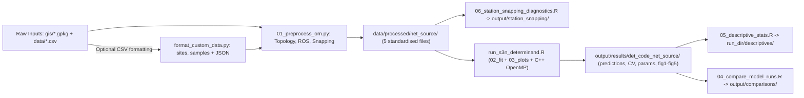

# 🌊 Spatial Stream Network (`S3N`) Water Quality & Ecological Modelling

[](docs/setup_and_architecture.md)
[](docs/setup_and_architecture.md)
[](src/s3n_fast_neighbors.cpp)
[](docs/usage_guide.md)
[](LICENSE)

A high-speed, headless pipeline for **Spatial Stream Network (`S3N` / NNGP)** regression, 5-fold cross-validation, universal stream kriging, and diagnostic reporting across national and regional river networks (defaulting to the Ordnance Survey Open Rivers Network v2, `ORN v2`, across England).

Designed to run cleanly on Linux servers, laptops, and Databricks clusters **without heavy GIS/plotting dependencies** (`GDAL`, `geopandas`, `sf`, `SSN2`, or `ggplot2`).

> **Attribution:** This pipeline builds on and adapts the **Scalable Spatial Stream Network (`S3N`)** framework ([`jpierkunke/S3N`](https://github.com/jpierkunke/S3N)), which brings linear $\mathcal{O}(n)$ Nearest-Neighbour Gaussian Process (`NNGP`) scaling to river networks. Full credit belongs to the authors of the foundational packages and theory on which this repository stands:
> - **`S3N` R Package** ([https://github.com/jpierkunke/S3N](https://github.com/jpierkunke/S3N)) — **Jessica P. Kunke, Julian D. Olden, and Tyler H. McCormick**:
>   Kunke, J. P., Olden, J. D., & McCormick, T. H. (2025). *Scalable Spatial Stream Network (S3N) Models*. **arXiv:2512.12398 [stat.ME]**. [https://arxiv.org/abs/2512.12398](https://arxiv.org/abs/2512.12398)
> - **`BRISC` R Package** — **Arkajyoti Saha and Abhirup Datta**:
>   Saha, A., & Datta, A. (2018). *BRISC: Bootstrap for Rapid Inference on Spatial Covariances*. *Stat*, 7(1), e184.
>
> **If you use this pipeline in published work or downstream analysis, please cite both the original `S3N` paper (Kunke et al., 2025, `arXiv:2512.12398`) and the `BRISC` paper (Saha & Datta, 2018, *Stat*, 7(1), e184).**
>
> See [Where This Pipeline Differs from `S3N`](docs/where_this_differs_from_s3n.md) for a full breakdown of what is shared, replaced, or added.

---

## 📑 Table of Contents

- [Key Features](#-key-features)
- [Pipeline Architecture](#-pipeline-architecture)
- [Setup & Installation](#-setup--installation)
  - [1. System Prerequisites](#1-system-prerequisites)
  - [2. Quick Setup (R Packages, C++ Library & Paths)](#2-quick-setup-r-packages-c-library--paths)
  - [3. Required Data Downloads](#3-required-data-downloads)
- [Quickstart](#-quickstart)
  - [Step 1 — Preprocess the River Network & Monitoring Data](#step-1--preprocess-the-river-network--monitoring-data)
  - [Step 2 — Inspect Station-to-Reach Snapping](#step-2--inspect-station-to-reach-snapping-optional)
  - [Step 3 — Fit S3N Models, Krige & Render Maps](#step-3--fit-s3n-models-krige--render-maps)
  - [Step 4 — Generate Statistical Reports & Multi-Run Comparisons](#step-4--generate-statistical-reports--multi-run-comparisons)
- [Key Outputs](#-key-outputs)
- [Repository Overview](#-repository-overview)
- [Running Automated Tests](#-running-automated-tests)
- [Documentation](#-documentation)
- [AI Disclosure](#-ai-disclosure)
- [License](#-license)

---

## ✨ Key Features

- ⚡ **Sub-Second C++/OpenMP Stream-Tree & Joint NNGP Engine** ([`src/s3n_fast_neighbors.cpp`](src/s3n_fast_neighbors.cpp)): Replaces slow R tree walks with an Euler-tour LCA and Nearest-Neighbour Gaussian Process (NNGP) builder, multi-kernel profile MLE solver (`exponential`, `spherical`, `mariah`, `linear`, `auto`), physical confluence `AFV` weighting (`length`, `shreve`, `hydro_yield`), and **Joint Additive `Tail-Up + Tail-Down + Euclidean` Universal Kriging** (`--combine=joint`), processing ~91,000 river reaches in under a second.
- 🐍 **Low-Dependency Python GIS Extractor** ([`scripts/01_preprocess_orn.py`](scripts/01_preprocess_orn.py)): Reads multi-gigabyte OGC GeoPackages (`.gpkg`) via Python's built-in `sqlite3` and binary WKB decoder (optional `pyarrow`/`libgdal` for GeoParquet), builds directed river trees, computes Strahler/Shreve orders and Additive Function Values (`log_AFV`), snaps stations (`≤ 250 m`), and auto-generates `configs/determinands.json`.
- 🧪 **Censored & Interval-Range Imputation**: Supports Robust Lognormal Regression on Order Statistics (`ROS`) and Spatial Tobit EM (`--censor=em`) for `<LOD` nondetects (`--censor-method` = `ros`, `ros_site`, `half_lod` in preprocessing), and range-handling modes (`--range-mode` = `auto`, `tobit`, `geometric`, `midpoint`, `lower`, `upper`, `none`) for `min..max` interval records.
- 📐 **12 Response Transformations & 4 Normalisation Methods**: Built-in `log`, `log10`, `log1p`, `sqrt`, `cbrt`, `fourthrt`, `reciprocal`, `boxcox`, `yeojohnson`, `asin`, `logit`, and `none` transforms (averaging samples on the transformed scale with exact analytical inverse back-transformation), plus automatic `zscore`, `robust_zscore`, `minmax`, and `percentile` outputs.
- 📉 **Two-Stage GAM & Measurement-Error Kriging**: Propagate site-level temporal/GAM standard errors (`meas_uncertainty`) directly into spatial variance estimation and kriging uncertainty via `--meas-error` / `--gam`.
- 🌲 **Non-Linear Spline (`GAM + S3N`) & Tree-Ensemble (`RF / GBM + S3N`) Regression Kriging**: Capture non-linear environmental thresholds and high-order catchment interactions using REML-penalised cubic regression splines (`--trend=gam`), GCV natural cubic splines (`--trend=spline`), Out-of-Bag Random Forests (`--trend=rf`), or cross-fitted Gradient Boosted Trees (`--trend=gbm`) combined with S3N residual stream kriging.
- 🗺️ **Multi-Source, Multi-Network & Temporal Batching**: Combine built-in (`rsn`, `ssn`, `rss`) and custom CSV data sources (`+` / `,` delimiters via [`scripts/format_custom_data.py`](scripts/format_custom_data.py)), bring custom river networks (`BYOWN`), customise `15` covariates with `--vars=`, and batch-fit by `--by=year|season|month`.
- 📊 **Automated Diagnostics, Statistics & Maps**: Exports publication-grade Base-R maps (`fig1`–`fig5`), station snapping diagnostics ([`06_station_snapping_diagnostics.R`](scripts/06_station_snapping_diagnostics.R)), single-run environmental gradient reports ([`05_descriptive_stats.R`](scripts/05_descriptive_stats.R)), and multi-run / `N:P` stoichiometry comparisons ([`04_compare_model_runs.R`](scripts/04_compare_model_runs.R)).
- 🔗 **Multivariate Stream Co-Kriging** ([`scripts/run_s3n_cokriging.R`](scripts/run_s3n_cokriging.R)): Jointly models $P \ge 2$ heterotopic chemical and ecological targets via a dedicated OpenMP **Factor-LMC Joint NNGP** engine ([`docs/multivariate_cokriging_guide.md`](docs/multivariate_cokriging_guide.md)), reporting both All-Holdout and Auxiliary-Aided CV gains.

---

## 🔄 Pipeline Architecture



---

## 🛠️ Setup & Installation

### 1. System Prerequisites

- **Python ≥ 3.8** — uses Python standard library only for core `.gpkg`/CSV preprocessing (optional `pyproj` for custom CRS reprojection, `pyarrow` for GeoParquet, and `Pillow` only for `scripts/build_showcase.py`).
- **R ≥ 3.5.0** with `S3N`, its CRAN dependencies, and optional **`data.table`** (strongly recommended for 5–15× faster CSV I/O). On Linux, install C++/OpenMP, BLAS/LAPACK, Cairo, and SQLite dev headers; on Windows, install **[Rtools](https://cran.r-project.org/bin/windows/Rtools/)** (or use **WSL2**).

### 2. Quick Setup (R Packages, C++ Library & Paths)
```r
install.packages(c("RANN", "rdist", "matrixStats", "pbapply", "dplyr", "jsonlite", "remotes", "data.table"))
remotes::install_github("jpierkunke/S3N")
```
```bash
# Recompile OpenMP C++ engine if needed (prebuilt Linux x86_64 .so is included; required for Windows .dll)
R CMD SHLIB src/s3n_fast_neighbors.cpp
```
Default workspace folders (`gis/`, `data/`, `data/processed/`, `output/`) are configured in [`configs/directories.json`](configs/directories.json) and can be overridden via environment variables or CLI flags (`--gis-dir=`, `--data-dir=`, `--processed-dir=`, `--output-dir=`). See [Setup, Architecture & Testing](docs/setup_and_architecture.md) for full OS package lists and configuration details.

### 3. Required Data Downloads

Download and unzip the three external datasets into `gis/` and `data/` before running the default pipeline (or pass `--source=rsn` if omitting the optional `SSN` dataset):

1. **OS Open Rivers Network (`ORN` v2.0 — Required)**: Download **version 2.0** in **GeoPackage** format (`ORN_v2_GeoPackage.zip`) from [openrivers.net/download/](https://openrivers.net/download/) and extract `ORN_v2.gpkg` into `gis/ORN_v2.gpkg`.
2. **River Surveillance Network (`RSN` — Required)**: Download `NCEA_River_Surveillance_Network_ARD_Open.zip` from [Environment Agency NCEA — RSN Analysis Ready Data](https://environment.data.gov.uk/natural-capital-ecosystem-assessment/search/21763290-f395-4ca1-bcf6-884c2e7548d4?q=analysis+ready+data#access) and extract its CSV files directly into `data/NCEA_River_Surveillance_Network_ARD_Open/`.
3. **Small Streams Network (`SSN` — Optional, recommended)**: Download `NCEA_Small_Streams_Network_ARD_Open.zip` from [Environment Agency NCEA — SSN Analysis Ready Data](https://environment.data.gov.uk/natural-capital-ecosystem-assessment/search/98aca14e-3736-4329-b4b6-ae7c36fa5db1?q=small+streams+network&jry=qs&pg=1&rpp=20&srt=most_relevant#access) and extract its CSV files directly into `data/NCEA_Small_Streams_Network_ARD_Open/`.

See [Section 3 of Setup, Architecture & Testing](docs/setup_and_architecture.md#3-obtaining--placing-the-required-data) for Bash/PowerShell unzip commands, avoiding nested subfolders, and verifying discovery via `python3 scripts/01_preprocess_orn.py --list-sources`.

---

## 🚀 Quickstart

> [!TIP]
> **Prefer a visual command builder over typing flags manually?** Open [`cli_workbench/index.html`](cli_workbench/index.html) directly in your web browser (works completely offline, no server required). Pick your analysis options from grouped dropdowns with **`i`** tooltips and copy ready-to-run commands formatted for **Bash**, **Windows PowerShell**, or **Windows Command Prompt** (including an optional full `Rscript.exe` path & R-version selector if `Rscript` isn't on Windows `PATH`).

### Step 1 — Preprocess the River Network & Monitoring Data
```bash
# Default: ORN v2 network + EA River Surveillance Network (auto-creates configs/determinands.json)
python3 scripts/01_preprocess_orn.py --network=orn --source=rsn

# Or combine RSN + Small Streams Network (SSN)
python3 scripts/01_preprocess_orn.py --network=orn --source=rss
```

### Step 2 — Inspect Station-to-Reach Snapping *(Optional)*
```bash
Rscript scripts/06_station_snapping_diagnostics.R --catchment=Thames
```

### Step 3 — Fit S3N Models, Krige & Render Maps
```bash
# Nitrate (0117) with square-root transform and robust Z-score maps
Rscript scripts/run_s3n_determinand.R 0117 --transform=sqrt --norm=robust_zscore

# Auto-select best stream covariance kernel (Exponential, Spherical, Mariah, Linear) + Hydrological-Yield AFV
Rscript scripts/run_s3n_determinand.R 0117 --transform=sqrt --kernel=auto --afv=hydro_yield --combine=joint

# Penalized GAM Smooths + S3N or Tree-Ensemble Regression Kriging (Random Forest / Gradient Boosting + S3N)
Rscript scripts/run_s3n_determinand.R 0117 --transform=sqrt --trend=gam
Rscript scripts/run_s3n_determinand.R 0117 --transform=sqrt --trend=rf --trees=150

# Orthophosphate (0180) with default log transform
Rscript scripts/run_s3n_determinand.R 0180

# Temporal batch mode (fits all 4 meteorological seasons + combined temporal grid)
Rscript scripts/run_s3n_determinand.R 0117 --transform=sqrt --by=season
```

### Step 4 — Generate Statistical Reports & Multi-Run Comparisons
```bash
# Single-run descriptive stats & landscape/stream-order gradient tests
Rscript scripts/05_descriptive_stats.R output/results/det_0117_orn_rsn_trans_sqrt

# Compare Nitrate vs. Orthophosphate (includes N:P stoichiometry & Wald Z-tests)
Rscript scripts/04_compare_model_runs.R \
  output/results/det_0117_orn_rsn_trans_sqrt \
  output/results/det_0180_orn_rsn \
  --labels="Nitrate (0117),Orthophosphate (0180)"
```

> 💡 **Split workflow tip**: You can run model fitting ([`scripts/02_fit_s3n_models.R`](scripts/02_fit_s3n_models.R)) and plotting ([`scripts/03_generate_plots.R`](scripts/03_generate_plots.R)) separately so you can re-style colorbars, basins (`--basin=Eden`), or `--norm=` views without re-fitting models.

---

## 📦 Key Outputs

| Stage / Script | Output Directory | Key Files Produced |
| :--- | :--- | :--- |
| **Preprocessing** (`01`) | `data/processed/<net>_<source>/` | `england_rsn_reaches.csv`, `rsn_sites.csv`, `rsn_reach_periods.csv`, `rsn_catchments_lookup.csv`, `network_metadata.json` |
| **Snapping Diagnostics** (`06`) | `output/station_snapping/<net>_<source>/` | `station_snapping_all.csv`, `catchment_snapping_summary.csv`, `station_snapping_report.md`, `fig_snap_*.png` |
| **S3N Fit & Plots** (`run` / `02`+`03`) | `output/results/det_<code>_<net>_<src>.../` | `predictions_*.csv` (+ normalised columns), `cv_comparison_*.csv`, `parameters_*.csv`, `fig1`–`fig7_*.png` |
| **Descriptive Stats** (`05`) | `<run_dir>/descriptives/` | `descriptive_report.md`, `descriptive_stats_summary.csv`, `stratified_results_summary.csv`, `within_run_statistical_tests.csv`, `fig_desc1`–`2.png` |
| **Run / Transform Comparisons** (`04`, `07`, `08`) | `output/comparisons/<slug>/` | `comparison_report.md`, `cv_metrics_comparison.csv`, `statistical_tests_summary.csv`, `reach_relationship_summary.csv`, `parameter_comparison.csv`, `fig_comp1`–`5.png`, `cs6_*`, `cs7_*` |

---

## 📂 Repository Overview

- `cli_workbench/` · Standalone browser CLI command builder (`index.html`)
- `configs/` · Path, determinand (`determinands.json`), network (`networks/`), and source (`sources/`) JSON configs
- `gis/`, `data/`, `output/` · Local raw GIS/monitoring archives, preprocessed CSVs, and model outputs (git-ignored/external)
- `modelling_dashboard/` · Interactive offline showcase dashboard built by `scripts/build_showcase.py`
- `scripts/` · Python preprocessors (`01`, `format_custom_data.py`, `build_showcase.py`), R runners (`run_s3n_determinand.R`, `run_s3n_cokriging.R`, `02`–`08`), and shared `s3n_*` modules
- `src/` · OpenMP C++ engine (`s3n_fast_neighbors.cpp`, `Makevars`, `Makevars.win`)
- `tests/` · Python (`test_python_utils.py`) and R/C++ (`test_r_and_cpp.R`) unit test suites
- `docs/` · Full user guides & theoretical reference (see [Setup & Architecture](docs/setup_and_architecture.md) for the complete file tree)

---

## 🧪 Running Automated Tests

Ensure `src/s3n_fast_neighbors.so` is compiled and `configs/determinands.json` exists (created automatically by any `01_preprocess_orn.py` invocation, e.g. `--list-sources`):

```bash
# Python utilities, WKB decoding, ROS imputation & custom formatter tests
python3 -m unittest tests/test_python_utils.py

# R module helpers (config, transforms, covariates, stats) & C++ OpenMP engine tests
Rscript tests/test_r_and_cpp.R
```

---

## 📚 Documentation

See the **[Documentation Hub](docs/README.md)** or jump straight to a guide:

| Category | Guides |
| :--- | :--- |
| **Getting Started & CLI** | [Interactive CLI Workbench](cli_workbench/index.html) · [Setup, Architecture & Testing](docs/setup_and_architecture.md) · [End-to-End Usage Guide](docs/usage_guide.md) · [Running on Databricks](docs/databricks_guide.md) |
| **Specialised Workflows** | [Regulatory Exceedance & Threshold Risk Mapping](docs/regulatory_exceedance_mapping_guide.md) · [Optimal Monitoring Network Design & Gap Mapping](docs/optimal_monitoring_design_guide.md) · [Spatio-Temporal Trends & Borrowing](docs/spatiotemporal_trends_and_borrowing_guide.md) · [Multivariate Stream Co-Kriging](docs/multivariate_cokriging_guide.md) · [Multi-Source & Citizen-Science Fusion](docs/multi_source_and_citizen_science_guide.md) · [Non-Linear (`GAM + S3N`) & Tree-Ensemble (`RF/GBM`) Guide](docs/nonlinear_and_tree_ensemble_trend_guide.md) |
| **Customising the Pipeline** | [Custom Monitoring Sources](docs/custom_data_sources_guide.md) · [Custom Water Networks (`BYOWN`)](docs/custom_water_network_guide.md) · [ORN Covariates Reference (`--vars`)](docs/orn_variables_reference.md) |
| **Diagnostics & Interpretation** | [Station Snapping Guide](docs/station_snapping_guide.md) · [Descriptive Statistics Guide](docs/descriptive_stats_interpretation_guide.md) · [Model Comparison Guide](docs/model_comparison_interpretation_guide.md) |
| **Methodology & Theory** | [S3N Modelling & Kriging Guide](docs/s3n_modelling_and_kriging_guide.md) · [Two-Stage GAM & Measurement-Error Kriging](docs/two_stage_gam_measurement_error_kriging_guide.md) · [Preprocessing & C++ Engine](docs/preprocessing_pipeline.md) · [Where This Differs from `S3N`](docs/where_this_differs_from_s3n.md) |

---

## 🤖 AI Disclosure

This project was created with the assistance of artificial intelligence.

- **Coding Assistant:** Google DeepMind Antigravity
- **Models Used:** Gemini 4 Argon, Gemini 4 Hydrogen
- **Human Oversight:** All code, statistical methods, documentation, and generated outputs were reviewed and verified by a human maintainer. Users remain responsible for validating model assumptions, outputs, and suitability for any downstream scientific or regulatory use.

---

## 📄 License

This codebase is licensed under the **GNU General Public License v3.0 (`GPL-3.0`)** — see the [LICENSE](LICENSE) file for the full text, consistent with the `GPL-3` / `GPL-2 | GPL-3` licenses of `S3N`, `BRISC`, and `mgcv`.

External river-network geometries and monitoring datasets (`gis/` and `data/`) are **not** included in this repository; users download them directly from their respective providers and remain responsible for complying with those datasets' terms and attributions (such as the UK Open Government Licence v3.0 for OS Open Rivers / Environment Agency ARD data).
