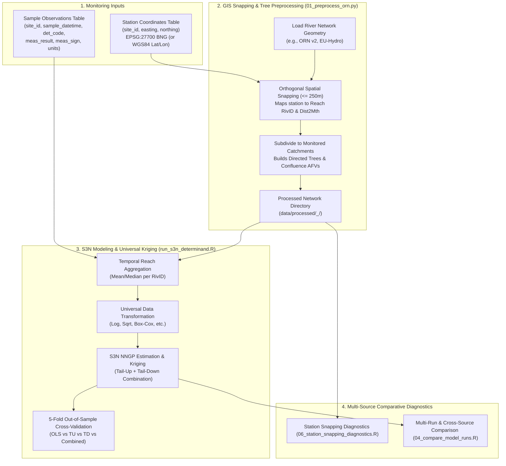

# Bring Your Own Monitoring Dataset & Custom Sources Guide

This guide explains how to incorporate additional monitoring data sources and custom field datasets into the Scalable Spatial Stream Network (`S3N`) modeling pipeline. It details the underlying architecture, data requirements, schema definitions, and provides step-by-step instructions for preprocessing, snapping diagnostics, model fitting, and multi-source comparative evaluations.

---

## Table of Contents

- [1. Executive Overview & Architecture](#1-executive-overview--architecture)
- [2. Ingestion Methods: How to Provide Your Data](#2-ingestion-methods-how-to-provide-your-data)
- [3. Dataset Requirements & Schema Specifications](#3-dataset-requirements--schema-specifications)
  - [3.1 Station Points Table (`sites.csv`)](#31-station-points-table-sitescsv)
  - [3.2 Sample Observations Table (`samples.csv`)](#32-sample-observations-table-samplescsv)
  - [3.3 Automated Formatting Tool: `scripts/format_custom_data.py`](#33-automated-formatting-tool-scriptsformat_custom_datapy)
- [4. Ingestion Workflows](#4-ingestion-workflows)
  - [Method 1: Drop-In Directory (`data/custom/<project_name>/`)](#method-1-drop-in-directory-datacustomproject_name)
  - [Method 2: Ad-Hoc CLI Flags (Zero Configuration)](#method-2-ad-hoc-cli-flags-zero-configuration)
  - [Method 3: Permanent Declarative JSON Profile (`configs/sources/<name>.json`)](#method-3-permanent-declarative-json-profile-configssourcesnamejson)
  - [Method 4: Multi-Source Combination & Composites (`--source=rsn+custom`)](#method-4-multi-source-combination--composites---sourcersncustom)
- [5. Hydrological & Geostatistical Modeling Considerations](#5-hydrological--geostatistical-modeling-considerations)
  - [5.1 Snapping Distance & Unrepresented Headwaters](#51-snapping-distance--unrepresented-headwaters)
  - [5.2 Catchment Subsetting](#52-catchment-subsetting)
  - [5.3 Sampling Frequency Imbalance & Aggregation](#53-sampling-frequency-imbalance--aggregation)
  - [5.4 Left-Censored Values & Detection Limits (`< LOD`)](#54-left-censored-values--detection-limits--lod)
  - [5.5 Two-Stage Modeling with Pre-Fitted Values (GAMs, Machine Learning) & Approach A: Measurement Error Kriging](#55-two-stage-modeling-with-pre-fitted-values-gams-machine-learning--approach-a-measurement-error-kriging)
- [6. End-to-End Walkthrough: Adding a Custom Dataset](#6-end-to-end-walkthrough-adding-a-custom-dataset)
  - [Step 1: Create Custom Data Directory & Files](#step-1-create-custom-data-directory--files)
  - [Step 2: Combine with National RSN and Preprocess](#step-2-combine-with-national-rsn-and-preprocess)
  - [Step 3: Run Station Snapping Diagnostics](#step-3-run-station-snapping-diagnostics)
  - [Step 4: Fit S3N Model & Predict Across All Reaches](#step-4-fit-s3n-model--predict-across-all-reaches)
  - [Step 5: Direct Statistical Comparison Against Baseline RSN](#step-5-direct-statistical-comparison-against-baseline-rsn)
- [7. Troubleshooting & Diagnostics Reference](#7-troubleshooting--diagnostics-reference)

---

## 1. Executive Overview & Architecture

The `S3N` pipeline models spatial autocorrelation along river networks using moving-average covariance functions:
- **Tail-Up (TU)**: Models unidirectional downstream advective transport and dilution across stream confluences using additive function values ($\pi_i$).
- **Tail-Down (TD)**: Models bidirectional mass exchange (advective downstream plus biological upstream movement/borrowing) conditioned on exact hydrologic distance to the river mouth (`Dist2Mth_km`).

Regardless of whether observations originate from the Environment Agency's official River Surveillance Network (`RSN`), the Small Streams Network (`SSN`), water utility compliance sampling, academic sensor telemetry, or citizen science surveys (such as the Anglers' Riverfly Monitoring Initiative), the pipeline requires only **two core data inputs**:



---

## 2. Ingestion Methods: How to Provide Your Data

The pipeline supports four flexible ways to ingest custom or additional data sources:

| Method | Primary Use Case | Configuration Required | Command-Line Example |
| :--- | :--- | :---: | :--- |
| **Method 1: Drop-In Directory** | Quickest way to add a custom project folder | None (auto-discovered) | `--source=my_project` |
| **Method 2: Ad-Hoc CLI Flags** | One-off runs on arbitrary CSV paths anywhere on disk | None | `--custom-sites=path/to/sites.csv --custom-samples=path/to/samples.csv` |
| **Method 3: Declarative JSON Profile** | Permanent registration of recurring external datasets | `configs/sources/<name>.json` | `--source=my_survey` (e.g. `configs/sources/rsn.json`) |
| **Method 4: Delimiter Combinations** | Merging custom datasets with official EA networks | None (on-the-fly syntax) | `--source=rsn+my_project` or `--source=rsn,ssn,my_project` |

Built-in profiles in `configs/sources/` include `rsn.json`, `ssn.json`, and `composites.json` (`rss`, `all`). Multi-source tokens joined with `,` or `+` are normalized internally with `+` (preserving hyphens inside custom source names such as `waterblitz-tobit`).

---

## 3. Dataset Requirements & Schema Specifications

### 3.1 Station Points Table (`sites.csv`)

The station points table defines the geographic locations of your monitoring points.

#### Canonical Column Schema:
| Column Name | Required | Data Type | Permitted Aliases / Variants | Description & Units |
| :--- | :---: | :---: | :--- | :--- |
| **`site_id`** | **Yes** | String / Integer | `network_id`, `station_id`, `id`, `location_id`, `site`, `code` | Unique monitoring station identifier (e.g. `"CS_001"`). |
| **`easting`** | **Yes** | Numeric | `ngr_easting`, `eastings`, `bng_easting`, `x`, `point_x`, `longitude`, `lon` | Easting coordinate in British National Grid (`EPSG:27700`) meters, OR decimal longitude in degrees. |
| **`northing`** | **Yes** | Numeric | `ngr_northing`, `northings`, `bng_northing`, `y`, `point_y`, `latitude`, `lat` | Northing coordinate in British National Grid (`EPSG:27700`) meters, OR decimal latitude in degrees. |
| `site_name` | No | String | `name`, `station_name`, `location_name`, `description` | Human-readable site label or river name. |
| `source` | No | String | `network`, `origin`, `survey` | Dataset identifier (e.g. `"Citizen"`, `"WaterCompany"`). Defaults to the source tag. |

#### Automatic Coordinate Reference System (CRS) Conversion:
- **British National Grid (`EPSG:27700`)**: If coordinates exceed planar thresholds ($x > 180$, $y > 90$), they are treated directly as BNG Eastings and Northings in meters.
- **WGS84 Lat/Lon (`EPSG:4326`)**: If coordinates fall within $-10 \le x \le 3$ and $49 \le y \le 61$, the preprocessor automatically detects decimal degrees and projects them to British National Grid meters in pure Python using Airy 1830 ellipsoid Transverse Mercator formulas with $< 1\text{ m}$ precision.
- **Explicit CRS Override**: You can pass `--custom-crs=4326` or `--custom-crs=27700` to enforce projection handling.

#### Example `sites.csv`:
```csv
site_id,easting,northing,site_name,source
CS_001,425100,210400,Tributary A Confluence,MyStudy
CS_002,426200,211500,Mainstem Bridge Sensor,MyStudy
CS_003,-0.1278,51.5074,Trafalgar Thames Reach,MyStudy
```

---

### 3.2 Sample Observations Table (`samples.csv`)

The sample observations table contains the individual physical, chemical, or biological measurements collected at the stations.

#### Canonical Column Schema:
| Column Name | Required | Data Type | Permitted Aliases / Variants | Description & Units |
| :--- | :---: | :---: | :--- | :--- |
| **`site_id`** | **Yes** | String / Integer | `network_id`, `station_id`, `id`, `location_id`, `site` | Foreign key matching `site_id` in `sites.csv`. |
| **`sample_datetime`** | **Yes** | String (ISO-8601) | `datetime`, `date_time`, `date`, `survey_date`, `timestamp` | Date and time of measurement (e.g. `"2023-05-14T10:30:00"` or `"2023-05-14"`). |
| **`meas_result`** | **Yes** | Numeric | `result`, `value`, `val`, `reading`, `score`, `concentration` | Observed measurement or score on the natural scale. |
| `det_code` | Optional* | String | `determinand_code`, `param_code`, `determinand`, `cas_number`, `code`, `metric_name` | Determinand or variable identifier (e.g. `"0117"`, `"whpt_aspt"`). *Optional if the file only contains a single determinand. |
| `meas_sign` | Optional | String | `less_than_flag`, `censored`, `is_censored`, `qualifier` | Censoring flag: `"<"`, `"yes"`, `"true"`, or `"1"` for left-censored measurements below the detection limit. |
| `det_name` | Optional | String | `det_desc`, `compound_name`, `description`, `parameter` | Human-readable determinand description (e.g. `"Nitrate as N"`). |
| `unit_short_desc` | Optional | String | `unit`, `units` | Measurement units (e.g. `"mg/L"`, `"ug/L"`, `"index"`). |

#### Example `samples.csv`:
```csv
site_id,sample_datetime,det_code,det_name,meas_result,meas_sign,unit_short_desc
CS_001,2023-03-15T10:00:00,0117,Nitrate as N,4.8,=,mg/L
CS_001,2023-06-20T11:15:00,0117,Nitrate as N,5.2,=,mg/L
CS_001,2023-09-18T10:45:00,0117,Nitrate as N,0.05,<,mg/L
CS_002,2023-04-10T09:30:00,0117,Nitrate as N,2.1,=,mg/L
CS_002,2023-07-14T10:00:00,0117,Nitrate as N,2.3,=,mg/L
CS_002,2023-10-05T09:45:00,0117,Nitrate as N,1.9,=,mg/L
```

---

### 3.3 Automated Formatting Tool: `scripts/format_custom_data.py`

To eliminate manual data manipulation, the repository provides a standalone Python script, [`scripts/format_custom_data.py`](../scripts/format_custom_data.py), that ingests raw, unstandardized CSV files from any source and automatically creates model-ready `sites.csv` and `samples.csv` files with canonical column names.

#### Key Features:
1. **Universal Auto-Detection**:
   Automatically detects station IDs, station names, coordinates (`x`/`y`, `lon`/`lat`, `easting`/`northing`), dates/times, concentrations, units, and censoring signs across dozens of naming conventions.
2. **Explicit Column Overrides**:
   Allows you to specify or remap any column name in the raw dataset if your data uses non-standard naming:
   `--id-col`, `--name-col`, `--x-col`, `--y-col`, `--date-col`, `--time-col`, `--val-col`, `--det-col`, `--unit-col`, `--sign-col`.
3. **"Gold Standard" Interval-Censored Tobit & Truncated Lognormal Model (`--range-mode=tobit`, Default)**:
   Citizen-science and test-strip datasets frequently record concentrations as ranges (e.g. `5-10`, `0.2-0.5`, `1-2`, `<0.2`, `>10`).
   - **Why Arithmetic Midpoints Fail**: Water quality determinands follow right-skewed lognormal distributions. Taking a linear midpoint ($\frac{5+10}{2} = 7.5$) introduces a systematic upward bias in log-transformed models ($\log(7.5) = 2.015$ vs log-midpoint $1.956$), and cannot handle open boundaries ($<0.2$ or $>10$) without arbitrary multipliers.
   - **The Gold Standard Solution**: The script fits an **interval-censored lognormal maximum likelihood model (Tobit formulation)** per determinand. It computes mathematically unbiased conditional expectations:

     $$
     E[Y \mid a \le Y \le b] = \exp\left( \mu + \sigma \left[ \frac{\phi(\alpha) - \phi(\beta)}{\Phi(\beta) - \Phi(\alpha)} \right] \right)
     $$

     where $\alpha = \frac{\log a - \mu}{\sigma}$, $\beta = \frac{\log b - \mu}{\sigma}$, and $\phi, \Phi$ are the standard normal PDF and CDF.
   - **Open-Ended Boundaries Handled Rigorously**: Non-detects ($<0.2$) and saturation limits ($>10$) are estimated strictly from the fitted distribution's tail probabilities ($0.119\text{ mg/L}$ for $<0.2$, $16.92\text{ mg/L}$ for $>10$) rather than ad-hoc guesses.
   - **Analytical Binning Uncertainty**: Calculates analytical interval variance $\sigma_{\text{bin}} = \frac{\log(b) - \log(a)}{\sqrt{12}}$ and stores interval bounds in `samples.csv` (`meas_lower`, `meas_upper`, `meas_uncertainty`, `meas_method`).
   - **Configurable Strategies (`--range-mode`)**:
     - `tobit` *(Default, Gold Standard)*: Maximum likelihood expectation conditional on the fitted lognormal distribution.
     - `geometric`: Geometric midpoint $y^* = \sqrt{a \cdot b} = \exp\left(\frac{\log a + \log b}{2}\right)$, exact linear midpoint in log-space.
     - `midpoint`: Standard arithmetic midpoint $y^* = \frac{a + b}{2}$.
     - `lower` / `upper`: Strict lower or upper interval bounds.
     - `skip`: Skips range intervals.
4. **Built-in Pure Python Coordinate Projection**:
   Converts WGS84 decimal degrees (lat/lon) into British National Grid (`EPSG:27700`) meters using Airy 1830 ellipsoid Transverse Mercator formulas. Zero external GIS or Python dependencies required (no pandas, geopandas, or pyproj needed).
5. **Wide-to-Long Determinand Unpivoting**:
   If raw files store determinands as separate columns (e.g. `Nitrate (mg/L)`, `Phosphate (mg/L)`), the script unpivots them into standard relational `samples.csv` records with canonical EA codes (`0117`, `0180`, etc.).
6. **Data Filtering & Subsetting**:
   Filter rows using `--filter="KEY=VALUE"` (e.g. `--filter="Country=England"`).
7. **Instant Pipeline Integration**:
   Writes outputs directly to `data/custom/<source_name>/` and optionally creates `configs/sources/<source_name>.json` (`--generate-config`), making the dataset immediately available for preprocessing and S3N modeling.

#### Example 1: Formatting the Earthwatch Waterblitz Dataset
```bash
python3 scripts/format_custom_data.py data/Waterblitz \
  --source-name=waterblitz \
  --source-label="Earthwatch Waterblitz" \
  --filter="Country=England" \
  --val-col="Nitrate (mg/L),Phosphate (mg/L)" \
  --group-sites-by=coords \
  --site-id-prefix="WB_" \
  --generate-config
```
*Result*: Converts 65,983 range intervals to numeric midpoints, flags 19,608 censored values, projects lat/lon to BNG meters, and writes 36,956 unique stations to `data/custom/waterblitz/sites.csv` and 85,591 observations to `data/custom/waterblitz/samples.csv`.

#### Example 2: Arbitrary External Sensor Dataset with Explicit Column Mappings
```bash
python3 scripts/format_custom_data.py path/to/my_sensor_export.csv \
  --source-name=river_sensor_study \
  --id-col="Logger_ID" \
  --name-col="Location_Description" \
  --x-col="Longitude" \
  --y-col="Latitude" \
  --date-col="Reading_Date" \
  --time-col="Reading_Time" \
  --val-col="NO3_Concentration" \
  --det-code=0117 \
  --det-name="Nitrate as N" \
  --unit="mg/L" \
  --range-mode=midpoint \
  --generate-config
```

#### CLI Reference: `format_custom_data.py`
| Flag / Option | Default | Description |
| :--- | :---: | :--- |
| `input` / `--input <path>` | *(Required)* | Path to raw CSV file or directory containing monitoring data |
| `--source-name <name>` | *(Auto)* | Source identifier (e.g. `waterblitz`, `catchment_study`) |
| `--source-label <label>` | *(Auto)* | Human-readable title for maps and reports |
| `--out-dir <dir>` | `data/custom/<name>/` | Output directory where `sites.csv` and `samples.csv` are written |
| `--id-col <name>` | *(Auto-detected)* | Column for unique station/site identifier |
| `--name-col <name>` | *(Auto-detected)* | Column for human-readable site name or river reach |
| `--x-col` / `--lon-col` | *(Auto-detected)* | Column for Easting (m) or decimal Longitude (deg) |
| `--y-col` / `--lat-col` | *(Auto-detected)* | Column for Northing (m) or decimal Latitude (deg) |
| `--date-col <name>` | *(Auto-detected)* | Column for sample date or ISO datetime |
| `--time-col <name>` | *(None)* | Separate column for sample time (e.g. `14:30`) |
| `--val-col <cols>` | *(Auto-detected)* | Measurement column(s) (comma-separated for wide tables) |
| `--det-col <name>` | *(Auto-detected)* | Column identifying determinand code in long-format CSVs |
| `--det-name-col <name>` | *(Auto-detected)* | Column identifying determinand description in long-format CSVs |
| `--unit-col <name>` | *(Auto-detected)* | Column identifying measurement units |
| `--sign-col <name>` | *(Auto-detected)* | Column identifying censoring flags (`<` / `>`) |
| `--det-code <code>` | `0117` | Determinand code (e.g. `0117` Nitrate, `0180` Orthophosphate) |
| `--det-name <name>` | `Nitrate as N` | Determinand descriptive name |
| `--unit <unit>` | `mg/L` | Measurement unit |
| `--range-mode <mode>` | `tobit` | Strategy: `tobit` (Gold Standard MLE), `geometric` ($\sqrt{ab}$), `midpoint` ($\frac{a+b}{2}$), `lower`, `upper`, `skip` |
| `--convert-to-bng` | `True` | Convert WGS84 lat/lon coordinates to BNG meters (disable with `--no-convert-to-bng`) |
| `--crs <epsg>` | *(Auto-detected)* | Override input coordinate CRS EPSG code (`4326` or `27700`) |
| `--filter <expr>` | *(None)* | Row filter expression (e.g. `Country=England`) |
| `--bbox <bounds>` | *(None)* | Spatial bounding box filter `min_x,min_y,max_x,max_y` |
| `--limit <N>` | *(None)* | Limit number of raw input rows read (useful for testing) |
| `--group-sites-by <mode>`| `auto` | Site grouping: `auto`, `id`, `name`, `coords`, `name_and_coords` |
| `--site-id-prefix <pre>` | `<SRC>_` | Prefix for generated site IDs (e.g. `WB_`) |
| `--generate-config` | `False` | Write declarative JSON config to `configs/sources/<name>_<mode>.json` (with `"unc_col"` & `"meth_col"`) |

#### Systematic Output Folder Tagging with Range Modes

Whenever range intervals are present and converted (via default `tobit` or any alternative mode), scripts across the S3N pipeline systematically tag their output directory names with the active range mode (e.g. `_tobit`, `_geometric`, `_midpoint`):

```text
Pipeline Stage                          Output Folder Pattern & Examples
---------------------------------------------------------------------------------------------
1. format_custom_data.py          ->    data/custom/<source>_<range_mode>/
                                        data/custom/waterblitz_tobit/
                                        data/custom/waterblitz_midpoint/

2. 01_preprocess_orn.py           ->    data/processed/<net>_<source>_<range_mode>/
                                        data/processed/orn_waterblitz_tobit/
                                        data/processed/orn_waterblitz_midpoint/

3. run_s3n_determinand.R          ->    output/results/det_<code>_<net>_<source>_<range_mode>/
                                        output/results/det_0117_orn_waterblitz_tobit/
                                        output/results/det_0117_orn_waterblitz_midpoint/

4. 06_station_snapping_...        ->    output/station_snapping/<net>_<source>_<range_mode>/
                                        output/station_snapping/orn_waterblitz_tobit/
```

Even when executing with default commands like `python3 scripts/01_preprocess_orn.py --source=waterblitz` or `Rscript scripts/run_s3n_determinand.R 0117 --source=waterblitz`, the pipeline detects the underlying range mode and guarantees that all intermediate reach caches and model output folders are explicitly tagged with `_tobit`. Note that `--range-mode=<mode>` on `01_preprocess_orn.py` and the R scripts also accepts `auto` (use configured/metadata default) or `none` (disable automatic range-mode suffixing).

---

## 4. Ingestion Workflows

### Method 1: Drop-In Directory (`data/custom/<project_name>/`)

This is the simplest way to add a project dataset. Any subdirectory placed in `data/custom/` is automatically registered by the pipeline.

1. Create a folder in `data/custom/`:
   ```bash
   mkdir -p data/custom/catchment_study
   ```
2. Place your `sites.csv` and `samples.csv` into that folder:
   ```text
   data/custom/catchment_study/
   ├── sites.csv
   └── samples.csv
   ```
3. Preprocess and fit models immediately:
   ```bash
   # Preprocess reaches for this custom source
   python3 scripts/01_preprocess_orn.py --source=catchment_study

   # Check station snapping diagnostics
   Rscript scripts/06_station_snapping_diagnostics.R --source=catchment_study --list-catchments

   # Fit S3N model
   Rscript scripts/run_s3n_determinand.R 0117 --source=catchment_study
   ```

---

### Method 2: Ad-Hoc CLI Flags (Zero Configuration)

If your data files are located in an external directory or have arbitrary filenames, you can pass them directly to the command line:

```bash
# 1. Preprocess directly from arbitrary file paths
python3 scripts/01_preprocess_orn.py \
  --custom-sites=path/to/my_sensor_sites.csv \
  --custom-samples=path/to/my_sensor_readings.csv \
  --custom-name=sensor_network

# 2. Fit S3N model using the custom source tag
Rscript scripts/run_s3n_determinand.R 0117 \
  --source=sensor_network \
  --custom-samples=path/to/my_sensor_readings.csv
```

---

### Method 3: Permanent Declarative JSON Profile (`configs/sources/<name>.json`)

If you regularly use a specific external monitoring dataset (such as a community citizen science network, river trust survey, or university sensor array) with custom column names, GPS coordinates, or specific subfolders, you can define a declarative profile in `configs/sources/`.

Create `configs/sources/river_guardians.json`:
```json
{
  "name": "river_guardians",
  "abbr": "RGCS",
  "label": "River Guardians Citizen Science Network",
  "description": "Volunteer water quality monitoring network collecting monthly nutrients and field chemistry",
  "data_dir": "data/custom/river_guardians",
  "sites_file": "volunteer_survey_points.csv",
  "id_col": "survey_site_id",
  "easting_col": "lon",
  "northing_col": "lat",
  "crs_epsg": 4326,
  "datasets": {
    "wq": {
      "file": "field_observations.csv",
      "id_col": "survey_site_id",
      "datetime_col": "observed_date",
      "det_col": "chemical_parameter",
      "det_desc_col": "parameter_name",
      "val_col": "concentration_ppm",
      "cens_col": "detection_flag",
      "cens_flag": "<",
      "unit_col": "units"
    }
  }
}
```

Once saved, `river_guardians` is automatically available everywhere:
```bash
# Verify it appears in the catalog
python3 scripts/01_preprocess_orn.py --list-sources
Rscript scripts/run_s3n_determinand.R --list-sources

# Preprocess and fit
python3 scripts/01_preprocess_orn.py --source=river_guardians
Rscript scripts/run_s3n_determinand.R 0117 --source=river_guardians
```

---

### Method 4: Multi-Source Combination & Composites (`--source=rsn+custom`)

To combine official baseline networks with your custom data, use the delimiter syntax (`+` or `,`):

```bash
# 1. Combine River Surveillance Network (RSN) with your custom study
python3 scripts/01_preprocess_orn.py --source=rsn+catchment_study

# 2. Fit S3N model across the combined network
Rscript scripts/run_s3n_determinand.R 0117 --source=rsn+catchment_study

# 3. Combine Small Streams Network (SSN) with your custom study
Rscript scripts/run_s3n_determinand.R 0117 --source=ssn+catchment_study

# 4. Triple combination: RSN + SSN + Custom
Rscript scripts/run_s3n_determinand.R 0117 --source=rsn,ssn,catchment_study
```

#### Defining Permanent Composite Aliases (`configs/sources/composites.json`)
You can register shorthand aliases for multi-network groups in `configs/sources/composites.json`:
```json
{
  "composites": {
    "my_combined": {
      "name": "my_combined",
      "abbr": "COMB",
      "label": "National RSN + Local Catchment Study",
      "description": "Integrated national surveillance and local high-resolution sampling",
      "sources": ["rsn", "catchment_study"]
    }
  }
}
```
Then simply use `--source=my_combined`.

---

## 5. Hydrological & Geostatistical Modeling Considerations

When integrating new monitoring sources with stream network models, keep these four domain considerations in mind:

### 5.1 Snapping Distance & Unrepresented Headwaters
The S3N preprocessor projects stations orthogonally onto the nearest stream reach segment:
- **Default threshold**: Stations within `max_snap_dist <= 250 m` are retained and assigned to a reach `RivID` and exact hydrologic outlet distance `obs_up_dist_km`.
- **Ditch / Small Tributary Gotcha**: If your custom dataset samples agricultural drainage ditches or upland springs that do not exist in the Ordnance Survey Open Rivers Network (`ORN v2`), the stations will fall $> 250\text{ m}$ from any reach polyline and be excluded.
- **Diagnostics & Solution**: Run `scripts/06_station_snapping_diagnostics.R --source=<your_source>` to view excluded stations. If appropriate, relax the threshold:
  ```bash
  python3 scripts/01_preprocess_orn.py --source=my_project --max-snap-dist 500
  ```

### 5.2 Catchment Subsetting
The preprocessor subsets the national water network to **only the catchments containing at least one monitored station**.
- If your custom dataset is confined to a single river basin (e.g. River Eden or River Tamar), the preprocessor automatically extracts only that catchment's reaches (e.g. ~2,500 reaches instead of 90,876), making downstream S3N modeling run in **< 2 seconds**!

### 5.3 Sampling Frequency Imbalance & Aggregation
If your custom data consists of high-frequency telemetry sondes (e.g. 15-minute readings: ~35,000 samples/station/year) while national RSN data is monthly grab sampling (~12 samples/station/year):
- **Why this matters**: In unweighted maximum likelihood estimation, a station with 35,000 observations would overwhelm the likelihood function relative to stations with 12 observations.
- **How S3N handles this**: In [`scripts/run_s3n_determinand.R`](../scripts/run_s3n_determinand.R), observations are aggregated to **reach-level means or medians** (`obs_mean` / `obs_median`) for the active modeling period (`all`, `year`, `season`, `month`) before conditioning the NNGP likelihood. This ensures each stream reach carries an appropriately balanced weight in spatial estimation.

### 5.4 Left-Censored Values & Detection Limits (`< LOD`)
If your custom dataset contains values reported below the Limit of Detection (e.g. `< 0.05 mg/L`):
- Mark `meas_sign = "<"` (or `less_than_flag = "yes"`).
- The pipeline applies **Multi-Threshold Robust Lognormal Regression on Order Statistics (`ROS`)** (Hirsch & Stedinger 1987; Helsel & Cohn 1988) by default (`--censor=ros`), or substitution via `--censor=half_lod`.

### 5.5 Two-Stage Modeling with Pre-Fitted Values (GAMs, Machine Learning) & Approach A: Measurement Error Kriging

A powerful geostatistical modeling pattern is **two-stage modeling**:
1. **Stage 1 (Temporal Smoothing / Detrending)**: A first-stage temporal model—such as a Generalized Additive Model (GAM), dynamic harmonic regression, or time-series filter—is fit independently at each monitoring station to remove seasonal cycles, flow dependence, and observation noise, producing site-level predictions $\hat{x}_i$ along with standard errors $u_i = \text{SE}(\hat{x}_i)$.
2. **Stage 2 (Spatial Stream Network Kriging)**: S3N spatial tail-up and tail-down stream network models are fit across the network to interpolate values to all unmonitored reaches.

#### Is Two-Stage Modeling Statistically Valid?
Yes, **provided the spatial model accounts for the heteroskedastic estimation uncertainty of the first stage**. 

If standard homoskedastic kriging is used on pre-modelled values, two statistical issues arise:
- Stations with poor first-stage fits (high SE due to sparse data or high residual scatter) are weighted identically to stations with hundreds of clean measurements.
- Standard kriging will interpolate straight through the first-stage point estimates, attributing first-stage estimation uncertainty to microscale spatial variability (inflating the nugget).

#### The Solution: Approach A — Heteroskedastic Measurement Error Kriging
Under Approach A, the observation equation for reach $i$ becomes:

$$
y_i = \boldsymbol{x}_i^T \boldsymbol{\beta} + w_{\text{TU}}(s_i) + w_{\text{TD}}(s_i) + \varepsilon_{\text{micro}, i} + \eta_i
$$

where:
- $w_{\text{TU}}(s_i), w_{\text{TD}}(s_i)$ are the spatial stream network processes.
- $\varepsilon_{\text{micro}, i} \sim \mathcal{N}(0, \tau_{\text{micro}}^2)$ is the intrinsic microscale spatial nugget variation.
- $\eta_i \sim \mathcal{N}(0, v_i)$ is the **known, site-specific measurement/estimation error variance** from the first stage.

#### 1. Delta Method Variance Transformation
Because S3N models log-transformed (or sqrt/Box-Cox/Yeo-Johnson transformed) concentrations $y_i = g(x_i)$, the raw standard error $u_i = \text{SE}(x_i)$ is converted to response-scale variance $v_i = \text{Var}(y_i)$ via the Delta Method:
- **Log scale ($y = \log x$)**: $v_i \approx \left(\frac{u_i}{x_i}\right)^2$ (the squared coefficient of variation, $\text{CV}^2$).
- **Square root scale ($y = \sqrt{x}$)**: $v_i \approx \left(\frac{u_i}{2\sqrt{x_i}}\right)^2$.
- **Box-Cox scale ($y = \frac{x^\lambda - 1}{\lambda}$)**: $v_i \approx (x_i^{\lambda - 1} u_i)^2$.
- **Raw scale ($y = x$)**: $v_i = u_i^2$.

#### 2. Nugget Decomposition & C++ NNGP Solver
The total estimated nugget $\hat{\tau}_{\text{total}}^2$ from BRISC reflects both spatial microscale variation and measurement noise:

$$
\tau_{\text{micro}}^2 = \max\left(10^{-6}\sigma^2, \hat{\tau}_{\text{total}}^2 - \bar{v}\right), \quad \text{where } \bar{v} = \frac{1}{n} \sum_{i=1}^n v_i
$$

In S3N's high-speed C++ solver (`src/s3n_fast_neighbors.cpp`), the NNGP prediction weights $\boldsymbol{\lambda}_0$ for target reach $s_0$ solve:

$$
\left[ \sigma^2 \boldsymbol{R}_m + \tau_{\text{micro}}^2 \boldsymbol{I}_m + \text{diag}(v_1, \dots, v_m) \right] \boldsymbol{\lambda}_0 = \boldsymbol{c}_0
$$

This downweights uncertain stations in spatial interpolation, denoises observation locations, and produces exact prediction standard errors.

#### Providing GAM Estimates to the Pipeline
To use Approach A, include `meas_uncertainty` and set `meas_method = "gam"` in your `samples.csv`:
```csv
site_id,sample_datetime,meas_result,meas_uncertainty,meas_method,unit_short_desc
RSN001,2023-06-01,2.351,0.2197,gam,mg/L
RSN002,2023-06-01,4.120,0.1850,gam,mg/L
```
- **Automatic Activation**: Whenever `meas_method = "gam"` is detected (or via `--meas-error` / `--gam` flag), Approach A is automatically activated.
- **Reporting**: Cross-validation tables tag `Spatial_Method = "Measurement Error Kriging"` and parameter tables report the decomposed `tau.sq (microscale)` and `mean_meas_variance`.
- **Example Two-Stage Workflow** (after placing GAM predictions & SEs into e.g. `data/custom/rsn_gam_mean/`):

```bash
# Preprocess reaches with GAM estimates and uncertainty
python3 scripts/01_preprocess_orn.py --source=rsn_gam_mean

# Fit S3N model with Measurement Error Kriging
Rscript scripts/run_s3n_determinand.R 0117 --source=rsn_gam_mean --basin=Thames
```

> [!TIP]
> **Comprehensive Two-Stage Modeling & Measurement Error Kriging Guide**: For a dedicated, complete guide detailing the theoretical foundations, Delta Method derivations, C++ stack solver mechanics, and comparative benchmarks, see [`docs/two_stage_gam_measurement_error_kriging_guide.md`](./two_stage_gam_measurement_error_kriging_guide.md).

---

## 6. End-to-End Walkthrough: Adding a Custom Dataset

Let us trace a complete, working example from raw files to comparative analysis.

### Step 1: Create Custom Data Directory & Files
```bash
mkdir -p data/custom/hampshire_avon_study
```

Create `data/custom/hampshire_avon_study/sites.csv`:
```csv
site_id,easting,northing,site_name,source
AVON_01,414500,129800,Avon Upper Chalk Reach,AvonStudy
AVON_02,415200,128400,Avon Mid Chalk Reach,AvonStudy
AVON_03,413800,131200,Avon Headwater Spring,AvonStudy
```

Create `data/custom/hampshire_avon_study/samples.csv`:
```csv
site_id,sample_datetime,det_code,det_name,meas_result,meas_sign,unit_short_desc
AVON_01,2023-04-12T10:00:00,0117,Nitrate as N,6.4,=,mg/L
AVON_01,2023-07-15T11:00:00,0117,Nitrate as N,6.8,=,mg/L
AVON_02,2023-04-12T10:45:00,0117,Nitrate as N,5.9,=,mg/L
AVON_02,2023-07-15T11:30:00,0117,Nitrate as N,6.1,=,mg/L
AVON_03,2023-04-12T09:30:00,0117,Nitrate as N,7.2,=,mg/L
AVON_03,2023-07-15T10:15:00,0117,Nitrate as N,7.5,=,mg/L
```

### Step 2: Combine with National RSN and Preprocess
```bash
python3 scripts/01_preprocess_orn.py --source=rsn+hampshire_avon_study
```
*Output*: Generates model-ready reaches and snapping coordinates in `data/processed/orn_rsn+hampshire_avon_study/`.

### Step 3: Run Station Snapping Diagnostics
```bash
Rscript scripts/06_station_snapping_diagnostics.R \
  --source=rsn+hampshire_avon_study \
  --catchment=Avon
```
*Output*: Generates metre-scale vector maps in `output/station_snapping/orn_rsn+hampshire_avon_study/` verifying that all custom stations snapped cleanly to the correct channel reaches.

### Step 4: Fit S3N Model & Predict Across All Reaches
```bash
Rscript scripts/run_s3n_determinand.R 0117 \
  --source=rsn+hampshire_avon_study \
  --transform=sqrt \
  --basin=Avon
```
*Output*: Generates reach predictions (`pred_combined`, `pred_model_sc`, plus normalised columns `pred_zscore`, `pred_robust_zscore`, `pred_minmax`, `pred_percentile`), kriging standard errors (`se_model_sc`), parameter estimates, cross-validation tables, and Figures 1–5 in `output/results/det_0117_orn_rsn+hampshire_avon_study_trans_sqrt/`.

### Step 5: Direct Statistical Comparison Against Baseline RSN
To quantify the impact of adding your custom data to the model:
```bash
Rscript scripts/04_compare_model_runs.R \
  output/results/det_0117_orn_rsn \
  output/results/det_0117_orn_rsn+hampshire_avon_study_trans_sqrt \
  --out=output/comparisons/nitrate_rsn_vs_with_avon_study
```
*Output*: Evaluates cross-validation accuracy improvement ($\Delta R^2$, $\Delta\text{RMSE}$), paired Wilcoxon tests, parameter stability, and produces Figure Comp 4 (side-by-side national maps) and Figure Comp 5 (scatter plots and spatial difference maps).

---

## 7. Troubleshooting & Diagnostics Reference

| Issue / Error | Likely Cause | Solution |
| :--- | :--- | :--- |
| `Custom sites file not found for source 'xyz'` | Directory in `data/custom/xyz/` lacks a `sites.csv` file. | Ensure file is named `sites.csv` or pass `--custom-sites=path/to/my_file.csv`. |
| `Could not find ID and Easting/Northing columns` | Column names do not match any recognized variant. | Rename columns to `site_id`, `easting`, `northing` or configure mappings in `configs/sources/<name>.json`. |
| `Stations snapped (0 active reaches)` | Monitoring points are $> 250\text{ m}$ from any reach polyline in the river network. | Inspect locations via `06_station_snapping_diagnostics.R` and rerun with `--max-snap-dist 500`. |
| Coordinates snapped to sea or wrong coast | Coordinates were given in Lat/Lon degrees without detection, or inverted $(y, x)$. | Ensure coordinates are `(easting, northing)` or pass `--custom-crs=4326`. |
| `Skipping separate fit (only N observed reaches)` | Custom source has $< 15$ observed reaches and S3N requires $m = 15$ nearest neighbors. | Combine with official surveillance data using `--source=rsn+<custom>` so the model has sufficient spatial observations for NNGP estimation. |
