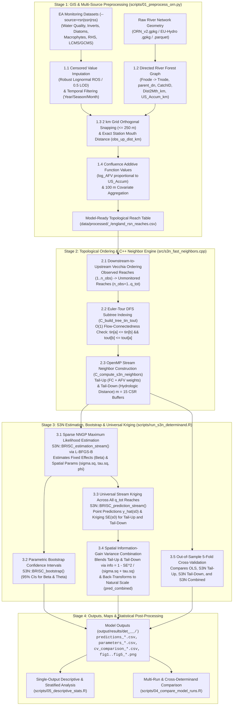

# Scalable Spatial Stream Network (S3N) Modelling & Universal Kriging — Complete Theoretical & Algorithmic Guide

## Table of Contents

- [1. Executive Overview & Motivation](#1-executive-overview--motivation)
  - [1.1 Why Standard Geostatistics Fails on River Networks](#11-why-standard-geostatistics-fails-on-river-networks)
  - [1.2 The Computational Bottleneck of Classical SSN Models](#12-the-computational-bottleneck-of-classical-ssn-models)
  - [1.3 How the `S3N` Package Solves the Scalability Barrier](#13-how-the-s3n-package-solves-the-scalability-barrier)
- [2. End-to-End Architecture: From Raw GIS & Monitoring Data to Modelled Output](#2-end-to-end-architecture-from-raw-gis--monitoring-data-to-modelled-output)
  - [2.1 Multi-Network Monitoring Data Sources & Domain Naming Conventions](#21-multi-network-monitoring-data-sources--domain-naming-conventions)
- [3. Stage 1: From Raw River Network & Monitoring Samples to a Directed Topological Graph](#3-stage-1-from-raw-river-network--monitoring-samples-to-a-directed-topological-graph)
  - [3.1 Step 1.1: Multi-Source Sample Ingestion & Left-Censored (`< LOD`) Imputation via Robust Lognormal ROS](#31-step-11-multi-source-sample-ingestion--left-censored--lod-imputation-via-robust-lognormal-ros)
  - [3.2 Step 1.2: Directed Acyclic River Graph Construction (`Fnode → Tnode` & `parent_dn`)](#32-step-12-directed-acyclic-river-graph-construction-fnode--tnode--parent_dn)
  - [3.3 Step 1.3: Orthogonal Station Snapping (`≤ 250 m`) & Exact Hydrologic Coordinates](#33-step-13-orthogonal-station-snapping--250-m--exact-hydrologic-coordinates)
  - [3.4 Step 1.4: Confluence Weighting & Additive Function Values (`AFV` and `log_AFV`)](#34-step-14-confluence-weighting--additive-function-values-afv-and-log_afv)
  - [3.5 Step 1.5: Environmental Design Matrix Construction (`build_design_matrix()`)](#35-step-15-environmental-design-matrix-construction-build_design_matrix)
  - [3.6 Step 1.6: Non-Linear / Spline Fixed Effects (`GAM + S3N`) & Tree-Ensemble Regression Kriging (`--trend=linear|spline|gam|rf|gbm`)](#36-step-16-non-linear--spline-fixed-effects-gam--s3n--tree-ensemble-regression-kriging---trendlinearsplinegamrfgbm)
- [4. Stage 2: Spatial Stream Network (SSN) Covariance Theory](#4-stage-2-spatial-stream-network-ssn-covariance-theory)
  - [4.1 Hydrologic Stream Distance (`d_hydro(s_i, s_j)`)](#41-hydrologic-stream-distance-d_hydros_i-s_j)
  - [4.2 The `Tail-Up` Covariance Function (`C_TU`: Flow-Connected + Confluence Weighting)](#42-the-tail-up-covariance-function-c_tu-flow-connected--confluence-weighting)
  - [4.3 The `Tail-Down` Covariance Function (`C_TD`: Hydrologic Stream Distance)](#43-the-tail-down-covariance-function-c_td-hydrologic-stream-distance)
  - [4.4 Stream Covariance Kernel Families (`--kernel=exponential|spherical|mariah|linear|auto`)](#44-stream-covariance-kernel-families---kernelexponentialsphericalmariahlinearauto)
  - [4.5 Joint Additive Covariance (`Tail-Up + Tail-Down + Euclidean`, `--combine=joint`)](#45-joint-additive-covariance-tail-up--tail-down--euclidean---combinejoint)
- [5. Stage 3: The `S3N` Package Architecture & C++ OpenMP Neighbor Engine](#5-stage-3-the-s3n-package-architecture--c-openmp-neighbor-engine)
  - [5.1 Core Functions in the `S3N` R Package](#51-core-functions-in-the-s3n-r-package)
  - [5.2 How the C++ Euler-Tour & Stream Neighbor Engine Works (`../src/s3n_fast_neighbors.cpp`)](#52-how-the-c-euler-tour--stream-neighbor-engine-works-srcs3n_fast_neighborscpp)
- [6. Stage 4: Sparse NNGP Maximum Likelihood Estimation & Parametric Bootstrap](#6-stage-4-sparse-nngp-maximum-likelihood-estimation--parametric-bootstrap)
  - [6.1 How `BRISC_estimation_stream()` Avoids the `O(n³)` Matrix Inversion](#61-how-brisc_estimation_stream-avoids-the-on³-matrix-inversion)
  - [6.2 Parametric Bootstrap Confidence Intervals (`BRISC_bootstrap()`)](#62-parametric-bootstrap-confidence-intervals-brisc_bootstrap)
- [7. Stage 5: How Universal Stream Kriging Works in Detail (`BRISC_prediction_stream`)](#7-stage-5-how-universal-stream-kriging-works-in-detail-brisc_prediction_stream)
  - [7.1 Mathematical Formulation of Universal Stream Kriging (`UK`)](#71-mathematical-formulation-of-universal-stream-kriging-uk)
  - [7.2 How `SE(s₀)` Behaves Across the River Network (3 Canonical Regimes)](#72-how-ses₀-behaves-across-the-river-network-3-canonical-regimes)
  - [7.3 Variance-Weighted Spatial Information Combination (`S3N Combined`)](#73-variance-weighted-spatial-information-combination-s3n-combined)
  - [7.4 Back-Transformation to the Physical Scale & Normalised Outputs](#74-back-transformation-to-the-physical-scale--normalised-outputs)
- [8. Stage 6: Out-of-Sample 5-Fold Cross-Validation Protocol](#8-stage-6-out-of-sample-5-fold-cross-validation-protocol)
- [9. Worked Numerical Walkthrough: Universal Kriging of a Single River Reach](#9-worked-numerical-walkthrough-universal-kriging-of-a-single-river-reach)
- [10. Hydrological Cross-Validation & Optimal Monitoring Network Design](#10-hydrological-cross-validation--optimal-monitoring-network-design)
  - [10.1 Hydrological Cross-Validation Modes (`--cv-mode=<mode>`)](#101-hydrological-cross-validation-modes---cv-modemode)
  - [10.2 Optimal Monitoring Network Design (`--design-sites=<K>`)](#102-optimal-monitoring-network-design---design-sitesk)
- [11. Spatio-Temporal Trend Mapping, Dynamic Borrowing & Spatial Tobit EM Censored Kriging](#11-spatio-temporal-trend-mapping-dynamic-borrowing--spatial-tobit-em-censored-kriging)
  - [11.1 Spatio-Temporal Trend Mapping & Dynamic Borrowing (`--by=year|season|month`, `--st-borrow`)](#111-spatio-temporal-trend-mapping--dynamic-borrowing---byyearseasonmonth---st-borrow)
  - [11.2 Spatial Tobit / Iterative EM Censored Kriging (`--censor=em|tobit`)](#112-spatial-tobit--iterative-em-censored-kriging---censoremtobit)
- [12. Summary Reference: Key Equations at a Glance](#12-summary-reference-key-equations-at-a-glance)
- [13. References & Further Reading](#13-references--further-reading)
- [14. Related Project Documentation](#14-related-project-documentation)

---

## 1. Executive Overview & Motivation

### 1.1 Why Standard Geostatistics Fails on River Networks
Classical geostatistical interpolation methods (such as Euclidean Ordinary or Universal Kriging) assume that spatial autocorrelation is a function of straight-line (**Euclidean**) distance `||s_i - s_j||` in two-dimensional space. On dendritic river networks, this assumption breaks down for two fundamental physical reasons:

1. **Watershed Boundaries & Topological Disconnection**: Two headwater streams separated by only `500 m` across a topographic ridge may flow into completely different river basins (or join `80 km` downstream), sharing zero water exchange. Conversely, a lowland mainstem reach directly receives advective mass transport from a monitoring station `15 km` upstream.
2. **Directional Flow & Confluence Dilution**: Water, dissolved solutes (`Nitrate`, `Orthophosphate`), and suspended sediments move **unidirectionally downstream** along the branching network (`Fnode → Tnode`). When a small tributary joins a major mainstem river at a confluence, the tributary exerts only a minor dilution/enrichment effect on the mainstem proportional to its relative discharge or drainage area—a directional conservation law that isotropic Euclidean kernels cannot represent.

### 1.2 The Computational Bottleneck of Classical SSN Models
To respect river topology, Ver Hoef, Peterson & Theobald (2006) and Ver Hoef & Peterson (2010) developed **Spatial Stream Network (`SSN`)** covariance models (`Tail-Up` and `Tail-Down` moving-average constructions), implemented in the `SSN` / `SSN2` R packages. However, classical `SSN` estimation and kriging construct **dense `n × n` covariance matrices** across observed stations (`n`) and **dense `q × q` hydrologic distance matrices** across all network reaches (`q`):
- Inverting a dense `n × n` covariance matrix via Cholesky factorization requires **`O(n³)` time and `O(n²)` memory** per likelihood evaluation.
- Building and storing all-pairs hydrologic distance matrices across national river networks (`q = 37,396` to `90,876` reaches) requires **`O(q²)` memory** (`> 60 GB` of disk/RAM matrices) and hours of computation.

### 1.3 How the `S3N` Package Solves the Scalability Barrier
The **Scalable Spatial Stream Network (`S3N`)** R package (Kunke, Olden & McCormick, 2024/2026; `https://github.com/jpierkunke/S3N`) overcomes this `O(n³)` bottleneck by embedding stream-network moving-average covariance functions inside a **Nearest-Neighbor Gaussian Process (`NNGP`)** framework (Datta et al., 2016) powered by the C++/OpenMP **`BRISC`** engine (Saha & Datta, 2018):
- Instead of conditioning each reach on all `n` stations simultaneously, `S3N` orders stations topologically along the river tree and conditions each station on at most **`m = 15` nearest stream-network neighbors**.
- This replaces the dense `n × n` matrix inversion with `n` independent **`m × m` (`15 × 15`) linear systems**, reducing computational complexity from **`O(n³)` and `O(q n²)` down to `O(n m³)` for estimation and `O(q m³)` for universal stream kriging**—scales that grow **linearly** with both the number of stations `n` and the number of river reaches `q`.
- In this codebase, we pair the `S3N` package's core estimation, kriging, and bootstrap engines (`BRISC_estimation_stream`, `BRISC_prediction_stream`, `BRISC_bootstrap`) with a custom OpenMP C++ Euler-tour tree neighbor engine ([`../src/s3n_fast_neighbors.cpp`](../src/s3n_fast_neighbors.cpp)), enabling full national model fitting, parametric bootstrapping, 5-fold cross-validation, and universal kriging across **`37,396–91,118` reaches and `177–1,384` observed reaches across England in ~15–25 seconds**.
- Models can be fitted to either the standard **River Surveillance Network (`RSN`)**, the headwater-focused **Small Streams Network (`SSN`)**, or their pooled combination **(`RSS`)** using `--source=<rsn|ssn|rss>`.

---

## 2. End-to-End Architecture: From Raw GIS & Monitoring Data to Modelled Output

The diagram below traces the complete data and mathematical pipeline from raw files on disk to final reach predictions, kriging standard errors, and diagnostic reports:



### 2.1 Multi-Network Monitoring Data Sources & Domain Naming Conventions

The S3N modeling framework supports official statutory networks, custom field campaigns, and arbitrary multi-network combinations via `--source=<name>`:
1. **`rsn` (*default*)**: Environment Agency **River Surveillance Network** (`data/NCEA_River_Surveillance_Network_ARD_Open/`) monitoring 1,382 stations across mainstems and major tributaries (1,210 snapped reaches on ORN v2; 90,876 reaches in 141 monitored catchments). Output directory: `output/results/det_<code>_<net>_rsn/`.
2. **`ssn`**: Environment Agency **Small Streams Network** (`data/NCEA_Small_Streams_Network_ARD_Open/`) monitoring 313 dedicated headwater stream stations with catchment areas < 20 km² (177 snapped reaches on ORN v2; 76,242 reaches in 58 monitored catchments). Output directory: `output/results/det_<code>_<net>_ssn/`.
3. **`rss`**: **Combined Surveillance + Small Streams Network** integrating both RSN and SSN (1,695 unique stations; 1,384 snapped reaches on ORN v2; 91,118 reaches in 150 monitored catchments). Output directory: `output/results/det_<code>_<net>_rss/`.
4. **Custom Sources & Combinations**: User-supplied or registered custom datasets (e.g. `--source=my_study`, or on-the-fly combination syntax `--source=rsn+my_study`). Output directory: `output/results/det_<code>_<net>_<source>/`.

> **Bring Your Own Monitoring Dataset Guide**: For comprehensive instructions on importing external field datasets, creating `sites.csv` and `samples.csv`, registering profiles in `configs/sources/`, and handling lat/lon coordinates, see [`docs/custom_data_sources_guide.md`](./custom_data_sources_guide.md).

#### Domain Naming & Canonical Cross-Source Harmonization
When models are estimated, each national model writes its domain descriptor into parameter and cross-validation summaries:
- **RSN**: `"All England RSN Network"`
- **SSN**: `"All England SSN Network"`
- **RSS**: `"All England RSS Combined Network"`
- **Custom / Combined**: `"All England <SOURCE> Network"`

In multi-run comparative evaluations ([`scripts/04_compare_model_runs.R`](../scripts/04_compare_model_runs.R)) and stratified diagnostics ([`scripts/05_descriptive_stats.R`](../scripts/05_descriptive_stats.R)), the `canonical_domain()` function maps any domain matching `^All England` to `"All England Stream Network"`. This allows seamless cross-model comparison, forest plots, and hypothesis testing across runs fitted on different data sources without domain key mismatches.

---

## 3. Stage 1: From Raw River Network & Monitoring Samples to a Directed Topological Graph

Before any statistical model can be fitted, [`../scripts/01_preprocess_orn.py`](../scripts/01_preprocess_orn.py) (and the dynamic sample loader in [`../scripts/run_s3n_determinand.R`](../scripts/run_s3n_determinand.R)) converts raw GIS vector geometries and point water quality measurements into a mathematically valid **directed dendritic graph** (`G = (V, E)`).

### 3.1 Step 1.1: Multi-Source Sample Ingestion & Left-Censored (`< LOD`) Imputation via Robust Lognormal ROS
Water chemistry datasets frequently contain **left-censored observations** reported as `< LOD` (below the analytical Limit of Detection, where `meas_sign == "<"`), often with multiple historical detection limits (`d_1 < d_2 < ... < d_J`) as laboratory methods improved over time. Simply discarding `< LOD` samples biases station means upward, while substituting `0.5 × LOD` distorts variance when censoring exceeds `10%–15%`.

Both [`../scripts/01_preprocess_orn.py`](../scripts/01_preprocess_orn.py) and [`../scripts/run_s3n_determinand.R`](../scripts/run_s3n_determinand.R) implement **Multi-Threshold Robust Lognormal Regression on Order Statistics (`ROS`)** (Hirsch & Stedinger, 1987; Helsel & Cohn, 1988):

1. **Partitioning by Detection Thresholds**: Let `0 = d_0 < d_1 < d_2 < ... < d_J < d_{J+1} = ∞` be the sorted unique censoring thresholds. Each sample `i` is assigned either to cohort `A_j` (uncensored detections falling in `[d_{j-1}, d_j)`) or cohort `C_j` (censored values at threshold `d_{j-1}`).
2. **Kaplan–Meier / Weibull Exceedance Probabilities (`p_j`)**: Working backward from the highest threshold `j = J + 1` down to `2`, the probability `p_j = P(Y ≥ d_{j-1})` of exceeding each threshold is estimated recursively from the conditional empirical survival fraction:
   `p_j = p_{j+1} + (1 - p_{j+1}) × [ |A_j| / (|A_j| + |B_j|) ]`
   where `|B_j|` is the count of all observations known to be below `d_{j-1}`.
3. **Weibull Plotting Positions (`pp_i`)**:
   - For uncensored observations ranked `r = 1, ..., |A_j|` within interval `j`:
     `pp_i = (1 - p_j) + (p_j - p_{j+1}) × [ r / (|A_j| + 1) ]`
   - For censored observations ranked `r = 1, ..., |C_j|` below threshold `d_{j-1}`:
     `pp_i = (1 - p_j) × [ r / (|C_j| + 1) ]`
4. **Lognormal Quantile Regression & Imputation**:
   - Convert uncensored plotting positions to standard normal quantiles `z_i = Φ⁻¹(pp_i)` and fit an Ordinary Least Squares (`OLS`) line against log-concentrations `log(y_i)` across all uncensored samples:
     `log(y_i) = α̂_ROS + β̂_ROS × z_i`
   - Each censored measurement `i ∈ C_j` is then imputed at its expected lognormal order statistic, capped strictly at its physical detection limit `LOD_i`:
     `ŷ_i = min(LOD_i, exp(α̂_ROS + β̂_ROS × Φ⁻¹(pp_i)))`
5. **Station & Reach Aggregation and Universal Response Transformation**:
   - After imputation (and any optional `--year`, `--season`, or `--month` filter), all samples at a station are averaged to form the station arithmetic mean `obs_value` (or `obs_mean` in raw preprocessing summaries).
   - **Universal Transformation Engine**: Because S3N Gaussian process estimation and kriging assume normally distributed residuals, the pipeline provides a mathematical transformation engine (`--transform=<type>`, defaulting to `log` for water chemistry and LCMS, and `none` for ecological indices):
     - **Natural Logarithm (`log`)**: $z = \ln(y)$, back-transform $\hat{y} = \exp(\hat{z})$. Ideal for multiplicative concentrations spanning orders of magnitude (`0180` Orthophosphate, `0301` DOC, `0077` Conductivity).
     - **Square Root (`sqrt`)**: $z = \sqrt{y}$, back-transform $\hat{y} = \hat{z}^2$. **Recommended for moderately skewed concentrations** (e.g. UK Nitrate `0117`, reducing skewness from $+1.00$ to $+0.09$) and macroinvertebrate taxa richness (`whpt_ntaxa`). Unlike $\ln y$, square root avoids over-stretching low clean headwater concentrations toward $-\infty$.
     - **Cube Root (`cbrt`)**: $z = \text{sign}(y) \cdot \lvert y \rvert^{1/3}$, back-transform $\hat{y} = \hat{z}^3$. Wilson-Hilferty transformation for Gamma-distributed hydrological variables.
     - **Zero-Tolerant Logarithm (`log1p`)**: $z = \ln(1 + y)$, back-transform $\hat{y} = \exp(\hat{z}) - 1$. Accommodates true zeros ($y = 0$) without arbitrary LOD substitution.
     - **Base-10 Logarithm (`log10`)**: $z = \log_{10}(y)$, back-transform $\hat{y} = 10^{\hat{z}}$. Order-of-magnitude scaling.
     - **Fourth Root (`fourthrt`)**: $z = y^{1/4}$, back-transform $\hat{y} = \hat{z}^4$. Classic ecological power transform for heavy-tailed community abundances.
     - **Box-Cox (`boxcox`)**: $z = (y^\lambda - 1)/\lambda$ (or $\ln y$ when $\lambda = 0$). Maximizes Gaussian profile likelihood $L(\lambda) = -0.5 n \ln(\hat{\sigma}^2(\lambda)) + (\lambda - 1) \sum \ln(y_i)$ over $\lambda \in [-2, 2]$ via Golden Section search if `--lambda` is omitted.
     - **Yeo-Johnson (`yeojohnson`)**: Continuous extension of Box-Cox supporting zero and negative observations, optimized via Profile MLE.
     - **Reciprocal (`reciprocal`)**: $z = -1/y$, back-transform $\hat{y} = -1/\hat{z}$. Preserves positive spatial gradient direction for rate-dilution modeling.
     - **Arcsine Square Root (`asin`)**: $z = \arcsin(\sqrt{y / \text{scale}})$. Angular transformation for bounded $[0, 1]$ or $[0, 100]\%$ proportions (e.g. sediment silt cover, diatom valences; upper bound controlled via `--scale`).
     - **Logit (`logit`)**: $z = \ln(p / (1 - p))$ with $p = y / \text{scale}$. S-shaped logistic stretching for bounded proportions.
     - **Identity / Raw (`none` / `raw`)**: $z = y$. Standard for multimetric ecological indices that are already approximately interval/normal (`WHPT ASPT`, `LIFE`, `PSI`, `RMNI`, `RHS HQA`).
   - Multiple stations on the same reach are aggregated into a single reach observation `obs_y = mean(z_k)` (with arithmetic reach mean `obs_mean` also preserved). Predictions at unmonitored reaches are mapped back to natural units via $\hat{y} = f^{-1}(\hat{z})$, and `add_normalised_columns()` in [`scripts/s3n_transforms.R`](../scripts/s3n_transforms.R) additionally exports Z-scores, robust MAD Z-scores, min-max `[0, 1]`, and empirical percentiles `[0, 100]`.

---

### 3.2 Step 1.2: Directed Acyclic River Graph Construction (`Fnode → Tnode` & `parent_dn`)
Every river reach `i ∈ {1, ..., q}` in the GIS network (`ORN_v2.gpkg` or a custom GeoPackage/GeoParquet network) is digitized as a directed polyline from its **upstream node (`Fnode`)** to its **downstream node (`Tnode`)**.

1. **Topological Linking**: Reach `u` flows into downstream reach `v` (`parent_dn[u] = v`) if and only if they belong to the same river basin (`CatchID[u] == CatchID[v]`) and `Tnode[u] == Fnode[v]`. Reaches terminating at the sea or estuary mouth have no downstream parent (`parent_dn = 0` in CSV tables, mapped to `-1` in 0-based C++ arrays).
2. **Enforcing Strict Tree Topology (Eliminating Braids & Canal Loops)**:
   - Natural river networks occasionally contain braided multi-channel splits or artificial canal loops where a node `Tnode[u]` has multiple downstream candidates or forms a cycle.
   - Because Spatial Stream Network moving-average models require a **directed rooted forest** (each reach has at most one downstream parent `parent_dn`, and no directed cycles exist), [`../scripts/01_preprocess_orn.py`](../scripts/01_preprocess_orn.py) resolves multi-outflow junctions by selecting the downstream reach on the shortest path to the sea (`Dist2Mth_km`) and breaks any residual cycle edges via Breadth-First Search (`BFS`) from the basin outlet.
3. **Hydrologic Distance Metrics**:
   - **`Dist2Mth_km`**: Total channel distance (`km`) from the reach's **upstream node (`Fnode`)** to the tidal river mouth.
   - **`up_dist_mid_km`**: Channel distance (`km`) from the reach's **geometric midpoint (`mid_X, mid_Y`)** to the river mouth:
     `up_dist_mid_km = max(0, Dist2Mth_km - 0.5 × Length_km)`.
   - **`US_Accum_km`**: Total cumulative channel length (`km`) of the reach plus all reaches in its upstream drainage subtree. Serves as the topological proxy for cumulative catchment discharge / drainage area.

---

### 3.3 Step 1.3: Orthogonal Station Snapping (`≤ 250 m`) & Exact Hydrologic Coordinates
Monitoring station coordinates `(px, py)` (in British National Grid `EPSG:27700` meters) rarely sit at the exact midpoint of a polyline segment. [`../scripts/01_preprocess_orn.py`](../scripts/01_preprocess_orn.py) snaps each station to the river network with sub-meter precision:

1. **2 km Spatial Hash Grid**: All monitoring stations are indexed into `2 km × 2 km` spatial grid buckets. For each reach polyline with bounding box `[minx, maxx, miny, maxy]`, only stations in overlapping or adjacent grid cells are tested.
2. **Orthogonal Segment Projection (`point_to_polyline()`)**:
   - A reach polyline consists of ordered vertices `v_0, v_1, ..., v_K` from `Fnode` (`v_0`) to `Tnode` (`v_K`).
   - For each line segment `e_k = v_{k+1} - v_k`, the station point `p` is projected orthogonally via the clamped scalar projection parameter:
     `t_k = max(0, min(1, ((p - v_k) · e_k) / ||e_k||²))`
   - The closest point on segment `k` is `proj_k = v_k + t_k × e_k`, yielding perpendicular Euclidean snap distance `d_snap = ||p - proj_k||` and cumulative along-reach distance `along_m` measured from the upstream `Fnode` `v_0` to `proj_k`.
3. **Configurable Acceptance Threshold (`--max-snap-dist`, default `≤ 250 m`) & Exact Station Mouth Distance (`obs_up_dist_km`)**:
   - Stations with `min(d_snap) ≤ max_snap_dist` (default 250 m) are linked to their nearest reach (`RivID`). (Across England on ORN v2, the median snapping distance is just **`8.0 m`**). The threshold can be adjusted via `--max-snap-dist` in [`scripts/01_preprocess_orn.py`](../scripts/01_preprocess_orn.py) (e.g. relaxed to 500 m for coarse networks or tightened to 100 m for dense canal systems).
   - Rather than approximating the station's position by the reach midpoint, its **exact hydrologic distance to the river mouth** is recorded as:
     `obs_up_dist_km = max(0, (Dist2Mth_m - along_m) / 1000.0)`
   - During `S3N` modelling, every reach `i` uses `up_dist[i] = obs_up_dist_km[i]` if monitored (`has_obs == 1`), and `up_dist[i] = up_dist_mid_km[i]` if unmonitored (`has_obs == 0`).

---

### 3.4 Step 1.4: Confluence Weighting & Additive Function Values (`AFV` and `log_AFV`)
To construct a valid stationary **Tail-Up** covariance function on a branching tree, moving-average functions must split their energy at river confluences so that the total variance `Var(z_TU(s)) = σ²_TU` remains constant downstream of every junction (Ver Hoef, Peterson & Theobald, 2006).

This is achieved via an **Additive Function Value (`AFV`)** constructed recursively from the river mouth (`root`) to the headwaters:
1. At every river mouth root reach `r` (`parent_dn[r] == 0`), initialize:
   `AFV(r) = 1.0`  (or in log-space: `log_AFV(r) = 0.0`).
2. Whenever a reach `u` has upstream tributary children `p ∈ Children(u)` joining at `u`'s upstream node `Fnode[u]`, each tributary `p` receives a **confluence proportion `π_p ∈ (0, 1]`** proportional to its cumulative upstream channel length `US_Accum(p)`:
   `π_p = US_Accum(p) / Σ_{q ∈ Children(u)} US_Accum(q)`
   Notice that at every junction, `Σ_{p ∈ Children(u)} π_p = 1.0` (strict additivity).
3. The Additive Function Value of reach `p` is the product of all confluence proportions along the unique directed path from the river mouth up to `p`:
   `AFV(p) = AFV(u) × π_p = Π_{k ∈ Path(mouth → p)} π_k`
4. **Why We Store `log_AFV`**:
   In a large river basin (such as the Humber or Thames), a first-order headwater stream may lie `40–70` bifurcations upstream of the estuary. Multiplying `60` fractions reduces `AFV(p)` to `10⁻¹⁵ – 10⁻²⁵`, risking floating-point precision loss. [`../scripts/01_preprocess_orn.py`](../scripts/01_preprocess_orn.py) and `C_compute_log_afv()` in [`../src/s3n_fast_neighbors.cpp`](../src/s3n_fast_neighbors.cpp) therefore accumulate `log_AFV` additively in double precision:
   `log_AFV(p) = log_AFV(u) + log(M(p)) - log(Σ_{q ∈ Children(u)} M(q))`
5. **Physically Weighted `AFV` Confluence Schemes (`--afv=length|shreve|hydro_yield` / `--afv-scheme=`)**:
   Instead of assuming that tributary confluence mixing is proportional solely to upstream channel length, the pipeline supports three physical hydrological mass proxies `M(p)` (selectable at preprocessing time via `--afv-scheme=` or dynamically at modeling time via `--afv=`):
   - **`length` (Default)**: Cumulative upstream channel length `M(p) = US_Accum_km(p)`.
   - **`shreve`**: Shreve hydrological link magnitude `M(p) = Shreve(p)` (the exact count of upstream 1st-order headwater sources draining through reach `p`).
   - **`hydro_yield`**: Hydrological Yield Proxy `M(p) = US_Accum_km(p) × (1 + 0.002 × Elevation(p)) × (1 + 0.50 × Is_Aquifer(p))`, weighting confluence mixing by both upland orographic rainfall enhancement and Principal Aquifer baseflow contribution so high-baseflow chalk/sandstone or upland tributaries receive realistic mass-balance weights when joining lowland clay ditches.

---

### 3.5 Step 1.5: Environmental Design Matrix Construction (`build_design_matrix()`)
At each reach `s_i`, the deterministic catchment trend is modeled via a fixed-effect design matrix `X` (`q_tot × p`) assembled by `build_design_matrix()` in [`../scripts/s3n_covariates.R`](../scripts/s3n_covariates.R). By default, `X` includes an `Intercept` plus **8 standardized/binary physical covariates for All England** (`6` for single-basin fits where `Is_Aquifer` replaces the 3 detailed geology classes; and any custom subset/additions can be selected via `--vars=`):

| Covariate Name | Formula / Transformation | Default Inclusion | Physical Process Represented |
| :--- | :--- | :--- | :--- |
| **`Intercept`** | `1.0` | Always | Baseline mean response at reference covariate levels. |
| **`Elevation_z`** (`elevation`) | `scale(Elevation)` (m AOD, z-score) | All domains | Altitudinal climate, temperature, runoff dilution, and upland-to-lowland transition. |
| **`Slope_z`** (`slope`) | `scale(Slope)` (%, z-score) | All domains | Channel hydraulic gradient, flow velocity, reaeration, and sediment transport capacity. |
| **`log10_US_Accum_z`** (`us_accum`) | `scale(log10(pmax(1e-4, US_Accum_km)))` | All domains | Cumulative drainage network length proxy for catchment area and river discharge. |
| **`Is_Chalk_Limestone`** (`chalk`) | Binary `{0, 1}` | All England | BGS Chalk / Limestone / Dolostone bedrock (carbonate groundwater baseflow enrichment). |
| **`Is_Sandstone`** (`sandstone`) | Binary `{0, 1}` | All England | BGS Sandstone aquifer bedrock (excluding mudstone/siltstone). |
| **`Is_Peat`** (`peat`) | Binary `{0, 1}` | All England | BGS Peat superficial deposits (upland blanket bog / organic soil influence). |
| **`Is_Aquifer`** (`aquifer`) | Binary `{0, 1}` (`Chalk/Limestone` OR `Sandstone`) | Single-basin fits | Composite aquifer baseflow indicator used on single-basin models where individual rock classes may lack variance. |
| **`Easting_z`** (`easting`) | `scale(mid_X)` (BNG m, z-score) | All domains | West-to-east climatic, rain-shadow, and agricultural intensity gradient. |
| **`Northing_z`** (`northing`) | `scale(mid_Y)` (BNG m, z-score) | All domains | South-to-north climatic, temperature, and topographic gradient. |

Optional hydromorphological covariates (`Sinuosity_z`, `SrcElevation_z`, `Dist2Mth_z`, `Length_z`, `log10_Shreve_z`, `Strahler_z`) can also be included via `--vars=+sinuosity,+strahler` etc. See [`./orn_variables_reference.md`](./orn_variables_reference.md) for the complete catalog.

---

### 3.6 Step 1.6: Non-Linear / Spline Fixed Effects (`GAM + S3N`) & Tree-Ensemble Regression Kriging (`--trend=linear|spline|gam|rf|gbm`)
While standard spatial stream network models assume a strictly linear fixed-effect relationship $\mu(s_i) = x(s_i)^\top \beta$, real river networks often exhibit **non-linear environmental thresholds and high-order covariate interactions** (e.g., sharp agricultural transition below $120\text{ m}$ elevation, non-monotonic drainage-size dilution curves, or Elevation $\times$ Slope $\times$ Geology interactions).

In [`../scripts/s3n_model_functions.R`](../scripts/s3n_model_functions.R) (`fit_nonlinear_trend()`), you can select among five fixed-effect / mean-trend engines via `--trend=<mode>` (listable via `--list-trends`):

| Trend Mode (`--trend=`) | CLI Shorthand | Mathematical Specification | Out-of-Sample Regularization & Diagnostics in `model_parameters_*.csv` |
| :--- | :--- | :--- | :--- |
| **`linear`** *(default)* | — | Parametric linear fixed-effects design matrix $\mu(s) = x(s)^\top \beta$ estimated via spatial GLS. | Reports GLS $\hat{\beta}$ and 95% bootstrap CIs. |
| **`spline`** | `--spline` | **Orthogonal Natural Cubic Regression Splines (`splines::ns`)**: Expands continuous covariates into natural cubic B-splines (`--spline-df=3`) orthogonalized against the linear columns $X$, with ridge penalty $\lambda$ selected by minimizing exact Leave-One-Out GCV error. | LOO hat-matrix regularization; reports `Spline_NL:<var>` curvature norms and `Spline_Total_EDF`. |
| **`gam`** | `--gam-s3n` | **Penalized Generalized Additive Model + S3N (`mgcv::gam` REML)**: Fits penalized cubic regression splines $\sum_j s_j(x_j, \text{bs}=\text{'cr'}, k)$ for continuous covariates plus parametric binary geology terms. | REML smoothing penalty + LOO influence adjustment; reports each smooth's Effective Degrees of Freedom (`GAM_EDF:<var>`). |
| **`rf`** | `--rf` / `--rf-s3n` | **Random Forest Regression Kriging (`RF + S3N`)**: Fits a Random-Subspace Bagged Regression Tree ensemble (`--trees=100`, `mtry = 0.7p`) capturing high-order non-linear interactions across topography, drainage scale, and geology. | Uses **Out-of-Bag (`OOB`) predictions** at monitored reaches so spatial residuals are never overfitted; reports normalized `RF_VarImp(%):<var>`. |
| **`gbm`** | `--gbm` / `--gbm-s3n` | **Gradient Boosted Regression Trees + S3N (`GBM + S3N`)**: Fits a regularized Stochastic Gradient Boosted Decision Tree ensemble (`maxdepth = 3`, learning rate $\nu = 0.06$, subsampling `0.8`, `--trees=100`). | Uses **5-fold cross-fitted Out-of-Fold (`OOF`) predictions** with early stopping on monitored reaches; reports `GBM_VarImp(%):<var>` and `GBM_Best_Trees`. |

#### Orthogonal Projection & Out-of-Fold Residual Kriging
To combine non-linear / tree-ensemble trends $\hat{f}_{\text{trend}}(s)$ with S3N universal kriging **without spatial confounding or in-sample variance collapse**, `fit_nonlinear_trend()` performs an **Orthogonal Projection Decomposition**:
1. **Out-of-Fold / Penalized Evaluation on Observed Reaches**: Computes out-of-bag / out-of-fold trend predictions $\hat{f}_{\text{OOF}}(s_{\text{obs}})$ on the $n_{\text{obs}}$ monitored reaches and full-model predictions $\hat{f}_{\text{eval}}(s)$ across all $q_{\text{tot}}$ reaches.
2. **Orthogonal Decomposition against Linear Design Matrix $X$**: Projects $\hat{f}$ onto the column space of the linear design matrix $X_{\text{obs}}$ via $\hat{\beta}_{\text{proj}} = (X_{\text{obs}}^\top X_{\text{obs}})^{-1} X_{\text{obs}}^\top \hat{f}_{\text{OOF}}$ to isolate the **purely non-linear / interaction surface** $\hat{g}_{\perp}(s) = \hat{f}(s) - X(s)\hat{\beta}_{\text{proj}}$, satisfying $X_{\text{obs}}^\top \hat{g}_{\perp}(s_{\text{obs}}) = 0$.
3. **Spatial GLS + S3N Kriging on $Y^*(s) = Y(s) - \hat{g}_{\perp}(s)$**: Fits the S3N `Tail-Up`, `Tail-Down`, and `Joint (TU + TD + Euc)` models to $Y^*(s_{\text{obs}})$ with design matrix $X_{\text{obs}}$, and adds $\hat{g}_{\perp}(s_0)$ back to the kriged predictions:

   $$
   \hat{Y}(s_0) = \underbrace{x(s_0)^\top \hat{\beta}_{\text{GLS}} + \hat{g}_{\perp}(s_0)}_{\text{Non-Linear / Ensemble Trend } \hat{\mu}(s_0)} + \sum_{k=1}^m \lambda_k(s_0) \left( Y(s_{j_k}) - \hat{\mu}_{\text{OOF}}(s_{j_k}) \right)
   $$

   This preserves spatial GLS inference and 95% CIs on all primary linear slopes $\hat{\beta}_{\text{GLS}}$, prevents tree ensembles from shrinking $\hat{\sigma}^2$ and $\hat{\tau}^2$, and exports `pred_trend_sc` in `predictions_*.csv`.

> **Full Guide**: See [`./nonlinear_and_tree_ensemble_trend_guide.md`](./nonlinear_and_tree_ensemble_trend_guide.md) for package details (zero extra CRAN installs needed), compatibility with standard raw data vs. `meas_method="gam"`, tuning flags (`--spline-df=`, `--trees=`), and output interpretation.

---

## 4. Stage 2: Spatial Stream Network (SSN) Covariance Theory

Let `Y(s_i)` denote the water quality or ecological response (on the model scale, e.g., `log(Concentration)`) at stream location `s_i`. The Spatial Stream Network linear mixed model decomposes `Y(s_i)` into a deterministic fixed-effect mean plus stochastic spatial and nugget processes:

`Y(s_i) = x(s_i)ᵀ β + z(s_i) + ε(s_i)`

where:
- `x(s_i)` is the `p × 1` vector of catchment/reach covariates and `β` is the `p × 1` vector of fixed-effect regression slopes.
- `z(s_i) ~ GP(0, C_stream(·, · | σ², φ))` is a zero-mean Gaussian Process defined over the topological river network with **partial sill `σ² > 0`** (spatially structured variance) and **spatial decay rate `φ > 0`** (`km⁻¹`).
- `ε(s_i) ~ N(0, τ²)` is an independent white-noise **nugget process** with **nugget variance `τ² ≥ 0`** representing micro-scale variability and measurement noise.

### 4.1 Hydrologic Stream Distance (`d_hydro(s_i, s_j)`)
For any two locations `s_i` and `s_j` belonging to the **same river basin** (`CatchID[i] == CatchID[j]`), let `Anc(s_i)` denote the set of all reaches on the directed path from `s_i` downstream to the river mouth.

1. **Flow-Connected Pair (`FC(s_i, s_j) = 1`)**:
   One location lies directly upstream of (or on the same reach as) the other (`s_i ∈ Anc(s_j)` or `s_j ∈ Anc(s_i)`). Water flows directly from the upstream site to the downstream site, and the hydrologic stream distance is simply the absolute difference in their distances to the river mouth:
   `d_hydro(s_i, s_j) = |up_dist(s_i) - up_dist(s_j)|`

2. **Flow-Unconnected Pair (`FC(s_i, s_j) = 0`, Same Basin)**:
   Locations `s_i` and `s_j` sit on **separate tributary branches** that merge downstream at a **Lowest Common Ancestor (`LCA`) confluence reach `s_LCA`**, whose upstream junction (`Fnode`) is at distance `d2m(s_LCA)` from the river mouth. To travel along the river network from `s_i` to `s_j`, one must travel downstream from `s_i` to the junction `s_LCA` (`up_dist(s_i) - d2m(s_LCA)`) and then upstream from `s_LCA` to `s_j` (`up_dist(s_j) - d2m(s_LCA)`):
   `d_hydro(s_i, s_j) = up_dist(s_i) + up_dist(s_j) - 2 × d2m(s_LCA)`

3. **Separate River Basins (`CatchID[i] != CatchID[j]`)**:
   Reaches draining into different sea outlets are hydrologically disconnected (`C_stream(s_i, s_j) = 0`).

---

### 4.2 The `Tail-Up` Covariance Function (`C_TU`: Flow-Connected + Confluence Weighting)
A **Tail-Up** process (Ver Hoef et al., 2006) is constructed by convolving a white-noise random field on the dendritic tree with a moving-average kernel whose "tail" points **upstream** from each location `s_i`, splitting at every upstream confluence according to the square root of the Additive Function Value ratios (`√π_k`).

Because the moving-average tails of two locations `s_i` and `s_j` only overlap if one location is **upstream of the other**, `Tail-Up` covariance is **strictly zero for flow-unconnected reaches**. Under the **Exponential Tail-Up model** (`cov.model = "exponential"` in `S3N`), the covariance between `s_i` and `s_j` is:

- **If `s_i` and `s_j` are Flow-Connected (`FC(s_i, s_j) = 1`)**:
  `C_TU(s_i, s_j | σ²_TU, τ²_TU, φ_TU) = σ²_TU × w_ij × exp(-φ_TU × d_hydro(s_i, s_j)) + τ²_TU × I(i == j)`
  where the **symmetric confluence weight `w_ij ∈ (0, 1]`** is the square root of the ratio of the upstream site's `AFV` to the downstream site's `AFV`:
  `w_ij = √( min(AFV(s_i), AFV(s_j)) / max(AFV(s_i), AFV(s_j)) ) = exp( 0.5 × [ min(log_AFV(s_i), log_AFV(s_j)) - max(log_AFV(s_i), log_AFV(s_j)) ] )`
- **If `s_i` and `s_j` are Flow-Unconnected (`FC(s_i, s_j) = 0`)**:
  `C_TU(s_i, s_j | σ²_TU, τ²_TU, φ_TU) = 0`

> **Physical & Hydrological Interpretation of `Tail-Up`**:
> `Tail-Up` is the mathematical analog of **advective mass transport and conservation of mass**. Suppose a small headwater stream `s_i` (`AFV = 0.04`) flows into a large mainstem river `s_j` (`AFV = 1.00`) just `0.5 km` downstream. Even though `d_hydro = 0.5 km` is tiny, the confluence weight is `w_ij = √(0.04 / 1.00) = 0.20`, so the small tributary only accounts for `20%` of the spatial correlation with the mainstem—the remaining `80%` comes from the mainstem's main upstream channel (`AFV = 0.96`, `w = √0.96 = 0.98`). Furthermore, two tributary streams entering the same confluence do not correlate directly with each other (`w = 0`) unless mediated through downstream observations.

---

### 4.3 The `Tail-Down` Covariance Function (`C_TD`: Hydrologic Stream Distance)
A **Tail-Down** process is constructed by pointing the moving-average kernel **downstream** from each location `s_i` toward the river mouth. Because any two locations `s_i` and `s_j` within the same river basin eventually flow through the same common path downstream of their Lowest Common Ancestor confluence `s_LCA`, their downstream-pointing tails **always overlap**, whether they are flow-connected or flow-unconnected!

Under the **Exponential Tail-Down model** (`cov.model = "exponential"`, where the exponential kernel is positively definite on trees for both flow-connected and flow-unconnected pairs with unit weights; Ver Hoef & Peterson, 2010; Kunke et al., 2024):

- **If `s_i` and `s_j` are in the Same River Basin (`CatchID[i] == CatchID[j]`)**:
  `C_TD(s_i, s_j | σ²_TD, τ²_TD, φ_TD) = σ²_TD × exp(-φ_TD × d_hydro(s_i, s_j)) + τ²_TD × I(i == j)`
- **If `s_i` and `s_j` are in Different River Basins (`CatchID[i] != CatchID[j]`)**:
  `C_TD(s_i, s_j | σ²_TD, τ²_TD, φ_TD) = 0`

> **Physical & Ecological Interpretation of `Tail-Down`**:
> `Tail-Down` captures spatial processes that can move **both downstream and upstream across confluences** along the river corridor—such as swimming fish, macroinvertebrate aerial/larval dispersal (`WHPT ASPT`), or shared sub-catchment geology/microclimate among neighboring headwater tributaries joining a common valley floor. Crucially, during kriging, `Tail-Down` allows an **unmonitored headwater tributary** to borrow spatial residual information from a **monitored sibling tributary** across their shared confluence `s_LCA`.

---

### 4.4 Stream Covariance Kernel Families (`--kernel=exponential|spherical|mariah|linear|auto`)
In addition to the standard Exponential covariance kernel, the C++ NNGP engine ([`../src/s3n_fast_neighbors.cpp`](../src/s3n_fast_neighbors.cpp) `eval_stream_kernel()` & `C_s3n_nngp_loglik()`) supports four stream covariance kernels (Ver Hoef et al., 2006) plus automatic AIC-based kernel selection (`--kernel=auto`):

| Kernel (`--kernel=`) | Correlation Function $\rho(d; \phi)$ ($u = \phi d \ge 0$) | Support / Tail Behavior | Best Physical & Ecological Use Cases |
| :--- | :--- | :--- | :--- |
| **`exponential`** *(default)* | $\exp(-u)$ | Infinite support; Markovian on trees | General water chemistry, conservative solutes, and baseline stream network kriging. |
| **`spherical`** | $(1 - \frac{3}{2}u + \frac{1}{2}u^3) \cdot \mathbb{I}(u < 1)$ | **Compact support** ($\rho = 0$ for $d \ge 1/\phi$) | Point-source discharges, localized urban/agricultural plumes, and sharp sub-basin boundaries. |
| **`mariah`** | $\frac{\ln(u + 1)}{u}$ for $u > 0$, $1$ for $u = 0$ | **Heavy-tailed** algebraic decay ($\sim \ln(u)/u$) | Long-range river continuum gradients (e.g. Nitrate `0117`, Alkalinity, Conductivity) that persist over $50$–$150\text{ km}$ of mainstem flow. |
| **`linear`** | $\max(0, 1 - u)$ | **Compact support** (linear tent with sill at $d = 1/\phi$) | Rapidly mixing or reactive headwater processes with a strict cutoff range. |
| **`auto`** | Selects best kernel per component (`TU`, `TD`) by NNGP $\text{AIC} = -2\ell + 2(p + 3)$ | Data-adaptive | Automatically tests all 4 kernels and reports the full AIC table in the console log. |

---

### 4.5 Joint Additive Covariance (`Tail-Up + Tail-Down + Euclidean`, `--combine=joint`)
Following the classical Ver Hoef & Peterson (2010) mixed spatial stream network specification, the pipeline supports **Joint Additive NNGP Estimation and Kriging** (`--combine=joint`, default) via `C_s3n_joint_nngp()` in [`../src/s3n_fast_neighbors.cpp`](../src/s3n_fast_neighbors.cpp):

$$
C_{\text{joint}}(s_i, s_j) = \sigma^2_{\text{TU}} \, w_{\text{TU}}(s_i, s_j) \, \rho_k(d_{\text{TU}}; \phi_{\text{TU}}) + \sigma^2_{\text{TD}} \, w_{\text{TD}}(s_i, s_j) \, \rho_k(d_{\text{TD}}; \phi_{\text{TD}}) + \sigma^2_{\text{Euc}} \, \rho_k(d_{\text{Euc}}; \phi_{\text{Euc}}) + (\tau^2 + v_{\text{meas}, i}) \, \mathbb{I}(i = j)
$$

- **Simultaneous Variance Partitioning**: Estimates how much residual variance is driven by downstream advective flow ($\sigma^2_{\text{TU}}$), along-channel dispersal/shared valley corridors ($\sigma^2_{\text{TD}}$), 2D overland/atmospheric/cross-divide proximity ($\sigma^2_{\text{Euc}}$), and microscale nugget ($\tau^2$), recording all joint parameters under `Model = "S3N Joint (TU + TD + Euc)"` in `model_parameters_*.csv`.
- **Single Cholesky Conditioning System**: Ranks candidate conditioning stations from the union of `Tail-Up`, `Tail-Down`, and `2D Euclidean` neighborhoods by composite covariance $c_{\text{joint}}(s_0, s_j)$ and solves a single $m \times m$ Cholesky system $C_{\text{joint}} \lambda = c_{\text{joint}}$ that accounts for the exact cross-covariance between upstream, sibling-tributary, and adjacent-catchment stations.
- **Legacy Precision-Weighted Mode (`--combine=precision`)**: Users can also select `--combine=precision` to combine separate `Tail-Up` and `Tail-Down` kriging predictions via local spatial information-gain weights (`info_tu` and `info_td`).

---

## 5. Stage 3: The `S3N` Package Architecture & C++ OpenMP Neighbor Engine

### 5.1 Core Functions in the `S3N` R Package
The `S3N` package (`remotes::install_github("jpierkunke/S3N")`, version `1.0.5`) extends the `BRISC` (Bootstrap for Rapid Inference on Spatial Covariances) C/C++ library to dendritic stream networks via five core functions:

| `S3N` Package Function | Role in `S3N` | How Our Pipeline Uses / Accelerates It |
| :--- | :--- | :--- |
| `order_stream()` | Orders observed stream locations topologically from downstream (river mouth) to upstream (headwaters) within each network (`netID`, `upDist`). | Implemented directly in R via `order(df$CatchID[obs_idx], df$obs_up_dist_km[obs_idx])` so observed sites `1..n_obs` are strictly ordered downstream-to-upstream before unmonitored reaches `(n_obs+1)..q_tot`. |
| `get_neighbor_stream()` | Finds the `m` nearest stream neighbors for each observed location `i` among `{1, ..., i-1}` and for each prediction location `j` among `{1, ..., n_obs}`, computing stream distances and confluence weights. | Replaced by our compiled C++/OpenMP engine **`.Call("C_compute_s3n_neighbors", ...)`** in [`../src/s3n_fast_neighbors.cpp`](../src/s3n_fast_neighbors.cpp), which produces the exact same `obs_neighbors`, `pred_neighbors`, `obsobs_dist`, and `obsobs_wt` data structures **100×–300× faster** (~0.88 sec vs. minutes in R). |
| `BRISC_estimation_stream()` | Estimates fixed-effect slopes `Beta` (`β̂`) and spatial covariance parameters `Theta = (sigma.sq, tau.sq, phi)` (`σ̂², τ̂², φ̂`) via sparse NNGP profile maximum likelihood (`L-BFGS-B`). | Called directly on both `nb_tu$obs_neighbors` (`Tail-Up`) and `nb_td$obs_neighbors` (`Tail-Down`). |
| `BRISC_bootstrap()` | Computes rapid `95%` parametric bootstrap confidence intervals for all fixed effects `Beta` and covariance parameters `Theta` by simulating from the sparse NNGP Cholesky factor. | Called directly on `fit_tu` and `fit_td` (`n_boot = 50` or `100` replicates). |
| `BRISC_prediction_stream()` | Performs **Universal Stream Kriging** at all `q_tot` target reaches using the `m = 15` nearest observed stations in `pred_neighbors`, returning point predictions (`$prediction`) and `95%` prediction intervals (`$prediction.ci`). | Called directly across all `q_tot` reaches (`37,396` to `90,876` reaches) for both `Tail-Up` and `Tail-Down`. |

---

### 5.2 How the C++ Euler-Tour & Stream Neighbor Engine Works ([`../src/s3n_fast_neighbors.cpp`](../src/s3n_fast_neighbors.cpp))

To feed `BRISC_estimation_stream()` and `BRISC_prediction_stream()`, we must evaluate flow-connectedness `FC(a, b)`, hydrologic distance `d_hydro(a, b)`, and confluence weights `w(a, b)` between Observed–Observed pairs and Predicted–Observed pairs. Doing this via naive tree walks in R takes `O(q × n × depth)` operations. [`../src/s3n_fast_neighbors.cpp`](../src/s3n_fast_neighbors.cpp) reduces this to sub-second C++ execution through three algorithmic steps:

#### Step A: `O(1)` Flow-Connectedness via Euler-Tour DFS Timestamps (`C_build_tree_tin_tout()`)
1. Starting from every river mouth root (`parent_dn[r] == -1`), `C_build_tree_tin_tout()` performs a single linear `O(q_tot)` Depth-First Search (`DFS`) upstream into the tributary trees.
2. It records an integer **entry timestamp `tin[u]`** when first visiting reach `u`, and an **exit timestamp `tout[u]`** after visiting all reaches in `u`'s upstream watershed subtree.
3. By the fundamental property of DFS Euler intervals on trees, reach `b` lies upstream of (or is identical to) reach `a` **if and only if**:
   `tin[a] <= tin[b] && tout[b] <= tout[a]`
   Thus, checking whether any two reaches `(a, b)` in England are **flow-connected** requires just **four integer comparisons (`O(1)` time)**!

#### Step B: Pairwise Stream Distance & Weight Kernel (`calc_pair()`)
For any pair of reaches `(a, b)`:
1. **Same Basin & Flow-Connected (`(tin[a] <= tin[b] && tout[b] <= tout[a]) || (tin[b] <= tin[a] && tout[a] <= tout[b])`)**:
   - `fc = true`
   - `dist = max(1e-4, |up_dist_km[a] - up_dist_km[b]|)`
   - For **Tail-Up (`model_type == 0`)**:
     `wt = min(1 - 1e-6, exp(0.5 × (min(log_afv[a], log_afv[b]) - max(log_afv[a], log_afv[b])) - 0.001 × dist))`
   - For **Tail-Down (`model_type == 1`)**:
     `wt = min(1 - 1e-6, exp(-0.001 × dist))`
   *(Note: The `-0.001 × dist` factor is a tiny numerical tie-breaking stabilizer compensated by `phi_shift = +0.001` when reporting `phi = φ̂ + 0.001`, ensuring strict positive-definiteness when multiple stations snap at nearly zero distance.)*
2. **Same Basin & Flow-Unconnected**:
   - Walk `anc = parent_dn[a]` downstream until `tin[anc] <= tin[b] && tout[b] <= tout[anc]` to find the Lowest Common Ancestor confluence reach `anc`.
   - `dist = max(1e-4, up_dist_km[a] + up_dist_km[b] - 2.0 × d2m_km[anc])`
   - For **Tail-Up (`model_type == 0`)**: `fc = false`, `wt = 0.0` (zero covariance across separate tributaries).
   - For **Tail-Down (`model_type == 1`)**: `fc = true`, `wt = min(1 - 1e-6, exp(-0.001 × dist))` (active hydrologic distance covariance across the confluence).
3. **Different River Basins (`CatchID[a] != CatchID[b]`)**:
   - `fc = false`, `wt = 0.0`, `dist = 1e6 + Euclidean_dist_km(a, b)`.
   - Because `wt = 0.0` and `dist > 1,000,000 km`, any padding neighbor drawn from another catchment when a small coastal basin has fewer than `m = 15` stations contributes **exactly `0.0`** to the covariance vector `c_i` and kriging weights `λ_i`.

#### Step C: Selecting the `m = 15` Nearest Stream Neighbors (`std::partial_sort`)
Why do we order observed reaches **downstream-to-upstream** (`1..n_obs`) before running Vecchia's NNGP approximation?
- In `BRISC_estimation_stream()`, observation `i` can only condition on **preceding** observations `j ∈ {0, 1, ..., i - 1}`.
- Because reaches are ordered by `CatchID` and increasing `obs_up_dist_km`, for any upstream reach `i`, all observations located **downstream** along its flow path to the sea (plus lower-basin tributaries) have indices `j < i` and are available as conditioning neighbors!
- Using `std::partial_sort` with comparator `Cand::operator<`, the engine selects the top `m_i = min(i, 15)` neighbors for each station `i` (and the top `m = 15` neighbors out of all `n_obs` stations for each prediction reach `s₀ ∈ {1, ..., q_tot}`), prioritizing **flow-connected neighbors (`fc == true`) first**, and then **smallest hydrologic distance (`dist`)**.

#### Step D: Exact Memory Layout of `obs_neighbors` and `pred_neighbors` Passed to `S3N`
`C_compute_s3n_neighbors()` returns a 4-element R list matching `S3N`'s internal C structures:
1. **`obsobs_dist`** (`n × n` matrix): Pairwise stream distances `d_hydro(i, j)` between all observed stations.
2. **`obsobs_wt`** (`n × n` matrix): Pairwise confluence weights `w_ij` between all observed stations.
3. **`obs_neighbors`** (8-element Compressed Sparse Row list consumed by `BRISC_estimation_stream()`):
   - `d` (`total_d` vector): Stream distances from each station `i` to its `m_i` conditioning neighbors `N(i)`.
   - `nnWt` (`total_d` vector): Confluence weights `w_{i, j}` between station `i` and each neighbor `j ∈ N(i)`.
   - `nnIndx` (`total_d` integer vector): 0-based station indices of the `m_i` neighbors.
   - `nnIndxLU` (`2n` integer lookup vector): First half `nnIndxLU[1:n]` stores the starting offset `ind1stnn[i]` in `d`/`nnWt`/`nnIndx`; second half `nnIndxLU[(n+1):2n]` stores the neighbor count `m_i = min(i, m)`.
   - `D` (`total_D` vector): Flattened lower-triangular `m_i × m_i` pairwise stream distances among the neighbors `k, l ∈ N(i)` themselves (`D[base_D + l × m_i + k] = obsobs_dist[n_k, n_l]`).
   - `Dwt` (`total_D` vector): Flattened lower-triangular `m_i × m_i` pairwise confluence weights among the neighbors `k, l ∈ N(i)` (`Dwt[base_D + l × m_i + k] = obsobs_wt[n_k, n_l]`, with `1.0` on the diagonal `l == k`).
   - `CIndx` (`2n` integer lookup vector): Starting offset `ind1stD[i]` and element count `m_i²` inside `D` and `Dwt` for each station `i`.
   - `Length.D` (scalar integer): Total length `Σ_{i=0}^{n-1} m_i²` of vectors `D` and `Dwt`.
4. **`pred_neighbors`** (3-element list of length `q_tot × m` consumed by `BRISC_prediction_stream()`):
   - `nnIndx`: 0-based indices (`0 .. n_obs-1`) of the `m = 15` nearest observed stations for every reach `s₀ ∈ {1, ..., q_tot}`.
   - `nnDist`: Hydrologic distances `d_hydro(s₀, s_{j_k})` from reach `s₀` to each of its `m` station neighbors.
   - `nnWght`: Confluence weights `w(s₀, s_{j_k})` between reach `s₀` and each of its `m` station neighbors.

---

## 6. Stage 4: Sparse NNGP Maximum Likelihood Estimation & Parametric Bootstrap

### 6.1 How `BRISC_estimation_stream()` Avoids the `O(n³)` Matrix Inversion
In a full Gaussian Process, the log-likelihood of the `n × 1` observed response vector `y` given design matrix `X` (`n × p`) and covariance matrix `Σ(θ) = C_stream(σ², φ) + τ² I_n` is:

`log L(β, σ², τ², φ) = -(n / 2) log(2π) - (1 / 2) log det(Σ(θ)) - (1 / 2) (y - Xβ)ᵀ Σ(θ)⁻¹ (y - Xβ)`

Evaluating `det(Σ(θ))` and `Σ(θ)⁻¹` directly for `n = 8,401` stations requires `~5.9 × 10¹¹` floating-point operations per optimizer step.

**The NNGP Sparse Precision Approximation (Vecchia, 1988; Datta et al., 2016; Saha & Datta, 2018; Kunke et al., 2024)**:
Instead of conditioning observation `y_i` on all preceding observations `{y_1, ..., y_{i-1}}`, NNGP conditions `y_i` only on its `m_i ≤ 15` nearest stream neighbors `N(i) ⊂ {1, ..., i-1}` stored in `obs_neighbors`:

1. For each observation `i = 1, ..., n`, let:
   - `c_i` (`m_i × 1`) be the stream covariance vector between station `i` and its neighbors `N(i)`, constructed from `obs_neighbors$d` and `obs_neighbors$nnWt`:
     `[c_i]_k = σ² × nnWt[k] × exp(-φ × d[k])`
   - `C_{N(i)}` (`m_i × m_i`) be the stream covariance matrix among the `m_i` neighbors in `N(i)`, constructed from `obs_neighbors$D` and `obs_neighbors$Dwt`:
     `[C_{N(i)}]_{kl} = σ² × Dwt[k, l] × exp(-φ × D[k, l]) + τ² × I(k == l)`
2. Define the **`1 × m_i` conditional regression coefficient vector `a_i`** and the **scalar conditional variance `d_i`** for station `i`:
   - `a_i = c_iᵀ C_{N(i)}⁻¹`
   - `d_i = (σ² + τ²) - c_iᵀ C_{N(i)}⁻¹ c_i = (σ² + τ²) - a_i c_i`
3. Embed each `a_i` into row `i` (at columns `N(i)`) of an `n × n` strictly lower-triangular sparse matrix `A` (which has at most `m = 15` non-zero entries per row!), and let `D_diag = diag(d_1, d_2, ..., d_n)`.
4. Then the NNGP precision matrix `Σ̃(θ)⁻¹` has the exact analytical representation:
   `Σ̃(θ)⁻¹ = (I - A)ᵀ D_diag⁻¹ (I - A)`
   and its determinant is simply the product of the scalar conditional variances:
   `log det(Σ̃(θ)) = Σ_{i=1}^n log(d_i)`

**Why this is a breakthrough**:
- Computing `a_i` and `d_i` for station `i` only requires solving a tiny **`15 × 15` linear system** (`m³ = 3,375` operations), which is completely independent across `i = 1, ..., n` and parallelized across OpenMP threads!
- Once `a_i` and `d_i` are known, applying `(I - A)` to `y` and `X` is a sparse `O(n m)` dot product:
  `ỹ_i = y_i - a_i y_{N(i)}`  and  `X̃_i = X_i - a_i X_{N(i)}`.
- The Generalized Least Squares (`GLS`) estimate of the fixed-effect slopes `β̂(θ)` for any candidate spatial parameters `θ` reduces to weighted least squares with diagonal weights `1 / d_i`:
  `β̂(θ) = (X̃ᵀ D_diag⁻¹ X̃)⁻¹ (X̃ᵀ D_diag⁻¹ ỹ)`
- `BRISC_estimation_stream()` profiles out `β̂` and total variance `σ²`, maximizing the profile log-likelihood over the remaining two parameters (`α = τ² / σ²` nugget-to-sill ratio and `φ` decay rate) via bounded **`L-BFGS-B`** optimization in **~0.10–0.25 seconds**.

---

### 6.2 Parametric Bootstrap Confidence Intervals (`BRISC_bootstrap()`)
Because maximum likelihood estimators of spatial variance components (`σ², τ², φ`) can have skewed finite-sample distributions, `S3N` provides `BRISC_bootstrap(BRISC_Out, n_boot)` (Saha & Datta, 2018):

1. Using the fitted parameters `β̂` and `Θ̂ = (σ̂², τ̂², φ̂)`, `BRISC` already holds the sparse NNGP factors `Â` and `D̂_diag = diag(d̂_1, ..., d̂_n)` from the final likelihood evaluation.
2. For each bootstrap replicate `b = 1, ..., B` (`n_boot = 50` or `100`):
   - Draw an independent standard normal vector `z*^(b) ~ N(0, I_n)`.
   - Scale by the conditional standard deviations: `u*^(b)_i = √d̂_i × z*^(b)_i`.
   - Solve the sparse unit lower-triangular system `(I - Â) w*^(b) = u*^(b)` by fast forward-substitution (`w*^(b)_i = u*^(b)_i + â_i w*^(b)_{N(i)}`) in `O(n m)` time!
   - Form the synthetic spatial stream response vector `y*^(b) = X β̂ + w*^(b)` and re-run `BRISC_estimation_stream` to obtain bootstrap estimates `(β̂*^(b), Θ̂*^(b))`.
3. The empirical `2.5%` and `97.5%` quantiles across the `B` bootstrap replicates yield the `95%` confidence intervals `[CI_Lower, CI_Upper]` saved in `parameters_<code>.csv`.

---

## 7. Stage 5: How Universal Stream Kriging Works in Detail (`BRISC_prediction_stream`)

Once `BRISC_estimation_stream()` has estimated the fixed-effect regression slopes `β̂` and spatial covariance parameters `Θ̂ = (σ̂², τ̂², φ̂)` for both the **Tail-Up (`fit_tu`)** and **Tail-Down (`fit_td`)** models, the pipeline predicts the water quality or ecological response across **all `q_tot` stream reaches in the network** (`1 .. q_tot`, covering both monitored reaches and the `75%–95%` of unmonitored reaches) using `BRISC_prediction_stream()`.

### 7.1 Mathematical Formulation of Universal Stream Kriging (`UK`)
At any target stream reach `s₀` with covariate row vector `x(s₀)ᵀ` (`1 × p`), we want the **Best Linear Unbiased Predictor (`BLUP`)**—or equivalently, under the Gaussian Process model, the **conditional expectation and conditional variance** of the latent response `Y(s₀)` given the `m = 15` nearest observed monitoring stations `N(s₀) = {s_{j_1}, s_{j_2}, ..., s_{j_m}}`:

`ŷ(s₀) = E[ Y(s₀) | y_{N(s₀)} ]`
`SE(s₀)² = Var( Y(s₀) - ŷ(s₀) | y_{N(s₀)} )`

Universal Kriging decomposes the prediction `ŷ(s₀)` into two additive parts:

`ŷ(s₀) = [ Deterministic Catchment Trend ] + [ Spatially Kriged Station Residual ]`
`ŷ(s₀) = x(s₀)ᵀ β̂ + λ(s₀)ᵀ ( y_{N(s₀)} - X_{N(s₀)} β̂ )`

Let us examine each term in this equation step by step:

#### Step 1: The Deterministic Catchment Trend (`μ̂(s₀) = x(s₀)ᵀ β̂`)
First, the reach's local and upstream catchment characteristics (`Elevation_z`, `Slope_z`, `log10_US_Accum_z`, `Is_Chalk_Limestone`, `Is_Sandstone`, `Is_Peat`, `Easting_z`, `Northing_z`) are multiplied by the GLS fixed-effect slopes `β̂`:
`μ̂(s₀) = β̂_0 + β̂_1 Elevation_z(s₀) + β̂_2 Slope_z(s₀) + ... + β̂_p Northing_z(s₀)`
Meanwhile, at each of the `m = 15` neighboring monitoring stations `s_{j_k} ∈ N(s₀)`, we compute the **observed station residual** (the difference between what was actually measured at station `s_{j_k}` and what its catchment covariates alone predicted):
`r(s_{j_k}) = y(s_{j_k}) - x(s_{j_k})ᵀ β̂`
- If `r(s_{j_k}) > 0`, station `s_{j_k}` has **higher concentrations than expected** from its land cover/geology (e.g., an unrecorded point source, local septic/agricultural hotspot, or elevated sub-catchment background).
- If `r(s_{j_k}) < 0`, station `s_{j_k}` is **cleaner than expected** from its catchment covariates.

#### Step 2: Building the Target-to-Station Cross-Covariance Vector `c(s₀)` (`m × 1`)
From `pred_neighbors`, reach `s₀` retrieves its `m = 15` nearest station indices `nnIndx`, hydrologic distances `d_k = d_hydro(s₀, s_{j_k})` (`nnDist`), and confluence weights `w_k = w(s₀, s_{j_k})` (`nnWght`). The **`m × 1` cross-covariance vector `c(s₀)`** between target reach `s₀` and its `m` station neighbors is:

`c_k(s₀) = Cov(Y(s₀), Y(s_{j_k})) = σ̂² × w_k × exp(-φ̂ × d_k)`   for `k = 1, ..., m`

- Notice that under **Tail-Up**, `w_k = √(AFV_up / AFV_dn)` if station `s_{j_k}` is **flow-connected** (`FC(s₀, s_{j_k}) = 1`) and **`w_k = 0`** if station `s_{j_k}` is flow-unconnected (`FC = 0`).
- Under **Tail-Down**, `w_k ≈ 1.0` for all stations in the same river basin regardless of whether they are upstream, downstream, or on a neighboring tributary branch sharing a downstream confluence.

#### Step 3: Building the Station-to-Station Covariance Matrix `C_{N(s₀)}` (`m × m`)
Simply weighting the `m` station residuals by `c_k(s₀)` would **double-count** clustered stations (for example, if three monitoring stations sit `200 m` apart on the same reach, they carry redundant information). Universal Kriging eliminates redundancy by constructing the **`m × m` covariance matrix `C_{N(s₀)}`** among the `m` stations themselves using `obsobs_dist` and `obsobs_wt`:

`[C_{N(s₀)}]_{kl} = σ̂² × w(s_{j_k}, s_{j_l}) × exp(-φ̂ × d_hydro(s_{j_k}, s_{j_l})) + τ̂² × I(k == l)`   for `k, l ∈ {1, ..., m}`

Notice that the diagonal entries (`k == l`) equal the **total prior variance `σ̂² + τ̂²`** (partial sill + nugget), whereas off-diagonal entries (`k != l`) measure the spatial redundancy between station `k` and station `l`.

#### Step 4: Solving for the Optimal Kriging Weights `λ(s₀)` (`m × 1`)
`BRISC_prediction_stream()` solves the `15 × 15` positive-definite linear system via Cholesky factorization to obtain the **Kriging Weight Vector `λ(s₀) = (λ_1, ..., λ_m)ᵀ`**:

`C_{N(s₀)} λ(s₀) = c(s₀)   ⟹   λ(s₀) = C_{N(s₀)}⁻¹ c(s₀)`

This system automatically enforces two crucial geostatistical properties:
1. **De-clustering / Screening Effect**: If two stations `s_1` and `s_2` are located immediately upstream of reach `s₀` along the exact same channel (`s_1` closer to `s₀`, `s_2` further upstream behind `s_1`), the Markov property of the exponential covariance on a tree causes `s_1` to **screen** `s_2` (`λ_1` is large, while `λ_2` drops near zero). Conversely, if `s_1` and `s_2` sit on **two different upstream tributaries** that merge to form `s₀`, `C_{N(s₀)}` knows they are on separate branches (`w(s_1, s_2) = 0` in Tail-Up) and assigns **both** tributaries positive kriging weights proportional to their confluence contributions `w_1` and `w_2`!
2. **Nugget Smoothing (`τ̂²` Regularization)**: Because the diagonal of `C_{N(s₀)}` contains the nugget variance `τ̂²` while `c(s₀)` does not (since we predict the latent noise-free river state at `s₀`), even when `s₀` is a monitored reach itself (`d_1 = 0, w_1 = 1`), its self-weight is `λ_1 ≤ σ̂² / (σ̂² + τ̂²) < 1`. This filters out single-day measurement/sampling noise (`τ̂²`) at observed stations.

#### Step 5: Computing the Universal Kriging Prediction `ŷ(s₀)` and Standard Error `SE(s₀)`
With `λ(s₀) = C_{N(s₀)}⁻¹ c(s₀)` in hand, `BRISC_prediction_stream()` computes:

1. **Kriged Point Prediction (`pr$prediction`)**:
   `ŷ(s₀) = x(s₀)ᵀ β̂ + Σ_{k=1}^m λ_k(s₀) × [ y(s_{j_k}) - x(s_{j_k})ᵀ β̂ ]`
2. **Kriging Prediction Variance & Standard Error (`SE(s₀)`)**:
   `SE(s₀)² = (σ̂² + τ̂²) - c(s₀)ᵀ C_{N(s₀)}⁻¹ c(s₀) = (σ̂² + τ̂²) - Σ_{k=1}^m c_k(s₀) λ_k(s₀)`
   `SE(s₀) = √( (σ̂² + τ̂²) - c(s₀)ᵀ λ(s₀) )`
3. **95% Prediction Interval (`pr$prediction.ci`)**:
   `[ ŷ(s₀) - 1.959964 × SE(s₀),  ŷ(s₀) + 1.959964 × SE(s₀) ]`

In R ([`../scripts/s3n_model_functions.R`](../scripts/s3n_model_functions.R)), we recover the exact Kriging standard error for each reach directly from `$prediction.ci`:
```r
se_tu <- (pr_tu$prediction.ci[, 2] - pr_tu$prediction) / 1.959964
se_td <- (pr_td$prediction.ci[, 2] - pr_td$prediction) / 1.959964
```

---

### 7.2 How `SE(s₀)` Behaves Across the River Network (3 Canonical Regimes)

Examining the variance equation `SE(s₀)² = (σ̂² + τ̂²) - c(s₀)ᵀ λ(s₀)` explains why Kriging uncertainty varies systematically across the river network:

| Network Position of Target Reach `s₀` | Behavior of `c(s₀)` and `λ(s₀)` | Resulting Prediction `ŷ(s₀)` | Resulting Kriging Standard Error `SE(s₀)` |
| :--- | :--- | :--- | :--- |
| **1. Monitored Reach or Reach Immediately Adjacent to a Station (`d → 0, w → 1`)** | `c_1(s₀) → σ̂²` and `λ_1(s₀) ≈ σ̂² / (σ̂² + τ̂²)`. The variance reduction term `c(s₀)ᵀ λ(s₀)` reaches its maximum `≈ (σ̂²)² / (σ̂² + τ̂²)`. | Strongly conditioned on the local station measurement `y(s_1)`. | **Minimum Uncertainty** (`SE(s₀)` is at its lowest, dominated only by the irreducible nugget `τ̂²`). Typical of higher-order lowland mainstems (`Strahler Order ≥ 4`). |
| **2. Unmonitored First-Order Headwater with Monitored Sibling Tributary (`has_obs == 0`, No Upstream Stations)** | • **In Tail-Up**: Because no station exists *upstream* of `s₀`, any downstream mainstem station has a tiny confluence weight `w_k = √(AFV(s₀)/AFV_main) << 1` (or `w_k = 0` for sibling tributaries). Thus `c_TU(s₀) ≈ 0` and `λ_TU(s₀) ≈ 0`.<br>• **In Tail-Down**: `w_k = 1`, so `c_TD(s₀) = σ̂²_TD exp(-φ̂_TD d_k) > 0` across the downstream confluence. | • **Tail-Up** reverts toward the fixed-effect covariate prediction `x(s₀)ᵀ β̂_TU`.<br>• **Tail-Down** interpolates the spatial residual from the nearby sibling/downstream station. | • **`SE_TU(s₀)` is high** (approaching the full prior sill `√(σ̂²_TU + τ̂²_TU)`).<br>• **`SE_TD(s₀)` is substantially lower** because `Tail-Down` resolves local sub-basin variance. |
| **3. Remote Unmonitored Reach Far from All Stations (`d_k >> 3 / φ̂`)** | Exponential decay drives `exp(-φ̂ d_k) → 0` for both models, so `c(s₀) → 0` and `λ(s₀) → 0`. | Both `Tail-Up` and `Tail-Down` converge smoothly to the catchment regression trend `x(s₀)ᵀ β̂`. | **Maximum Uncertainty**: `SE(s₀) → √(σ̂² + τ̂²)` (the unconditional residual standard deviation of the river network). |

---

### 7.3 Variance-Weighted Spatial Information Combination (`S3N Combined`)

A major strength of our modelling pipeline ([`../scripts/s3n_model_functions.R`](../scripts/s3n_model_functions.R)) is how it combines the **Tail-Up (`pr_tu`)** and **Tail-Down (`pr_td`)** universal kriging predictions at every individual reach `s₀` using **Local Spatial Information-Gain Weighting**:

1. **Total Prior Residual Variance (`Sill`)**:
   For each fitted model (`fit_tu` and `fit_td`), `Theta[1] = σ̂²` (partial sill) and `Theta[2] = τ̂²` (nugget), so `sum(fit$Theta[1:2]) = σ̂² + τ̂²` is the unconditional variance of a reach before conditioning on any neighboring stations.
2. **Proportion of Local Spatial Variance Resolved (`info_tu` and `info_td`)**:
   At every reach `s₀ ∈ {1, ..., q_tot}`, we compute the **fraction of prior variance eliminated by local stream kriging** (the local spatial `R²` of the kriging neighborhood):
   `info_tu(s₀) = max(10⁻⁴, 1 - SE_TU(s₀)² / (σ̂²_TU + τ̂²_TU)) = max(10⁻⁴, [c_TU(s₀)ᵀ λ_TU(s₀)] / (σ̂²_TU + τ̂²_TU))`
   `info_td(s₀) = max(10⁻⁴, 1 - SE_TD(s₀)² / (σ̂²_TD + τ̂²_TD)) = max(10⁻⁴, [c_TD(s₀)ᵀ λ_TD(s₀)] / (σ̂²_TD + τ̂²_TD))`
3. **Adaptive Reach-by-Reach Combination**:
   The combined model-scale prediction `pred_model_sc` (`ŷ_comb(s₀)`) and combined Kriging standard error `se_model_sc` (`SE_comb(s₀)`) are computed as:
   `ŷ_comb(s₀) = [ info_tu(s₀) × ŷ_TU(s₀) + info_td(s₀) × ŷ_TD(s₀) ] / [ info_tu(s₀) + info_td(s₀) ]`
   `SE_comb(s₀) = √( [ info_tu(s₀)² × SE_TU(s₀)² + info_td(s₀)² × SE_TD(s₀)² ] / [ info_tu(s₀) + info_td(s₀) ]² )`

**Why is Spatial Information-Gain Weighting superior to fixed global weights?**
- Suppose we used a fixed 50/50 average (`0.5 × ŷ_TU + 0.5 × ŷ_TD`) everywhere. In an **unmonitored first-order headwater tributary** (`78%` of all reaches in England!), `Tail-Up` has no upstream stations (`c_TU(s₀) ≈ 0`), so `ŷ_TU(s₀)` is purely a non-spatial `OLS`-like prediction with zero local kriging information (`info_tu(s₀) = 10⁻⁴`). Meanwhile, `Tail-Down` has a nearby station `1.5 km` away on an adjacent tributary (`info_td(s₀) = 0.45`).
- Under **Spatial Information-Gain Weighting**, at that unmonitored headwater reach, `Tail-Down` automatically receives `0.45 / (0.45 + 0.0001) = 99.98%` of the weight!
- Conversely, along a **monitored mainstem river** where flow-connected stations sit directly upstream and downstream, both `info_tu(s₀)` and `info_td(s₀)` are large (`~0.50–0.70`), so `S3N Combined` blends both flow-connected mass-conserving kriging (`Tail-Up`) and hydrologic-distance kriging (`Tail-Down`), consistently outperforming both individual models in out-of-sample 5-fold cross-validation (`p < 0.001`).

### 7.4 Back-Transformation to the Physical Scale & Normalised Outputs
- When a determinand is modeled on its raw/identity scale (`trans_obj$type == "none"`, e.g., `WHPT ASPT`, `RHS HQA`, `pH`), `pred_combined = pred_model_sc`.
- When a determinand is modeled with any nonlinear transformation (`log`, `sqrt`, `cbrt`, `boxcox`, etc.), `pred_model_sc` represents `E[f(Y(s₀)) | Data]`, and the back-transformed prediction `pred_combined = trans_obj$inv(pred_model_sc)` (e.g., `exp(pred_model_sc)` for `log`) maps the prediction back to natural physical units at reach `s₀` (`pred_tu` and `pred_td` are back-transformed identically alongside `pred_tu_sc` and `pred_td_sc`).
- Every prediction CSV also includes **normalised columns** computed across England-wide reference statistics via `add_normalised_columns()` in [`../scripts/s3n_transforms.R`](../scripts/s3n_transforms.R): `pred_zscore`, `pred_robust_zscore`, `pred_minmax`, and `pred_percentile` (plus `_tu_`, `_td_`, and `obs_` variants).

---

## 8. Stage 6: Out-of-Sample 5-Fold Cross-Validation Protocol

To rigorously evaluate predictive skill at unmonitored locations, [`../scripts/02_fit_s3n_models.R`](../scripts/02_fit_s3n_models.R) and [`../scripts/run_s3n_determinand.R`](../scripts/run_s3n_determinand.R) execute a strict **Out-of-Sample 5-Fold Cross-Validation** across all `n_obs` monitored reaches in each spatial domain (`All England`, `Humber`, `Thames`, `Severn`, plus any custom `--basin`):

1. **Random Fold Assignment (`set.seed(2026)`)**:
   The `n_obs` monitored reaches are randomly assigned to `K = 5` equal-sized folds (`folds ∈ {1, 2, 3, 4, 5}`).
2. **Per-Fold Re-Indexing & Zero Data Leakage**:
   For each fold `k = 1, ..., 5`:
   - Let `tr = which(folds != k)` (`80%` training stations, count `n_tr`) and `te = which(folds == k)` (`20%` held-out test stations, count `n_te = n_obs - n_tr`).
   - **Non-Spatial OLS Baseline**: Fit `β̂_OLS = (X_trᵀ X_tr)⁻¹ X_trᵀ y_tr` via QR decomposition (`qr.solve`) and predict at held-out stations: `ŷ_OLS[te] = X_te β̂_OLS`.
   - **Dynamic Graph Re-Ordering**: Reorder the reach table `df_cv <- df_ord[c(tr, te, (n_obs + 1):q_tot), ]` so that **only the `n_tr` training stations occupy indices `1 .. n_tr`**, while the held-out test stations sit at indices `(n_tr + 1) .. n_obs` (treated identically to unmonitored prediction reaches!).
   - **Re-Building Fold-Specific Stream Neighbors**: Call `.Call("C_build_tree_tin_tout", ...)` and `.Call("C_compute_s3n_neighbors", as.integer(n_tr), ...)` so that neighbors are selected **exclusively from the `n_tr` training stations**.
   - **Fold-Specific Estimation & Universal Kriging**: Fit `BRISC_estimation_stream()` strictly on the `n_tr` training stations (`y_tr`, `X_tr`) for both `Tail-Up` and `Tail-Down`, then call `BRISC_prediction_stream()` to krige the held-out test stations `(n_tr + 1) .. n_obs`, combining them via their fold-specific information weights `inf_tu_cv` and `inf_td_cv`.
3. **Out-of-Sample Accuracy Metrics**:
   Across all `n_obs` out-of-sample predictions `ŷ_CV`, the pipeline computes:
   - **`CV RMSE` (Root Mean Squared Error)**: `√( (1 / n_obs) Σ_{i=1}^{n_obs} (y_i - ŷ_CV,i)² )`
   - **`CV MAE` (Mean Absolute Error)**: `(1 / n_obs) Σ_{i=1}^{n_obs} |y_i - ŷ_CV,i|`
   - **`CV R²` (Out-of-Sample Coefficient of Determination)**: `1 - [ Σ_{i=1}^{n_obs} (y_i - ŷ_CV,i)² ] / [ Σ_{i=1}^{n_obs} (y_i - ȳ)² ]`

---

## 9. Worked Numerical Walkthrough: Universal Kriging of a Single River Reach

To make the mathematics concrete, let us trace how the pipeline computes the final prediction for a single reach `s₀` in the **All England Nitrate (`0117`) model on ORN v2** (using illustrative fitted parameters `σ̂²_TU = 0.2580, τ̂²_TU = 0.1449, φ̂_TU = 0.0256 km⁻¹` and `σ̂²_TD = 0.2465, τ̂²_TD = 0.1552, φ̂_TD = 0.0568 km⁻¹` on the `log` scale):

1. **Step 1 — Fixed-Effect Covariate Trend (`x(s₀)ᵀ β̂`)**:
   Suppose target reach `s₀` is a lowland Chalk stream reach (`Elevation = 65 m`, `Slope = 0.18 %`, `US_Accum_km = 42 km`, `Is_Chalk_Limestone = 1`, `Is_Sandstone = 0`, `Is_Peat = 0`, standardized coordinates `Easting_z`, `Northing_z`).
   Multiplying `x(s₀)ᵀ` by the fitted GLS regression slopes `β̂` yields a baseline catchment log-nitrate expectation of:
   - `μ̂_TU(s₀) = x(s₀)ᵀ β̂_TU = 1.180` (`exp(1.180) = 3.25 mg/L` expected from elevation, slope, drainage size, coordinates, and Chalk geology alone).
   - `μ̂_TD(s₀) = x(s₀)ᵀ β̂_TD = 1.165` (`exp(1.165) = 3.21 mg/L`).

2. **Step 2 — Conditioning on the `m = 15` Nearest Stream Monitoring Stations**:
   Suppose the two closest stations in `N(s₀)` are:
   - **Station `s_1`** (`2.4 km` upstream along the same channel, `log_AFV` ratio giving confluence weight `w_1 = 0.85`, observed log-nitrate `y(s_1) = 1.620`, covariate expectation `x(s_1)ᵀ β̂ = 1.200`, so **positive station residual `r_1 = +0.420`**).
   - **Station `s_2`** (`3.1 km` away on a neighboring tributary sharing a confluence `1.2 km` downstream, so `FC(s₀, s_2) = 0` for Tail-Up [`w_2,TU = 0`], while for Tail-Down `w_2,TD = 1.0`, with **station residual `r_2 = +0.350`**).

3. **Step 3 — Tail-Up Universal Kriging (`BRISC_prediction_stream` on `fit_tu`)**:
   - `Tail-Up` cross-covariance with `s_1`: `c_1,TU = 0.2580 × 0.85 × exp(-0.0256 × 2.4) = 0.2061` (while `c_2,TU = 0` because `s_2` is flow-unconnected).
   - Solving `C_{N(s₀),TU} λ_TU = c_TU` gives weight `λ_1,TU ≈ 0.511` on Station `s_1` (plus smaller weights on further upstream/downstream flow-connected stations), shifting the prediction upward by `+0.215`:
     `ŷ_TU(s₀) = 1.180 + 0.215 = 1.395` (`exp(1.395) = 4.035 mg/L`)
   - The resulting Tail-Up Kriging variance is `SE_TU(s₀)² = (0.2580 + 0.1449) - 0.1053 = 0.2976`, so **`SE_TU(s₀) = 0.5455`**.

4. **Step 4 — Tail-Down Universal Kriging (`BRISC_prediction_stream` on `fit_td`)**:
   - `Tail-Down` incorporates **both** flow-connected Station `s_1` (`c_1,TD = 0.2465 × exp(-0.0568 × 2.4) = 0.2153`) and sibling-tributary Station `s_2` (`c_2,TD = 0.2465 × exp(-0.0568 × 3.1) = 0.2068`).
   - Solving `C_{N(s₀),TD} λ_TD = c_TD` assigns positive weights to both `s_1` and `s_2`, yielding:
     `ŷ_TD(s₀) = 1.165 + 0.245 = 1.410` (`exp(1.410) = 4.096 mg/L`)
   - Because `Tail-Down` conditions on two close stations instead of one, its Kriging variance drops to `SE_TD(s₀)² = 0.2610`, so **`SE_TD(s₀) = 0.5109`**.

5. **Step 5 — Spatial Information-Gain Combination (`S3N Combined`)**:
   - Prior total sills: `Sill_TU = 0.2580 + 0.1449 = 0.4029` and `Sill_TD = 0.2465 + 0.1552 = 0.4017`.
   - Local spatial information gains:
     `info_TU(s₀) = 1 - (0.2976 / 0.4029) = 0.2614` (`26.1%` of local variance resolved by Tail-Up)
     `info_TD(s₀) = 1 - (0.2610 / 0.4017) = 0.3503` (`35.0%` of local variance resolved by Tail-Down)
   - Combined log-scale prediction (`pred_model_sc`):
     `ŷ_comb(s₀) = (0.2614 × 1.395 + 0.3503 × 1.410) / (0.2614 + 0.3503) = 1.4036`
   - Combined Kriging Standard Error (`se_model_sc`):
     `SE_comb(s₀) = √( (0.2614² × 0.2976 + 0.3503² × 0.2610) / (0.2614 + 0.3503)² ) = 0.3740`
   - Final back-transformed Nitrate prediction (`pred_combined`):
     `pred_combined(s₀) = exp(1.4036) = 4.070 mg/L`

---

## 10. Hydrological Cross-Validation & Optimal Monitoring Network Design

### 10.1 Hydrological Cross-Validation Modes (`--cv-mode=<mode>`)

Standard 5-fold random station CV (`--cv-mode=random`) randomly splits monitoring stations across folds. Because adjacent stations along the same river channel are strongly spatially autocorrelated, random CV can overestimate generalisation performance to unmonitored catchments or headwaters. Four CV splitting modes are supported in [`run_s3n_determinand.R`](../scripts/run_s3n_determinand.R) and [`02_fit_s3n_models.R`](../scripts/02_fit_s3n_models.R):

| Mode (`--cv-mode=...`) | Splitting Strategy | What It Measures | Automatic Fallback |
| :--- | :--- | :--- | :--- |
| `random` *(default)* | 5-fold random station split | In-network interpolation accuracy | — |
| `catchment` | 5-fold CV grouped by `CatchID` (greedy balanced assignment) | **Leave-Catchment-Out**: generalisation to completely unmonitored river basins | Falls back to `spatial_block` if domain has `< 2` catchments |
| `strahler` | Train on mainstems (`Strahler >= 3`), evaluate on headwaters (`Strahler <= 2`) | **Headwater Extrapolation**: accuracy when predicting unmonitored small streams from mainstem gauges | Falls back to `spatial_block` if `< 5` mainstem or `< 5` headwater stations |
| `spatial_block` | 5-fold `stats::kmeans` clustering on standardised `(mid_X, mid_Y)` coordinates | Spatial block generalisation across geographically contiguous regions | Falls back to `random` if `< 5` unique coordinates |

- Non-default CV modes append `_cv_<mode>` to the output directory (e.g. `output/results/det_0117_orn_rsn_cv_catchment/`).
- `cv_comparison_<det>.csv` records the executed mode in `CV_Mode` and appends `[CV:<mode>]` to `Spatial_Method`, while keeping `Model` names unchanged so downstream plotting and comparison scripts remain compatible.

### 10.2 Optimal Monitoring Network Design (`--design-sites=<K>`)

*(For full CLI workflow, map panel breakdown, and interpretation guidance, see [`./optimal_monitoring_design_guide.md`](./optimal_monitoring_design_guide.md).)*

Passing `--design-sites=<K>` (alias `--optimal-design=<K>`) invokes the OpenMP C++ greedy active-learning solver (`C_s3n_optimal_design` in [`../src/s3n_fast_neighbors.cpp`](../src/s3n_fast_neighbors.cpp)) to identify where new monitoring stations would most reduce domain-wide prediction uncertainty.

Starting from the current kriging variance $\sigma^2_{\text{curr}}(s_j) = \text{SE}_{\text{curr}}(s_j)^2$ at evaluation reaches $s_j \in \mathcal{E}$, at each step $t = 1, \dots, K$ the solver evaluates every unmonitored candidate reach $c \in \mathcal{C}$ and computes the Schur-complement variance reduction across all evaluation reaches if a new station were placed at $c$:

$$
\Delta V(c) = \sum_{j \in \mathcal{E}} \frac{\big[C_{\text{S3N}}(s_j, c)\big]^2}{\sigma^2_{\text{curr}}(c) + \tau^2}
$$

The candidate $c^*$ maximising $\Delta V(c)$ is selected, $\sigma^2_{\text{curr}}(s_j)$ is updated in place for all $j \in \mathcal{E}$, and the loop repeats until $K$ stations are ranked. For huge national domains ($> 4{,}000$ reaches), candidates and evaluation reaches are deterministically thinned to $4{,}000$ evenly spaced reaches to keep runtime under a second.

Results are exported to `optimal_monitoring_design_<det>.csv` with `Rank`, reach metadata (`RivID`, `CatchID`, `Strahler`, `Dist2Mth_km`, `US_Accum_km`, `mid_X`, `mid_Y`, `Elevation`), `Current_SE_sc`, `Var_Reduced`, `Pct_Var_Reduced`, `Cum_Pct_Reduced`, `Mean_SE_Before`, and `Mean_SE_After`, and rendered automatically into monitoring gap & priority placement maps (`fig_optimal_design_<domain>_<det>.png`) via `plot_fig_optimal_design()`.

```bash
# Leave-Catchment-Out CV + rank top 15 optimal new monitoring reaches
Rscript scripts/run_s3n_determinand.R 0117 --cv-mode=catchment --design-sites=15
```

---

## 11. Spatio-Temporal Trend Mapping, Dynamic Borrowing & Spatial Tobit EM Censored Kriging

### 11.1 Spatio-Temporal Trend Mapping & Dynamic Borrowing (`--by=year|season|month`, `--st-borrow`)

*(For full CLI examples, intuition, and output column details, see [`./spatiotemporal_trends_and_borrowing_guide.md`](./spatiotemporal_trends_and_borrowing_guide.md).)*

When running temporal batch mode (`--by=year`, `--by=season`, or `--by=month`), each slice $t \in \{1, \dots, T\}$ produces reach-level kriging predictions $\hat{z}_{i,t}$ and kriging variances $v_{i,t} = \text{SE}_{i,t}^2$:

- **Dynamic Borrowing Across Time (`--st-borrow`, alias `--temporal-borrow`)**:
  Estimates the lag-1 temporal correlation $\hat{\rho}_t \in [0.15, 0.85]$ from overlapping monitored reaches across consecutive slices and applies precision-weighted exponential temporal smoothing:

  $$
  \hat{z}_{i,t}^{\text{ST}} = \frac{\sum_{s=1}^T \hat{\rho}_t^{|t-s|} \, \hat{z}_{i,s} / v_{i,s}}{\sum_{s=1}^T \hat{\rho}_t^{|t-s|} / v_{i,s}}, \qquad \text{SE}_{i,t}^{\text{ST}} = \left(\sum_{s=1}^T \frac{\hat{\rho}_t^{|t-s|}}{v_{i,s}}\right)^{-1/2}
  $$

  Reaches that are well-monitored in slice $t$ retain their own-slice estimate, while reaches left unmonitored in a sparse period borrow strength from adjacent periods—reducing $\text{SE}_{i,t}$ and updating `predictions_*.csv` (including `exceed_prob` and `compliance_tier` when `--threshold=` is active).

- **Reach-Level Spatio-Temporal Trend Mapping**:
  Automatically computed whenever `--by=` fits $\ge 2$ slices. Fits a precision-weighted least squares (WLS) regression of $\hat{z}_{i,t}$ on $t$ with weights $w_{i,t} = 1/v_{i,t}$ at every reach, computing $\hat{\beta}_{\text{time}}(i)$, $\text{SE}(\hat{\beta}_{\text{time}}(i))$, Wald $Z_i$, two-sided $p$-value, raw-scale change $\Delta \hat{Y}_i$, and a 5-tier significance classification (`Significant Decrease`, `Moderate Decrease`, `Stable / No Clear Trend`, `Moderate Increase`, `Significant Increase`). Exports `spatiotemporal_trends_by_<mode>_<det>.csv` and renders **`fig6_spatiotemporal_trends_by_<mode>_<det>.png`**.

### 11.2 Spatial Tobit / Iterative EM Censored Kriging (`--censor=em|tobit`)

Standard non-spatial ROS (`--censor=ros`) imputes left-censored `< LOD` samples from the marginal distribution alone, ignoring where a censored station sits on the river network. For determinands with heavy censoring (e.g., 30–80% nondetects in trace organics, pesticides, or metals), **`--censor=em`** (alias `--censor=tobit`) runs an iterative **Spatial Tobit EM** loop inside `fit_s3n_domain()`:

1. **Initialisation**: Starts from ROS-imputed values bounded below $c_i = g(\text{LOD}_i)$.
2. **M-step**: Fits the S3N Tail-Down NNGP on all $n_{\text{obs}}$ stations using the current completed response vector $y^{(t-1)}$.
3. **E-step**: Conditions each censored reach $i$ on its $m$ nearest uncensored spatial neighbors via `C_s3n_predict_meas_error()` to obtain $(\mu_i, s_i)$, and updates $y_i^{(t)}$ to its exact truncated-normal conditional expectation:

   $$
   y_i^{(t)} = \mathbb{E}[Z_i \mid Z_i \le c_i, Z_{\text{uncens}}] = \mu_i - s_i \frac{\phi(\alpha_i)}{\Phi(\alpha_i)}, \qquad \alpha_i = \frac{c_i - \mu_i}{s_i}
   $$

4. **Convergence & Outputs**: Iterates until $\max_i |y_i^{(t)} - y_i^{(t-1)}| < 10^{-3}$ (up to 6 iterations), tags `Spatial_Method` with `[Tobit-EM]`, and records `Tobit_EM_Censored_N` and `Tobit_EM_Iterations` in `parameters_<det>.csv`.

```bash
# Spatio-temporal dynamic borrowing + trend map across years
Rscript scripts/run_s3n_determinand.R 0117 --by=year --st-borrow

# Spatial Tobit EM censored kriging for a heavily censored determinand
Rscript scripts/run_s3n_determinand.R 0052 --censor=em
```

---

## 12. Summary Reference: Key Equations at a Glance

| Modelling Step | Mathematical Expression | Code Implementation |
| :--- | :--- | :--- |
| **1. Confluence Additive Function (`log_AFV`)** | `log_AFV(p) = log_AFV(u) + log(US_Accum(p) / Σ_{q ∈ Children(u)} US_Accum(q))` | [`../scripts/01_preprocess_orn.py`](../scripts/01_preprocess_orn.py) |
| **2. Tail-Up Confluence Weight (`w_ij`)** | `w_ij = √(AFV_up / AFV_dn) = exp(0.5 × (min(log_AFV_i, log_AFV_j) - max(log_AFV_i, log_AFV_j)))` if `FC(i,j)=1`, else `0` | [`../src/s3n_fast_neighbors.cpp`](../src/s3n_fast_neighbors.cpp) (`calc_pair`) |
| **3. Exponential Stream Covariance (`C_stream`)** | `C(s_i, s_j) = σ² × w_ij × exp(-φ × d_hydro(s_i, s_j)) + τ² × I(i == j)` | `S3N::BRISC_estimation_stream()` |
| **4. Sparse NNGP Precision Matrix (`Σ̃⁻¹`)** | `Σ̃⁻¹ = (I - A)ᵀ D_diag⁻¹ (I - A)`, where `a_i = c_iᵀ C_{N(i)}⁻¹` and `d_i = (σ² + τ²) - a_i c_i` | `S3N::BRISC_estimation_stream()` |
| **5. Universal Stream Kriging Weights (`λ(s₀)`)** | `λ(s₀) = C_{N(s₀)}⁻¹ c(s₀)` (`m × m` system with `m = 15` nearest observed stations) | `S3N::BRISC_prediction_stream()` |
| **6. Universal Stream Kriging Prediction (`ŷ(s₀)`)** | `ŷ(s₀) = x(s₀)ᵀ β̂ + λ(s₀)ᵀ (y_{N(s₀)} - X_{N(s₀)} β̂)` | `S3N::BRISC_prediction_stream()` |
| **7. Universal Stream Kriging Variance (`SE(s₀)²`)** | `SE(s₀)² = (σ̂² + τ̂²) - c(s₀)ᵀ C_{N(s₀)}⁻¹ c(s₀)` | `S3N::BRISC_prediction_stream()` |
| **8. Spatial Information-Gain Weight (`info(s₀)`)** | `info(s₀) = max(10⁻⁴, 1 - SE(s₀)² / (σ̂² + τ̂²))` | [`../scripts/s3n_model_functions.R`](../scripts/s3n_model_functions.R) |
| **9. Combined `Tail-Up + Tail-Down` Estimator** | `ŷ_comb = (info_TU × ŷ_TU + info_TD × ŷ_TD) / (info_TU + info_TD)` | [`../scripts/s3n_model_functions.R`](../scripts/s3n_model_functions.R) |

---

## 13. References & Further Reading

- **Kunke, J. P., Olden, J. D., & McCormick, T. H. (2024/2026)**. *Scalable Spatial Stream Network (S3N) Models for Large River Networks*. `S3N` R Package (`https://github.com/jpierkunke/S3N`).
- **Saha, A., & Datta, A. (2018)**. *BRISC: Bootstrap for Rapid Inference on Spatial Covariances*. Stat, 7(1), e184.
- **Datta, A., Banerjee, S., Finley, A. O., & Gelfand, A. E. (2016)**. *Hierarchical Nearest-Neighbor Gaussian Process Models for Large Geostatistical Datasets*. Journal of the American Statistical Association, 111(514), 800–812.
- **Ver Hoef, J. M., & Peterson, E. E. (2010)**. *A Moving Average Approach for Spatial Statistical Models of Stream Networks*. Journal of the American Statistical Association, 105(489), 6–18.
- **Ver Hoef, J. M., Peterson, E. E., & Theobald, D. (2006)**. *Spatial Statistical Models that Use Flow and Stream Distance*. Environmental and Ecological Statistics, 13(4), 449–464.
- **Helsel, D. R., & Cohn, T. A. (1988)**. *Estimation of Descriptive Statistics for Multiply Censored Water Quality Data*. Water Resources Research, 24(12), 1997–2004.

---

## 14. Related Project Documentation

- **End-to-End Pipeline Usage Guide**: [`./usage_guide.md`](./usage_guide.md)
- **Multivariate Stream Co-Kriging (Factor-LMC) Guide**: [`./multivariate_cokriging_guide.md`](./multivariate_cokriging_guide.md)
- **Regulatory Exceedance Probability & Threshold Risk Mapping Guide**: [`./regulatory_exceedance_mapping_guide.md`](./regulatory_exceedance_mapping_guide.md)
- **Two-Stage GAM Modeling & Measurement Error Kriging Guide**: [`./two_stage_gam_measurement_error_kriging_guide.md`](./two_stage_gam_measurement_error_kriging_guide.md)
- **Custom Monitoring Data & External Sources Guide**: [`./custom_data_sources_guide.md`](./custom_data_sources_guide.md)
- **Single-Output Descriptive Statistics Interpretation Guide**: [`./descriptive_stats_interpretation_guide.md`](./descriptive_stats_interpretation_guide.md)
- **Multi-Run & Cross-Determinand Comparison Interpretation Guide**: [`./model_comparison_interpretation_guide.md`](./model_comparison_interpretation_guide.md)
- **Custom Water Network Guide (`BYOWN`)**: [`./custom_water_network_guide.md`](./custom_water_network_guide.md)
- **Technical Preprocessing & System Dependencies Summary**: [`./preprocessing_pipeline.md`](./preprocessing_pipeline.md)
- **ORN Variables & Covariates Reference**: [`./orn_variables_reference.md`](./orn_variables_reference.md)

