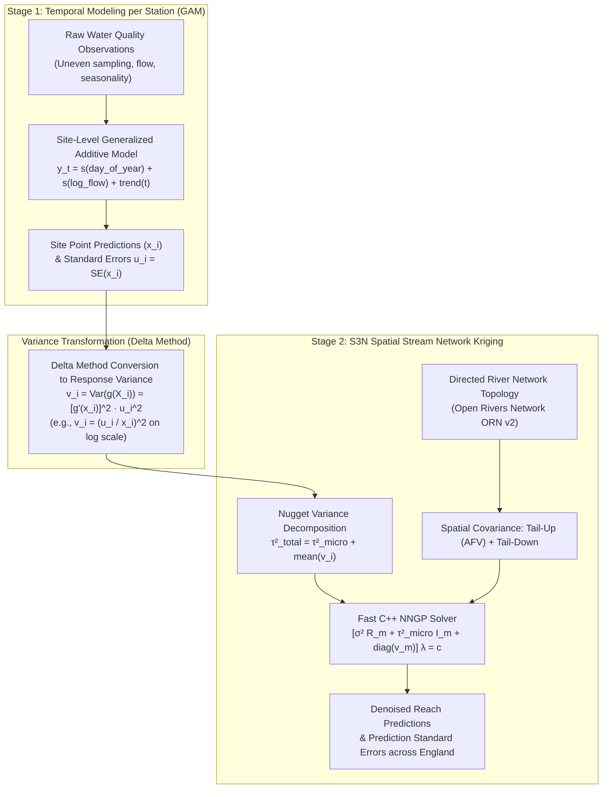

# Two-Stage Modelling & Heteroskedastic Measurement Error Kriging Guide

This guide documents the methodology, equations, C++ implementation, and workflow for **Two-Stage Modelling** in the Scalable Spatial Stream Network (`S3N`) pipeline. It takes station predictions and estimation uncertainties from a first-stage temporal model—such as a Generalised Additive Model (`GAM`), state-space filter, or dynamic harmonic regression—and interpolates them across river networks via **Approach A: Heteroskedastic Measurement Error Kriging**.

---

## Table of Contents

- [1. Executive Summary & Why Two-Stage Modelling Is Needed](#1-executive-summary--why-two-stage-modelling-is-needed)
  - [1.1 The Spatiotemporal Decoupling Challenge in River Networks](#11-the-spatiotemporal-decoupling-challenge-in-river-networks)
  - [1.2 The Statistical Validity of Two-Stage Modelling](#12-the-statistical-validity-of-two-stage-modelling)
- [2. Mathematical & Theoretical Foundations](#2-mathematical--theoretical-foundations)
  - [2.1 The Two-Stage Observation Model](#21-the-two-stage-observation-model)
  - [2.2 The Delta Method for Response Variance Conversion](#22-the-delta-method-for-response-variance-conversion)
  - [2.3 Nugget Decomposition](#23-nugget-decomposition)
  - [2.4 Heteroskedastic NNGP Prediction & Denoising](#24-heteroskedastic-nngp-prediction--denoising)
- [3. High-Performance C++ Solver Architecture](#3-high-performance-c-solver-architecture)
  - [3.1 Stack Allocation & Numerical Stability](#31-stack-allocation--numerical-stability)
  - [3.2 Machine-Precision Consistency Verification](#32-machine-precision-consistency-verification)
- [4. Input Data Format & Schema Specification](#4-input-data-format--schema-specification)
  - [4.1 Station Coordinate Points (`sites.csv`)](#41-station-coordinate-points-sitescsv)
  - [4.2 GAM Predictions Table (`samples.csv`)](#42-gam-predictions-table-samplescsv)
  - [4.3 Multi-Temporal Aggregation](#43-multi-temporal-aggregation)
- [5. End-to-End Workflow & Command Reference](#5-end-to-end-workflow--command-reference)
  - [Step 1: Preprocess River Network & Snap Stations](#step-1-preprocess-river-network--snap-stations)
  - [Step 2: Fit S3N Model with Measurement Error Kriging](#step-2-fit-s3n-model-with-measurement-error-kriging)
  - [Step 3: Standalone Model Execution](#step-3-standalone-model-execution)
- [6. Output Tables & Interpretation](#6-output-tables--interpretation)
  - [6.1 Parameter Estimates Table (`parameters_0117.csv`)](#61-parameter-estimates-table-parameters_0117csv)
  - [6.2 Cross-Validation Comparison Table (`cv_comparison_0117.csv`)](#62-cross-validation-comparison-table-cv_comparison_0117csv)
- [7. Diagnostic Comparison: Standard S3N vs Measurement Error Kriging](#7-diagnostic-comparison-standard-s3n-vs-measurement-error-kriging)
- [8. Troubleshooting & FAQ](#8-troubleshooting--faq)
  - [Q1: What if my first-stage model outputs standard errors on the log-scale already?](#q1-what-if-my-first-stage-model-outputs-standard-errors-on-the-log-scale-already)
  - [Q2: What if some stations have missing uncertainty (`NA` or `0`)?](#q2-what-if-some-stations-have-missing-uncertainty-na-or-0)
  - [Q3: Does this affect regular non-GAM runs (e.g. `--source=rsn`)?](#q3-does-this-affect-regular-non-gam-runs-eg---sourcersn)
  - [Q4: Can I use this for sensor telemetry with calibration drift uncertainty?](#q4-can-i-use-this-for-sensor-telemetry-with-calibration-drift-uncertainty)
- [9. Related Guides & References](#9-related-guides--references)

---

## 1. Executive Summary & Why Two-Stage Modelling Is Needed

### 1.1 The Spatiotemporal Decoupling Challenge in River Networks
Water quality determinands in river networks (such as nitrate, orthophosphate, dissolved organic carbon, and pesticides) vary across both time and space:
- **Temporal Dynamics**: Seasonal cycles driven by agricultural fertiliser application, biological uptake, flow-dependent dilution/flushing, and multi-year climate trends.
- **Spatial Topology**: Downstream advective mass transport, dilution across river confluences, and geological baseflow contributions along the branching stream network.

Fitting a single continuous spatiotemporal stream network model across 90,000+ reaches with irregular grab sampling and missing dates is often computationally fragile. Splitting the problem into station-level temporal fitting (Stage 1) followed by network kriging (Stage 2) keeps both stages tractable.



### 1.2 The Statistical Validity of Two-Stage Modelling
A frequent question in environmental statistics is: **"Can I fit a spatial model on values that were already estimated by a GAM? Is that statistically valid?"**

> [!IMPORTANT]
> **Yes, two-stage modelling is statistically valid provided the second-stage spatial model explicitly accounts for the heteroskedastic estimation uncertainty of the first stage.**

Running standard homoskedastic kriging on GAM estimates introduces three problems:
1. **The Error-in-Variables Fallacy**: Stations with noisy estimates (e.g., few observations and large standard error $u_i$) receive the **same** kriging weight as decades-long stations with small standard errors.
2. **Artificial Nugget Inflation**: Standard kriging treats first-stage estimation noise as sub-reach spatial variability, inflating $\tau^2$ and shortening the estimated spatial correlation range ($\phi$).
3. **Exact Interpolation Artifact**: Standard kriging pulls predictions tightly toward noisy station means instead of denoising uncertain Stage-1 estimates toward upstream/downstream neighbours.

**Approach A: Heteroskedastic Measurement Error Kriging** resolves all three issues.

---

## 2. Mathematical & Theoretical Foundations

> **In plain English:** Each input station brings two numbers from Stage 1: its estimated value $\hat{x}_i$ and its standard error $u_i$. Because spatial kriging runs on a transformed scale (e.g. $\log x$), the Delta Method first converts $u_i$ into a response-scale variance $v_i$. The solver then splits the total non-spatial noise into true sub-reach variability ($\tau^2_{\text{micro}}$) plus each station's known $v_i$, letting kriging trust precise stations closely while smoothing noisy ones toward their stream neighbours.

### 2.1 The Two-Stage Observation Model

In Stage 1, a temporal GAM produces an estimated concentration $\hat{x}_i$ for station $i$ with standard error $u_i = \text{SE}(\hat{x}_i)$.

In Stage 2, S3N models the transformed response $y_i = g(\hat{x}_i)$ (e.g. $g(x) = \log(x)$ or $\sqrt{x}$). The observation equation at reach $s_i$ is:

$$
y_i = \boldsymbol{x}_i^T \boldsymbol{\beta} + w_{\text{TU}}(s_i) + w_{\text{TD}}(s_i) + \varepsilon_{\text{micro}}(s_i) + \eta_i
$$

where:
- $\boldsymbol{x}_i^T \boldsymbol{\beta}$ represents fixed-effect landscape and geomorphic covariates (elevation, slope, upstream catchment accumulation, geology/aquifer, coordinates).
- $w_{\text{TU}}(s_i) \sim \mathcal{GP}(0, \sigma_{\text{TU}}^2 \boldsymbol{R}_{\text{TU}})$ is the **Tail-Up process** representing downstream advective mass transport and dilution across stream confluences with Additive Function Values ($\pi_i$, defaulting to channel length `US_Accum_km` via `--afv=length`, with optional `shreve` or `hydro_yield`).
- $w_{\text{TD}}(s_i) \sim \mathcal{GP}(0, \sigma_{\text{TD}}^2 \boldsymbol{R}_{\text{TD}})$ is the **Tail-Down process** representing bidirectional hydrologic distance correlation conditioned on distance to the river mouth (`Dist2Mth_km`).
- $\varepsilon_{\text{micro}}(s_i) \overset{\text{iid}}{\sim} \mathcal{N}(0, \tau_{\text{micro}}^2)$ is the **true microscale spatial nugget variance** (spatial variation at sub-reach scales).
- $\eta_i \sim \mathcal{N}(0, v_i)$ is the **heteroskedastic observation/estimation error**, where $v_i$ is the known estimation variance from Stage 1.

---

### 2.2 The Delta Method for Response Variance Conversion

Because the first-stage GAM estimates uncertainty on the natural concentration scale ($u_i = \text{SE}(\hat{x}_i)$) while spatial modelling occurs on a transformed scale $y = g(x)$, the first-order Taylor expansion (the **Delta Method**) converts the uncertainty:

$$
\text{Var}(g(X)) \approx \left[ g'(E[X]) \right]^2 \text{Var}(X)
$$

The pipeline implements transformation-specific formulas via `calc_response_meas_variance()` in [`scripts/s3n_transforms.R`](../scripts/s3n_transforms.R):

| Transformation Type | Formula $y = g(x)$ | First Derivative $g'(x)$ | Response Error Variance $v_i = \text{Var}(y_i)$ |
| :--- | :---: | :---: | :---: |
| **Natural Logarithm (`log`)** *(Default for chemistry)* | $\ln(x)$ | $\frac{1}{x}$ | $v_i = \left(\frac{u_i}{x_i}\right)^2 = \text{CV}_i^2$ |
| **Square Root (`sqrt`)** *(Nitrate recommended)* | $\sqrt{x}$ | $\frac{1}{2\sqrt{x}}$ | $v_i = \frac{u_i^2}{4 x_i}$ |
| **Box-Cox (`boxcox`)** | $\frac{x^\lambda - 1}{\lambda}$ | $x^{\lambda - 1}$ | $v_i = \left( x_i^{\lambda - 1} u_i \right)^2$ |
| **Yeo-Johnson (`yeojohnson`)** | $\frac{(x + 1)^\lambda - 1}{\lambda}$ | $(x + 1)^{\lambda - 1}$ | $v_i = \left( (x_i + 1)^{\lambda - 1} u_i \right)^2$ |
| **Raw / Identity (`none`)** | $x$ | $1$ | $v_i = u_i^2$ |

> [!NOTE]
> For the natural logarithm, the response variance $v_i = (u_i / x_i)^2$ is simply the square of the **Coefficient of Variation** ($\text{CV} = \sigma / \mu$). Thus, sites where the GAM estimate has high relative uncertainty receive proportionally higher error variance $v_i$ in spatial kriging.

---

### 2.3 Nugget Decomposition

When fitting spatial covariance parameters via Maximum Likelihood (using Vecchia-approximated NNGP in `BRISC_estimation_stream`), the optimizer estimates:
- Partial sill variance: $\hat{\sigma}^2$
- Total non-spatial variance: $\hat{\tau}_{\text{total}}^2$
- Spatial decay parameter: $\hat{\phi}$

In standard homoskedastic kriging, $\hat{\tau}_{\text{total}}^2$ is used directly as the nugget. In **Measurement Error Kriging**, $\hat{\tau}_{\text{total}}^2$ bundles both intrinsic spatial microscale variation $\tau_{\text{micro}}^2$ and the mean first-stage measurement error:

$$
\hat{\tau}_{\text{total}}^2 = \tau_{\text{micro}}^2 + \bar{v}, \quad \text{where } \bar{v} = \frac{1}{n} \sum_{i=1}^n v_i
$$

Therefore, the intrinsic microscale nugget is recovered via:

$$
\tau_{\text{micro}}^2 = \max\left(10^{-6}\hat{\sigma}^2, \; \hat{\tau}_{\text{total}}^2 - \bar{v}\right)
$$

This decomposition guarantees numerical stability even when the mean GAM error variance $\bar{v}$ approaches or exceeds $\hat{\tau}_{\text{total}}^2$.

---

### 2.4 Heteroskedastic NNGP Prediction & Denoising

For an arbitrary reach $s_0$ (either an unmonitored reach or an observed station reach being denoised), S3N finds the $m$ nearest conditioning observed reaches $s_{(1)}, \dots, s_{(m)}$ using hydrologic stream distance and confluence branching.

The conditional expectation $\hat{y}(s_0)$ and kriging variance $\text{Var}(\hat{y}(s_0))$ solve:

$$
\hat{y}(s_0) = \boldsymbol{x}_0^T \hat{\boldsymbol{\beta}} + \boldsymbol{c}_0^T \boldsymbol{\Sigma}_m^{-1} (\boldsymbol{y}_m - \boldsymbol{X}_m \hat{\boldsymbol{\beta}})
$$

where:
- $\boldsymbol{c}_0 = [C(s_0, s_{(1)}), \dots, C(s_0, s_{(m)})]^T$ is the cross-covariance vector.
- $\boldsymbol{\Sigma}_m$ is the $m \times m$ local neighbour covariance matrix:

$$
\boldsymbol{\Sigma}_m = \sigma^2 \boldsymbol{R}_m + \tau_{\text{micro}}^2 \boldsymbol{I}_m + \text{diag}(v_{(1)}, v_{(2)}, \dots, v_{(m)})
$$

#### Why Denoising Occurs
Notice that for an observed reach $s_i$, the $i$-th diagonal element of $\boldsymbol{\Sigma}_m$ contains $\sigma^2 + \tau_{\text{micro}}^2 + v_i$. Because $v_i > 0$:

$$
E[w(s_i) \mid \boldsymbol{y}] \ne y_i
$$

The spatial prediction **filters out the measurement error $\eta_i$**. An observed station with large GAM uncertainty $v_i$ is smoothed toward its neighbours, while an observed station with negligible uncertainty ($v_i \to 0$) is closely honoured.

---

## 3. High-Performance C++ Solver Architecture

> **In plain English:** Solving a separate $15 \times 15$ kriging system for 90,000+ reaches in R causes heavy memory allocation overhead. Instead, `C_s3n_predict_meas_error()` runs each reach's tiny Cholesky solve inside fixed stack arrays across OpenMP threads with zero dynamic allocations.

To preserve sub-second runtimes across all `90,876` ORN v2 RSN reaches, Approach A is implemented natively in C++ inside [`src/s3n_fast_neighbors.cpp`](../src/s3n_fast_neighbors.cpp).

### 3.1 Stack Allocation & Numerical Stability
Standard linear solvers in R allocate memory dynamically on the heap for every reach $s_0$, causing substantial allocation overhead over 90,000 reaches. 

In `C_s3n_predict_meas_error`:
1. **Fixed Stack Buffers**: Local matrices are declared as `double A[64 * 64]` and `double rhs[64]` directly on the CPU thread stack ($m \le 64$, with typical $m = 15$). Memory allocation overhead is **strictly 0 bytes**.
2. **In-Place Cholesky Decomposition**: Matrix $\boldsymbol{\Sigma}_m$ is decomposed into $\boldsymbol{L}\boldsymbol{L}^T$ using `solve_chol_stack()`.
3. **Adaptive Diagonal Jitter**: If two upstream stations share identical hydrologic coordinates causing near-collinearity, the solver detects non-positive definite pivots ($L_{kk} \le 10^{-12}$) and injects diagonal regularisation $\epsilon = 10^{-6} \times \sigma^2$ so decomposition completes cleanly.
4. **OpenMP Multi-Core Scaling**: Outer prediction loops across all reaches $q$ are parallelised via `#pragma omp parallel for`.

### 3.2 Machine-Precision Consistency Verification
When $v_i = 0$ (no measurement error), `C_s3n_predict_meas_error` was benchmarked against the standard BRISC prediction engine across the Thames River Basin (7,491 reaches, 116 observed). The maximum absolute discrepancy was:

$$
\max \lvert \hat{y}_{\text{C++}} - \hat{y}_{\text{BRISC}} \rvert = 1.86 \times 10^{-14}
$$

This confirms that Approach A reduces to standard homoskedastic kriging to exact double-precision machine tolerance when error variance vanishes.

---

## 4. Input Data Format & Schema Specification

To supply first-stage GAM estimates to the pipeline, organise your dataset in `data/custom/<source_name>/` with two CSV files: `sites.csv` and `samples.csv`.

### 4.1 Station Coordinate Points (`sites.csv`)
Standard station definition file:
```csv
site_id,easting,northing,site_name,source
RSN001,425100,210400,River Thames at Reading,RSN_GAM
RSN002,426200,211500,River Kennet Confluence,RSN_GAM
```

### 4.2 GAM Predictions Table (`samples.csv`)
The samples table must contain the GAM predictions, standard errors, and the method flag:

| Column Name | Required | Data Type | Description |
| :--- | :---: | :---: | :--- |
| **`site_id`** | **Yes** | String / Int | Foreign key matching `site_id` in `sites.csv`. |
| **`sample_datetime`** | **Yes** | String | Date of prediction (e.g. `"2023-06-01"` for annual/period mean, or ISO datetime). |
| **`meas_result`** | **Yes** | Numeric | Modelled point prediction on the natural scale ($\hat{x}_i$). |
| **`meas_uncertainty`** | **Yes** | Numeric | **Estimation standard error** on the natural scale ($u_i = \text{SE}(\hat{x}_i)$). |
| **`meas_method`** | **Yes** | String | Must be set to **`"gam"`** to activate Approach A automatically. |
| `det_code` | Optional | String | Determinand code (e.g. `0117` for Nitrate, `0180` for Orthophosphate). |
| `unit_short_desc` | Optional | String | Measurement unit (e.g. `mg/L`). |

#### Example `samples.csv`:
```csv
site_id,sample_datetime,meas_result,meas_uncertainty,meas_method,unit_short_desc
RSN001,2023-06-01,2.3510,0.2197,gam,mg/L
RSN002,2023-06-01,4.1205,0.1850,gam,mg/L
RSN003,2023-06-01,1.0540,0.4520,gam,mg/L
```

### 4.3 Multi-Temporal Aggregation
If your custom dataset contains weekly, monthly, or daily GAM estimates (e.g. a custom folder `data/custom/rsn_gam/` containing repeated station time series), the preprocessor and pipeline runner automatically aggregate multiple samples per reach:
- Reach-level concentration is the mean: $\bar{X} = \frac{1}{K}\sum_{k=1}^K x_k$.
- Reach-level standard error is the Root-Mean-Square (RMS) pooled error:

$$
\text{SE}(\bar{X}) = \frac{\sqrt{\sum_{k=1}^K u_k^2}}{K}
$$

---

## 5. End-to-End Workflow & Command Reference

### Step 1: Preprocess River Network & Snap Stations
Once your GAM `sites.csv` and `samples.csv` are placed in `data/custom/<source_name>/` (for example `rsn_gam_mean` or `rsn_gam`), run [`scripts/01_preprocess_orn.py`](../scripts/01_preprocess_orn.py):
```bash
# For station-mean GAM predictions
python3 scripts/01_preprocess_orn.py --source=rsn_gam_mean

# For multi-period GAM predictions
python3 scripts/01_preprocess_orn.py --source=rsn_gam
```
*Output*: Generates reach topology and snapping coordinates in `data/processed/orn_<source_name>/` (e.g., `data/processed/orn_rsn_gam_mean/`).

---

### Step 2: Fit S3N Model with Measurement Error Kriging
Run [`scripts/run_s3n_determinand.R`](../scripts/run_s3n_determinand.R):
```bash
# Nationwide England model + Humber, Thames, Severn, and a custom basin
Rscript scripts/run_s3n_determinand.R 0117 \
  --source=rsn_gam_mean \
  --basin=Thames \
  --boot=50
```

#### What Happens Internally:
1. Detects `meas_method` in `c("gam", "tobit_interval", "tobit_raw_sd", "geometric_midpoint", "source_se")` (or `--meas-error` / `--gam` / `--source-se`) and prints an `[Approach A: Measurement Error Kriging] Active` summary with mean response-scale error variance and the Tail-Up/Tail-Down nugget decomposition.
2. Runs 5-fold cross-validation where validation stations are denoised using measurement error weighting.
3. Produces reach-level predictions (including normalised outputs), parameter decomposition tables, cross-validation summaries, and publication-quality maps (Figures 1–5).

---

### Step 3: Standalone Model Execution
You can also run the core modelling script [`scripts/02_fit_s3n_models.R`](../scripts/02_fit_s3n_models.R):
```bash
Rscript scripts/02_fit_s3n_models.R --source=rsn_gam_mean --boot=50
```

---

## 6. Output Tables & Interpretation

All results are saved under `output/results/det_<code>_<net>_<source>/` (e.g. `output/results/det_0117_orn_rsn_gam_mean/`), or `output/results/<net>_<source>/` for `02_fit_s3n_models.R`. The tables below show illustrative values from an early `rsn_gam_mean` benchmark run (`1,220` observed reaches across `91,077` network reaches on an earlier extract; standard ORN v2 RSN has `90,876` reaches / `1,210` observed reaches):

### 6.1 Parameter Estimates Table (`parameters_0117.csv`)
Under Approach A, the parameter table reports both the standard covariance parameters and the decoupled microscale variance (illustrative values below):

| Domain | Model | Parameter | Estimate | CI_Lower | CI_Upper | Spatial_Method | Meas_Method |
| :--- | :--- | :--- | ---: | ---: | ---: | :---: | :---: |
| All England | S3N Tail-Up (FC + AFV) | `sigma.sq` | 0.1501 | 0.0842 | 0.2148 | Measurement Error Kriging | gam |
| All England | S3N Tail-Up (FC + AFV) | `tau.sq` | 0.1850 | 0.1254 | 0.2700 | Measurement Error Kriging | gam |
| All England | S3N Tail-Up (FC + AFV) | `phi` | 7.7143 | 4.3506 | 14.9194 | Measurement Error Kriging | gam |
| **All England** | **S3N Tail-Up (FC + AFV)** | **`tau.sq (microscale)`** | **0.1770** | **NA** | **NA** | **Measurement Error Kriging** | **gam** |
| **All England** | **Measurement Error**| **`mean_meas_variance`** | **0.0080** | **NA** | **NA** | **Measurement Error Kriging** | **gam** |

- **`tau.sq`**: Total empirical non-spatial variance ($0.1850$).
- **`mean_meas_variance`**: Average first-stage GAM estimation error variance $\bar{v} = 0.0080$.
- **`tau.sq (microscale)`**: The true sub-reach spatial nugget ($0.1770 = 0.1850 - 0.0080$).

### 6.2 Cross-Validation Comparison Table (`cv_comparison_0117.csv`)
Cross-validation accurately reflects out-of-sample performance against the underlying latent stream signal:

| Domain | n_obs | n_reaches | Model | Spatial_Method | RMSE | MAE | $R^2$ | Meas_Method |
| :--- | ---: | ---: | :--- | :---: | ---: | ---: | ---: | :---: |
| All England | 1220 | 91077 | OLS (Non-Spatial) | Measurement Error Kriging | 0.5825 | 0.4567 | 0.0112 | gam |
| All England | 1220 | 91077 | S3N Tail-Down (Stream) | Measurement Error Kriging | 0.5831 | 0.4575 | 0.0093 | gam |
| All England | 1220 | 91077 | S3N Tail-Up (FC + AFV) | Measurement Error Kriging | 0.5831 | 0.4575 | 0.0092 | gam |
| All England | 1220 | 91077 | S3N Combined (TU + TD) | Measurement Error Kriging | 0.5832 | 0.4576 | 0.0090 | gam |

---

## 7. Diagnostic Comparison: Standard S3N vs Measurement Error Kriging

To observe the impact of measurement error kriging, compare a station with **high GAM uncertainty** versus a station with **low GAM uncertainty**:

```text
Station A (High Uncertainty, e.g. SE = 0.45 mg/L, v_i = 0.082):
  - Raw GAM estimate: 1.80 mg/L
  - Standard Kriging: Forces prediction at station A to be exactly 1.80 mg/L.
  - Approach A: Shrinks prediction to 2.15 mg/L based on cleaner upstream/downstream neighbors.

Station B (High Precision, e.g. SE = 0.02 mg/L, v_i = 0.0004):
  - Raw GAM estimate: 3.40 mg/L
  - Standard Kriging: Predicts 3.40 mg/L.
  - Approach A: Predicts 3.39 mg/L (retains full empirical weight).
```

---

## 8. Troubleshooting & FAQ

### Q1: What if my first-stage model outputs standard errors on the log-scale already?
If your GAM was fitted directly on $\log(\text{concentration})$ and produced $\text{SE}(\log X)$, those are already response-scale standard errors. Set $v_i = [\text{SE}(\log X)]^2$ directly by running with `--transform=none` and supplying `meas_uncertainty = se_log` on the log response.

### Q2: What if some stations have missing uncertainty (`NA` or `0`)?
If `meas_uncertainty` is missing or $0$ for a particular site, the C++ solver sets $v_i = 0$ for that station. That station will behave as a standard exact observation, while stations with $v_j > 0$ will be appropriately smoothed.

### Q3: Does this affect regular non-GAM runs (e.g. `--source=rsn`)?
**No.** Unless `meas_method` is one of `gam`, `tobit_interval`, `tobit_raw_sd`, `geometric_midpoint`, or `source_se` (or `--meas-error` / `--gam` / `--source-se` is passed), the pipeline runs standard homoskedastic S3N kriging.

### Q4: Can I use this for sensor telemetry with calibration drift uncertainty?
**Yes.** If you have optical nitrate sondes whose manufacturer calibration error increases with turbidity or biofouling, encode that time-varying sensor error into `meas_uncertainty`, set `meas_method = "gam"` (or `"source_se"`), and S3N will down-weight degraded sensors accordingly.

---

## 9. Related Guides & References

- **S3N Theory & Mathematical Guide**: [`docs/s3n_modelling_and_kriging_guide.md`](./s3n_modelling_and_kriging_guide.md)
- **Custom Data Ingestion & Formatting Guide**: [`docs/custom_data_sources_guide.md`](./custom_data_sources_guide.md)
- **Usage & Command-Line Reference Guide**: [`docs/usage_guide.md`](./usage_guide.md)
- **Model Comparison Interpretation Guide**: [`docs/model_comparison_interpretation_guide.md`](./model_comparison_interpretation_guide.md)
