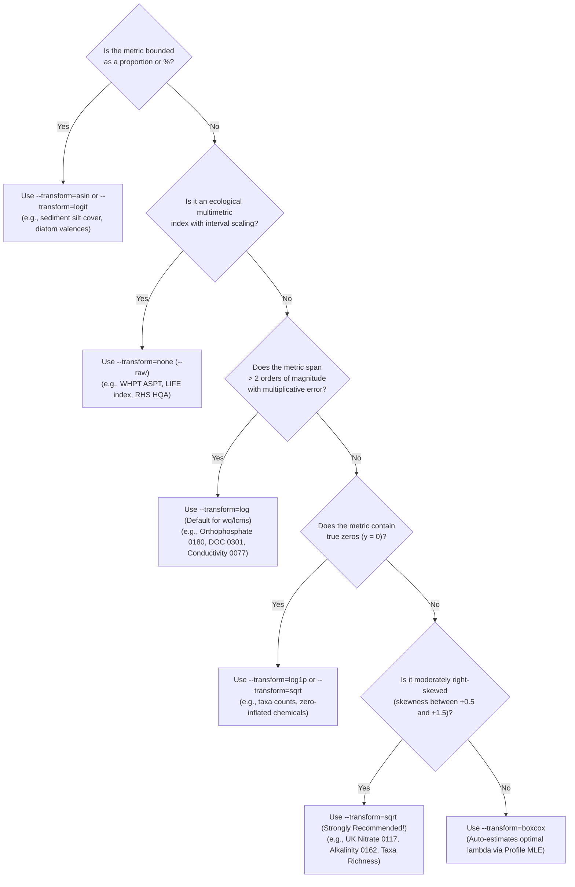

# Scalable Spatial Stream Network (S3N) Pipeline — Usage & CLI Reference Guide

This guide documents all scripts, command-line options, output directory conventions, and practical examples for running the Scalable Spatial Stream Network (S3N) water quality pipeline across the Ordnance Survey Open Rivers Network ([`gis/ORN_v2.gpkg`](../gis/ORN_v2.gpkg), 90,876 reaches across 141 monitored catchments), the Environment Agency River Surveillance Network ([`RSN`](../data/NCEA_River_Surveillance_Network_ARD_Open/)), the Small Streams Network ([`SSN`](../data/NCEA_Small_Streams_Network_ARD_Open/)), and the combined River Surveillance + Small Streams ([`RSS`](../data/processed/orn_rss/)) monitoring network.

> **Mathematical & Algorithmic Deep-Dive**: For a step-by-step theoretical and mathematical explanation of how the `S3N` package, stream-network covariance functions (`Tail-Up` & `Tail-Down`), Nearest-Neighbor Gaussian Process (`NNGP`) estimation, and Universal Stream Kriging work, see [`./s3n_modelling_and_kriging_guide.md`](./s3n_modelling_and_kriging_guide.md).

---

## 1. Overview of Pipeline Scripts

| Script | Language | Purpose |
| :--- | :--- | :--- |
| [`scripts/run_s3n_determinand.R`](../scripts/run_s3n_determinand.R) | R + C | **Primary all-in-one runner**: Extracts any determinand (`det_code`), applies ROS or 0.5 × LOD censoring, filters or loops over time periods (`all`, `year`, `season`, `month`), fits S3N models (`England`, `Humber`, `Thames`, `Severn`, plus any custom `--basin`), runs 5-fold cross-validation, and generates all publication-quality base-R figures (`fig1`–`fig4` + custom `fig5+`). |
| [`scripts/01_preprocess_orn.py`](../scripts/01_preprocess_orn.py) | Python 3 | **Network & GIS preprocessor**: Parses [`gis/ORN_v2.gpkg`](../gis/ORN_v2.gpkg), snaps RSN stations to stream reaches within 250 m (configurable via `--max-snap-dist`), builds directed river tree topology (`parent_dn`, `Dist2Mth_km`, `log_AFV`), and exports [`england_rsn_reaches.csv`](../data/processed/england_rsn_reaches.csv), [`rsn_sites.csv`](../data/processed/rsn_sites.csv), [`rsn_reach_periods.csv`](../data/processed/rsn_reach_periods.csv), and [`rsn_catchments_lookup.csv`](../data/processed/rsn_catchments_lookup.csv). |
| [`scripts/02_fit_s3n_models.R`](../scripts/02_fit_s3n_models.R) | R + C | **Standalone model fitter**: Fits S3N Tail-Up, Tail-Down, and Combined models directly on whichever determinand/period is currently stored in [`data/processed/england_rsn_reaches.csv`](../data/processed/england_rsn_reaches.csv) and writes outputs to [`output/`](../output). |
| [`scripts/03_generate_plots.R`](../scripts/03_generate_plots.R) | R | **Standalone figure generator**: Sources [`scripts/s3n_plot_functions.R`](../scripts/s3n_plot_functions.R) to render Figures 1–4 from saved CSV outputs in [`output/`](../output) or any determinand output directory (`--dir=output/det_0117`). |
| [`scripts/04_compare_model_runs.R`](../scripts/04_compare_model_runs.R) | R | **Model run & network comparator**: Compares 2 or more model output directories (across networks such as `ORN v2` vs. `EU-Hydro`, covariate subsets, or temporal slices `year_*`/`season_*`/`month_*`), runs statistical hypothesis tests, writes `comparison_report.md` + CSV summary tables, and renders 5 base-R comparison figures (`fig_comp1`–`fig_comp5`). |
| [`scripts/05_descriptive_stats.R`](../scripts/05_descriptive_stats.R) | R | **Single-output descriptive & stratified analyzer**: Computes 18 distributional metrics, monitoring network representativeness tests, and stratified environmental/topological breakdowns for any single model output folder (`<run_dir>/descriptives/`). |
| [`scripts/06_station_snapping_diagnostics.R`](../scripts/06_station_snapping_diagnostics.R) | R | **Station-to-reach snapping diagnostics & catchment plotter**: Standalone function (`analyze_station_snapping()`) and CLI tool that produces station-to-reach snapping coordinate tables (`station_X/Y`, `snapped_RivID`, `snap_reach_X/Y`, `reach_mid_X/Y`, `snap_dist_m`) and catchment-level base-R snapping figures (`fig_snap_catchment_*.png`). |
| [`scripts/s3n_plot_functions.R`](../scripts/s3n_plot_functions.R) | R | **Shared modular plotting library**: Contains all base-R stream network and diagnostic plotting functions (`plot_stream_network`, `plot_fig1_england_map`, `plot_basin_map`, `plot_fig2_humber_map`, `plot_fig3_thames_severn_map`, `plot_fig4_diagnostics`) sourced by both [`scripts/run_s3n_determinand.R`](../scripts/run_s3n_determinand.R) and [`scripts/03_generate_plots.R`](../scripts/03_generate_plots.R). |

> [!TIP]
> Once [`scripts/01_preprocess_orn.py`](../scripts/01_preprocess_orn.py) has been run once to build [`data/processed/england_rsn_reaches.csv`](../data/processed/england_rsn_reaches.csv), [`data/processed/rsn_sites.csv`](../data/processed/rsn_sites.csv), and [`data/processed/rsn_catchments_lookup.csv`](../data/processed/rsn_catchments_lookup.csv), you can do all subsequent modeling, temporal slicing, custom basin analysis, and plotting directly with [`scripts/run_s3n_determinand.R`](../scripts/run_s3n_determinand.R) without re-running the GIS preprocessor.

---

## 2. Primary Runner: [`scripts/run_s3n_determinand.R`](../scripts/run_s3n_determinand.R)

### 2.1 Synopsis
```bash
Rscript scripts/run_s3n_determinand.R --list [--dataset=wq|inverts|diatoms|macrophytes|rhs|lcms]
Rscript scripts/run_s3n_determinand.R --list-basins
Rscript scripts/run_s3n_determinand.R <code_or_var> [OPTIONS]
```

### 2.2 Complete Option Reference

| Option / Argument | Default | Description |
| :--- | :--- | :--- |
| `<code_or_var>` | *(Required)* | Either a 4-digit EA RSN determinand code (e.g., `0117` for Nitrate, `0180` for Orthophosphate, `0061` for pH) **or** an ecological/habitat metric column name (e.g., `whpt_aspt`, `whpt_ntaxa`, `life_family_index`, `psi_family_score`, `rmni`, `hqa_score`). |
| `--source=<name>` | `rsn` | Selects the monitoring station network data source:<br>• `rsn`: **River Surveillance Network** ([`RSN`](../data/NCEA_River_Surveillance_Network_ARD_Open/)), the default nationwide surveillance network (1,382 monitoring stations across wider rivers)<br>• `ssn`: **Small Streams Network** ([`SSN`](../data/NCEA_Small_Streams_Network_ARD_Open/)), dedicated to headwaters and smaller tributaries (313 monitoring stations; saves outputs to `output/det_<code>_<net>_src_ssn/`)<br>• `rss`: **Combined River Surveillance & Small Streams** ([`RSS`](../data/processed/orn_rss/)), merging RSN + SSN into a single integrated dataset (1,695 stations, 1,384 snapped observed reaches on ORN v2; saves outputs to `output/det_<code>_<net>_src_rss/`). |
| `--list-sources` | — | Prints all supported monitoring network data sources (`rsn`, `ssn`, `rss`), abbreviations, full descriptive labels, and resolved data directories. |
| `--dataset=<name>` | Auto-detected (`wq` for 4-digit codes) | Selects which dataset to model:<br>• `wq`: Water Quality Samples (`Water Quality Samples.csv`)<br>• `inverts`: Macroinvertebrate Samples (`Macroinvertebrate Samples.csv`)<br>• `diatoms`: Diatom Samples (`Diatom Samples.csv`)<br>• `macrophytes`: Macrophyte Samples (`Macrophyte Samples.csv`)<br>• `rhs`: River Habitat Surveys (`River Habitat Surveys.csv`, RSN only)<br>• `lcms`: LCMS/GCMS Organic Pollutants (`LCMS GCMS Samples.csv`, RSN only)<br>*(Note: If omitted, the script automatically detects `inverts`, `diatoms`, `macrophytes`, or `rhs` when you pass a column name like `whpt_aspt` or `rmni`)*. |
| `--list`, `-h`, `--help` | — | Lists available variables, sample counts, descriptions, and units for the selected `--dataset` (defaults to top 25 water quality determinands; combine with `--dataset=inverts`, `--dataset=diatoms`, `--dataset=macrophytes`, `--dataset=rhs`, or `--dataset=lcms`). |
| `--list-basins` | — | Prints all 11 Environment Agency River Basin Districts (`RBD_ID`, `RBD_Name`) and the top 30 individual catchments (`CatchID`, `Main_River`, `RBD_Name`, total reaches, and monitored reaches) from [`data/processed/rsn_catchments_lookup.csv`](../data/processed/rsn_catchments_lookup.csv). |
| `--list-networks` | — | Lists all configured water network profiles (`orn`, `euhydro_thames`, `euhydro_tweed`, `euhydro`) in [`configs/networks/`](../configs/networks). |
| `--network=<name>` | `orn` | Selects the river network dataset (`orn`, `euhydro_thames`, `euhydro_tweed`, `euhydro`, or a custom GeoPackage `.gpkg`, GeoParquet `.parquet`/`.geoparquet`, or JSON profile). Automatically preprocesses the network if not yet cached in `data/processed/<name>/`, appends the network abbreviation to the output directory (e.g., `output/det_0117_orn/`, `output/det_0117_euhydro_thames/`), and displays the network name on all figures. See [`docs/custom_water_network_guide.md`](./custom_water_network_guide.md) for instructions on adding new water networks. |
| `--list-vars` (or `--list-covariates`) | — | Lists all 15 available fixed-effect regression covariates, their short CLI aliases, transformations, and default inclusion status. |
| `--vars=<spec>` (or `--covariates=<spec>`) | `default` | Selects which fixed-effect predictors enter the regression design matrix `X` (without needing to re-run [`01_preprocess_orn.py`](../scripts/01_preprocess_orn.py)):<br>• `default`: `Elevation_z`, `Slope_z`, `log10_US_Accum_z`, `Is_Chalk_Limestone`, `Is_Sandstone`, `Is_Peat` (or `Is_Aquifer` for single basins), `Easting_z`, `Northing_z` (saves to `output/det_<code>_<net>/`)<br>• **Explicit subset**: e.g. `--vars=elevation,slope,aquifer` (saves to `output/det_<code>_<net>_vars_elev_slope_aquifer/` and adds covariate names to the subtitles of Figures 1–4)<br>• **Relative add/remove (`+var`/`-var`)**: e.g. `--vars=-easting,-northing` (saves to `output/det_<code>_<net>_vars_no_east_no_north/`) or `--vars=+sinuosity,+strahler`<br>• `none` (or `intercept`): Intercept-only model (`X = 1`, saves to `output/det_<code>_<net>_vars_none/`)<br>• `all`: All available covariates (saves to `output/det_<code>_<net>_vars_all/`). |
| `--list-transforms` | — | Prints a comprehensive reference table of all available data transformation algorithms, mathematical formulas \(z = f(y)\), valid domains, and scientific recommendations across [`run_s3n_determinand.R`](../scripts/run_s3n_determinand.R), [`02_fit_s3n_models.R`](../scripts/02_fit_s3n_models.R), and [`01_preprocess_orn.py`](../scripts/01_preprocess_orn.py). |
| `--transform=<type>` | `log` (`wq`/`lcms`), `none` (ecology) | Selects the mathematical response transformation applied prior to spatial covariance estimation and universal stream kriging. Supported options: `log`, `sqrt`, `cbrt`, `log1p`, `log10`, `fourthrt`, `boxcox`, `yeojohnson`, `reciprocal`, `asin`, `logit`, `none` (or `raw`). When a non-default transformation is specified, the output directory is tagged automatically (e.g. `output/det_0117_orn_trans_sqrt/`). |
| `--lambda=<val>` | Auto (Profile MLE) | Power parameter \(\lambda\) for Box-Cox and Yeo-Johnson transformations. If omitted, the optimal parameter \(\hat{\lambda}\) is automatically estimated from observed samples via Profile Maximum Likelihood over \([-2, 2]\). |
| `--scale=<val>` | `1.0` (proportions) / `100.0` (%) | Upper bound scale parameter for bounded angular (`asin`) and logistic (`logit`) transformations. |
| `--raw` / `--log` | `log` for `wq`/`lcms`; `raw` for ecology | Backward-compatible convenience flags equivalent to `--transform=none` and `--transform=log`. |
| `--reverse-color` (or `--reverse-colour`) | `FALSE` (blue = low, red = high) | Reverses the map color palette (`val_cols_rev`) so that **low values are warm red/orange and high values are cool blue/teal** — useful for ecological/habitat quality metrics where higher scores indicate better condition (e.g., `hqa_score`, `whpt_aspt`, `life_family_index`, `psi_family_score`). Also supported in [`scripts/03_generate_plots.R`](../scripts/03_generate_plots.R). |
| `--vmin=<val>` / `--vmax=<val>` | Auto-shared across periods | Optional explicit minimum and maximum scale bar bounds (in raw measurement units, e.g., `--vmin=0.2 --vmax=20`). Note: When running seasonal, yearly, or monthly plots (`--by=season|year|month` or individual period slices), scale bars are **automatically synchronized** across all periods even without `--vmin`/`--vmax`. |
| `--censor=<method>` | `ros` | Method for imputing left-censored (`<`) observations below the limit of detection:<br>• `ros`: **Robust Lognormal Regression on Order Statistics** (Helsel & Cohn, 1988; Hirsch & Stedinger, 1987). Fits a log-normal quantile regression above the detection limit(s) and imputes censored values via Weibull/Kaplan–Meier plotting positions.<br>• `half_lod`: Simple substitution of `< L` with `0.5 * L`. |
| `--boot=<N>` | `50` | Number of parametric bootstrap iterations (`BRISC_bootstrap`) used to compute 95% confidence intervals on fixed-effect and covariance parameters. Use `--boot=15` for faster exploratory runs or `--boot=100` for final tables. |
| `--basin=<spec>` | *(None)* | Additionally models, cross-validates, and plots one or more custom river basins alongside `All England`, `Humber`, `Thames`, and `Severn`. Accepts:<br>• **Mainstem river name** (case-insensitive substring, e.g., `--basin=Eden`, `--basin="Great Ouse"`, `--basin=Tyne`, `--basin=Ribble`)<br>• **Numeric `CatchID`** (e.g., `--basin=3125`, `--basin=27`, `--basin=2828`)<br>• **River Basin District name or ID** (e.g., `--basin=Anglian`, `--basin="South West"`, `--basin=rbd:5`)<br>• **Multiple basins**: Comma-separated (`--basin=Eden,Tyne`) or repeated `--basin=` flags. |
| `--year=<YYYY>` | *(All years)* | Filters water quality samples to a single calendar year (e.g., `--year=2021`, `--year=2022`, `--year=2023`, `--year=2024`). Saves outputs in `output/det_<code>/year_<YYYY>/`. |
| `--season=<season>` | *(All seasons)* | Filters water quality samples to a single meteorological season:<br>• `winter` (Dec, Jan, Feb)<br>• `spring` (Mar, Apr, May)<br>• `summer` (Jun, Jul, Aug)<br>• `autumn` or `fall` (Sep, Oct, Nov)<br>Saves outputs in `output/det_<code>/season_<season>/`. |
| `--month=<1..12>` | *(All months)* | Filters water quality samples to a single calendar month (`1` to `12`). Saves outputs in `output/det_<code>/month_<MM>/`. Can be combined with `--year=<YYYY>` (e.g., `--year=2023 --month=7`). |
| `--by=<mode>` | *(None)* | **Automated Temporal Batch Mode**: Automatically loops over all periods in `<mode>`, fitting the full S3N suite and generating all figures in per-period subdirectories, plus combined multi-period summary CSVs (`cv_summary_by_<mode>_<code>.csv` and `parameters_by_<mode>_<code>.csv`):<br>• `--by=year`: Fits every calendar year (`year_2021/`, `year_2022/`, `year_2023/`, `year_2024/`)<br>• `--by=season`: Fits all 4 meteorological seasons (`season_winter/`, `season_spring/`, `season_summer/`, `season_autumn/`)<br>• `--by=month`: Fits all 12 calendar months (`month_01/` .. `month_12/`). |
| `--gis-dir=<path>` (or `--gis=<path>`) | `gis` (or `$S3N_GIS_DIR`) | Custom path (relative or absolute) to the directory containing river network GeoPackages (`ORN_v2.gpkg`, `euhydro_thames_v013.gpkg`, etc.). |
| `--data-dir=<path>` (or `--data=<path>`) | `data` (or `$S3N_DATA_DIR`) | Custom path (relative or absolute) to the root data directory containing `NCEA_River_Surveillance_Network_ARD_Open/` and `processed/`. |
| `--output-dir=<path>` (or `--out-dir=<path>`) | `output` (or `$S3N_OUTPUT_DIR`) | Custom path (relative or absolute) to the root output directory where model results (`det_<code>/`) and figures are written. |

---

### 2.3 Common Determinand Codes (`det_code`)

| `det_code` | Determinand Description | Units | Recommended Scale Flag |
| :--- | :--- | :--- | :--- |
| `0117` | Nitrate as N | `mg/l` | Default (log scale) |
| `0180` | Orthophosphate, reactive as P | `mg/l` | Default (log scale) |
| `0111` | Ammoniacal Nitrogen as N | `mg/l` | Default (log scale) |
| `0116` | Nitrogen, Total Oxidised as N (TON) | `mg/l` | Default (log scale) |
| `0118` | Nitrite as N | `mg/l` | Default (log scale) |
| `0301` | Carbon, Organic, Dissolved as C (DOC) | `mg/l` | Default (log scale) |
| `0077` | Conductivity at 25 C | `uS/cm` | Default (log scale) |
| `0162` | Alkalinity to pH 4.5 as CaCO3 | `mg/l` | Default (log scale) |
| `0253` | Magnesium, Dissolved | `mg/l` | Default (log scale) |
| `0241` | Calcium, Dissolved | `mg/l` | Default (log scale) |
| `6396` | Turbidity : In Situ | `FTU` | Default (log scale) |
| `0061` | pH : In Situ | `pH units` | `--raw` (untransformed) |
| `0076` | Temperature of Water | `CEL` | `--raw` (untransformed) |
| `0085` | Oxygen, Dissolved, % Saturation | `%` | `--raw` (untransformed) |
| `9924` | Oxygen, Dissolved as O2 : In Situ | `mg/l` | `--raw` (untransformed) |

### 2.4 Ecological & Biological Datasets (`--dataset=inverts|diatoms|macrophytes|rhs|lcms`)

| Dataset (`--dataset=...`) | Variable Name | Description | Units | Default Scale |
| :--- | :--- | :--- | :--- | :--- |
| `inverts` | `whpt_aspt` | WHPT Average Score Per Taxon (WFD standard) | `ASPT` | Raw (`--raw`) |
| `inverts` | `whpt_ntaxa` | WHPT Taxon Richness (N-Taxa) | `taxa` | Raw (`--raw`) |
| `inverts` | `life_family_index` | LIFE Flow Velocity Stress Index (Family) | `LIFE` | Raw (`--raw`) |
| `inverts` | `psi_family_score` | PSI Fine Sediment Sensitivity Score | `%` | Raw (`--raw`) |
| `inverts` | `epsi_family_score` | Empirically Weighted PSI Sediment Score | `%` | Raw (`--raw`) |
| `inverts` | `cci` | Community Conservation Index | `CCI` | Raw (`--raw`) |
| `inverts` | `dehli` | DEHLI Drought Stress Index | `DEHLI` | Raw (`--raw`) |
| `inverts` | `armi_score` | Anglers' Riverfly Monitoring Score | `score` | Raw (`--raw`) |
| `diatoms` | `percent_organic_tolerant` | Organic-Tolerant Diatom Relative Abundance | `%` | Raw (`--raw`) |
| `diatoms` | `percent_motile` | Motile Diatom Guild Relative Abundance | `%` | Raw (`--raw`) |
| `macrophytes` | `rmni` | River Macrophyte Nutrient Index (RMNI) | `RMNI` | Raw (`--raw`) |
| `macrophytes` | `rn_a_taxa` | Macrophyte Aquatic Taxon Richness | `taxa` | Raw (`--raw`) |
| `rhs` | `hqa_score` | River Habitat Survey Habitat Quality (HQA) | `HQA` | Raw (`--raw`) |
| `rhs` | `hms_score` | River Habitat Survey Modification Score (HMS) | `HMS` | Raw (or `--log`) |

---

### 2.5 Universal Data Transformation Engine (`--transform=<type>`)

Geostatistical spatial stream network kriging assumes that the stochastic error process follows a multivariate Gaussian distribution. For many stream determinands, raw observations exhibit marked skewness or heteroscedasticity. The pipeline provides a universal transformation framework supporting 12 analytical transformations with exact inverse back-transformation, automatic Profile Maximum Likelihood parameter estimation (\(\hat{\lambda}\)), and color scale generation.

```bash
# Print the full transformation catalog from the command line
Rscript scripts/run_s3n_determinand.R --list-transforms
```

#### Supported Transformations Catalog

| Transform (`--transform=`) | Aliases | Forward Formula \(z = f(y)\) | Inverse Formula \(y = f^{-1}(z)\) | Domain | Scientific Application & Suitability |
| :--- | :--- | :--- | :--- | :--- | :--- |
| `log` | `ln` | \(\ln(y)\) | \(\exp(z)\) | \(y > 0\) | **Default for chemical & LCMS determinands**. Best for multiplicative concentrations spanning \(2+\) orders of magnitude (e.g. Orthophosphate `0180`, Dissolved Organic Carbon `0301`, Conductivity `0077`). |
| `sqrt` | `square_root` | \(\sqrt{y}\) | \(z^2\) | \(y \ge 0\) | **Strongly recommended for moderately skewed concentrations and taxa counts**. Ideal for UK Nitrate `0117` (reduces skewness from \(+1.00\) to \(+0.09\)), Alkalinity `0162`, and macroinvertebrate taxa richness `whpt_ntaxa`. Avoids over-penalizing clean upland headwaters. |
| `cbrt` | `cube_root` | \(\text{sign}(y) \cdot \|y\|^{1/3}\) | \(z^3\) | All real \(y\) | **Wilson-Hilferty transformation for Gamma-distributed hydrological variables**. Compresses extreme flood peaks while preserving low-flow headwater observations without crushing near-zero readings. |
| `log1p` | `log_1p` | \(\ln(1 + y)\) | \(\exp(z) - 1\) | \(y \ge 0\) | **Zero-tolerant logarithmic transformation**. Accommodates true zero values (\(y = 0\)) without requiring arbitrary limit-of-detection substitutions. Excellent for low taxa counts or trace pollutant occurrences. |
| `log10` | `log_10` | \(\log_{10}(y)\) | \(10^z\) | \(y > 0\) | **Base-10 order-of-magnitude scaling**. Standard for environmental health metrics spanning multiple orders of magnitude (e.g. pathogen indicator counts, electrical conductivity). |
| `fourthrt` | `qtrt` | \(y^{1/4}\) | \(z^4\) | \(y \ge 0\) | **Quartic root power transform**. Classic ecological community standard for heavy-tailed abundance and macroinvertebrate biomass distributions. Intermediate between square root and natural log. |
| `boxcox` | `bc`, `box_cox` | \((y^\lambda - 1)/\lambda\) | \((\lambda z + 1)^{1/\lambda}\) | \(y > 0\) | **Profile Maximum Likelihood Gaussian optimization**. Analytically estimates the optimal power parameter \(\hat{\lambda} \in [-2, 2]\) from observed station samples. |
| `yeojohnson` | `yj` | Yeo-Johnson(\(\lambda\)) | Inverse YJ(\(z, \lambda\)) | All real \(y\) | **Zero- and negative-tolerant power transformation**. Extension of Box-Cox that continuously maps all real values including zeros and standardized anomaly indices. Auto-estimates \(\hat{\lambda}\) via Profile MLE. |
| `reciprocal` | `inv` | \(-1 / y\) | \(-1 / z\) | \(y > 0\) | **Rate-dilution process modeling**. Monotonically transforms dilution rates while preserving positive spatial gradient direction (higher raw \(y\) corresponds to higher \(z\)). |
| `asin` | `arcsin` | \(\arcsin(\sqrt{y / \text{scale}})\) | \(\text{scale} \cdot \sin^2(z)\) | \(0 \le y \le \text{scale}\) | **Angular transformation for bounded proportions and percentages**. Standard for substrate silt cover (`percent_silt`), diatom guild relative abundances, and percentage saturation. |
| `logit` | `logistic` | \(\ln(p / (1 - p))\) | \(\text{scale} / (1 + \exp(-z))\) | \(0 < y < \text{scale}\) | **Logistic transformation for bounded proportions**. S-shaped stretching of tails for bounded sediment percentages and proportional indices. |
| `none` | `raw`, `identity` | \(y\) | \(z\) | All real \(y\) | **Default for multimetric ecological indices**. Standard for indices that are already approximately interval/normal (e.g. WHPT ASPT `whpt_aspt`, LIFE Flow Index `life_family_index`, RHS `hqa_score`). |

#### Which Transformation is Best for My Data?



> [!TIP]
> **Why Square Root (`sqrt`) is superior to Logarithm (`log`) for UK Nitrate (`0117`):**
> Raw UK Nitrate observations in [`data/processed/england_rsn_reaches.csv`](../data/processed/england_rsn_reaches.csv) have moderate right skewness (\(+1.001\)). 
> - Applying a **log transform** (\(\ln y\)) over-compresses the distribution, flipping the skewness to a long negative tail (\(-1.128\)). This over-magnifies small measurement differences in pristine upland headwaters and pulls predictions toward \(-\infty\).
> - In contrast, the **square root transform** (\(y^{0.5}\)) eliminates skewness almost entirely (\(+0.092\)), producing near-ideal Gaussian residual symmetry, lower cross-validation root mean square error (CV RMSE = `0.5837` vs `0.7996`), and significantly reduced kriging standard errors across England.

---

### 2.6 Multi-Network Monitoring Data Sources (`--source=rsn|ssn|rss`)

The pipeline supports three monitoring dataset configurations via `--source=<name>`:

| Source Flag | Abbreviation | Monitoring Network | Focus / Character | Total Stations | Snapped Reaches (ORN v2) | Total Reaches | Output Folder Tag |
| :---: | :---: | :--- | :--- | ---: | ---: | ---: | :--- |
| `--source=rsn` *(default)* | `RSN` | **River Surveillance Network** | Nationwide network across wider rivers and mainstems | 1,382 | 1,210 | 90,876 | `output/det_<code>_<net>/` |
| `--source=ssn` | `SSN` | **Small Streams Network** | Dedicated headwater streams (< 20 km² drainage) | 313 | 177 | 76,242 | `output/det_<code>_<net>_src_ssn/` |
| `--source=rss` | `RSS` | **Combined Surveillance & Small Streams** | Integrated nationwide surveillance + headwater monitoring | 1,695 | 1,384 | 91,118 | `output/det_<code>_<net>_src_rss/` |

> [!NOTE]
> **Dataset Availability Across Sources**:
> - **Water Quality (`--dataset=wq`)**, **Macroinvertebrates (`--dataset=inverts`)**, **Diatoms (`--dataset=diatoms`)**, and **Macrophytes (`--dataset=macrophytes`)** are monitored on **both RSN and SSN**. They can be modeled independently (`--source=rsn`, `--source=ssn`) or integrated seamlessly (`--source=rss`).
> - **LCMS/GCMS Organic Pollutants (`--dataset=lcms`)** and **River Habitat Surveys (`--dataset=rhs`)** are monitored exclusively on RSN. If requested with `--source=ssn`, the pipeline halts with an informative message; if requested with `--source=rss`, it uses available RSN observations.

---

### 2.7 Practical Examples for [`scripts/run_s3n_determinand.R`](../scripts/run_s3n_determinand.R)

#### A. Discovery Commands
```bash
# List supported monitoring network sources and data paths
Rscript scripts/run_s3n_determinand.R --list-sources
python3 scripts/01_preprocess_orn.py --list-sources

# List the top 25 water quality determinands across monitoring sources
Rscript scripts/run_s3n_determinand.R --list                   # RSN (default)
Rscript scripts/run_s3n_determinand.R --list --source=ssn      # SSN
Rscript scripts/run_s3n_determinand.R --list --source=rss      # Combined RSS

# List available variables in the Macroinvertebrate, Diatom, Macrophyte, or RHS datasets
Rscript scripts/run_s3n_determinand.R --list --dataset=inverts
Rscript scripts/run_s3n_determinand.R --list --dataset=diatoms
Rscript scripts/run_s3n_determinand.R --list --dataset=macrophytes
Rscript scripts/run_s3n_determinand.R --list --dataset=rhs

# List all 11 River Basin Districts and top 30 individual catchments
Rscript scripts/run_s3n_determinand.R --list-basins
Rscript scripts/run_s3n_determinand.R --list-basins --source=ssn
Rscript scripts/run_s3n_determinand.R --list-basins --source=rss
```

#### B. Running Water Chemistry & Ecological / Macroinvertebrate Variables
```bash
# 1. Nitrate as N (0117) on RSN (default), SSN, and Combined RSS
Rscript scripts/run_s3n_determinand.R 0117                   # RSN (default nationwide network)
Rscript scripts/run_s3n_determinand.R 0117 --source=ssn      # Small Streams Network (SSN headwaters)
Rscript scripts/run_s3n_determinand.R 0117 --source=rss      # Combined RSN + SSN (RSS integrated network)

# 2. Macroinvertebrate WHPT ASPT across headwater streams (SSN)
Rscript scripts/run_s3n_determinand.R whpt_aspt --source=ssn --reverse-color

# 3. Macroinvertebrate WHPT ASPT across combined RSS surveillance network
Rscript scripts/run_s3n_determinand.R whpt_aspt --source=rss --reverse-color

# 4. Compare RSN vs. SSN vs. RSS models directly in scripts/04_compare_model_runs.R
Rscript scripts/04_compare_model_runs.R \
  output/det_0117 \
  output/det_0117_orn_src_ssn \
  output/det_0117_orn_src_rss \
  --out=output/comparisons/nitrate_rsn_vs_ssn_vs_rss

# 5. Macroinvertebrate WHPT ASPT, LIFE Flow Index, or PSI Sediment Score (auto-detects --dataset=inverts)
Rscript scripts/run_s3n_determinand.R whpt_aspt
Rscript scripts/run_s3n_determinand.R life_family_index
Rscript scripts/run_s3n_determinand.R psi_family_score

# 6. River Macrophyte Nutrient Index (RMNI) and River Habitat Survey Quality (HQA)
Rscript scripts/run_s3n_determinand.R rmni --dataset=macrophytes
Rscript scripts/run_s3n_determinand.R hqa_score --dataset=rhs

# 7. Orthophosphate as P (0180) comparing ROS vs. 0.5 * LOD substitution
Rscript scripts/run_s3n_determinand.R 0180 --censor=ros
Rscript scripts/run_s3n_determinand.R 0180 --censor=half_lod

# 8. In-situ pH (0061) modeled on its natural (raw) scale
Rscript scripts/run_s3n_determinand.R 0061 --raw
```

#### C. Modeling & Plotting Additional Custom Basins (`--basin=...`)
```bash
# 1. Add the River Eden catchment (CatchID=3125, Solway Tweed RBD) by river name
Rscript scripts/run_s3n_determinand.R 0117 --basin=Eden

# 2. Add the River Great Ouse catchment (CatchID=27, Anglian RBD) by quoted name or CatchID
Rscript scripts/run_s3n_determinand.R 0117 --basin="Great Ouse"
Rscript scripts/run_s3n_determinand.R 0117 --basin=27

# 3. Add multiple custom basins simultaneously (produces fig5 and fig6 maps + combined Fig 4)
Rscript scripts/run_s3n_determinand.R 0117 --basin=Eden,Tyne,Ribble

# 4. Model an entire Environment Agency River Basin District (e.g. Anglian RBD = 10,555 reaches)
Rscript scripts/run_s3n_determinand.R 0117 --basin=Anglian
Rscript scripts/run_s3n_determinand.R 0117 --basin="South West"
```

#### D. Temporal Filtering & Automated Multi-Period Batch Runs
```bash
# 1. Single calendar year (saved to output/det_0117/year_2023/)
Rscript scripts/run_s3n_determinand.R 0117 --year=2023

# 2. Single meteorological season (saved to output/det_0117/season_summer/)
Rscript scripts/run_s3n_determinand.R 0117 --season=summer

# 3. Single calendar month (saved to output/det_0117/month_07/)
Rscript scripts/run_s3n_determinand.R 0117 --month=7

# 4. Specific year + season combination (saved to output/det_0117/year_2023_season_winter/)
Rscript scripts/run_s3n_determinand.R 0117 --year=2023 --season=winter

# 5. Automated batch run across all 4 meteorological seasons (winter, spring, summer, autumn)
Rscript scripts/run_s3n_determinand.R 0117 --by=season

# 6. Automated batch run across all calendar years (2021, 2022, 2023, 2024) with custom basin
Rscript scripts/run_s3n_determinand.R 0117 --by=year --basin=Eden
```

#### E. Using Custom `gis`, `data`, and `output` Directory Locations
All scripts in the pipeline (`01_preprocess_orn.py`, `run_s3n_determinand.R`, `02_fit_s3n_models.R`, `03_generate_plots.R`, `04_compare_model_runs.R`, and `05_descriptive_stats.R`) use relative paths (`gis`, `data`, `output`) by default, and allow overriding any of these three folders via command-line flags or environment variables (`S3N_GIS_DIR`, `S3N_DATA_DIR`, `S3N_OUTPUT_DIR`):
```bash
# 1. Run preprocessing with custom gis and data folders
python3 scripts/01_preprocess_orn.py \
  --network=orn \
  --gis-dir=custom_gis \
  --data-dir=custom_data

# 2. Run S3N model fitting & plotting with custom gis, data, and output folders
Rscript scripts/run_s3n_determinand.R 0117 \
  --gis-dir=custom_gis \
  --data-dir=custom_data \
  --output-dir=custom_output

# 3. Run single-output descriptive stats or multi-run comparisons on a custom output root
Rscript scripts/05_descriptive_stats.R --list --output-dir=custom_output
Rscript scripts/05_descriptive_stats.R det_0117 --output-dir=custom_output
Rscript scripts/04_compare_model_runs.R det_0117 det_0180_orn --output-dir=custom_output
```

---

## 3. GIS & Network Preprocessor: [`scripts/01_preprocess_orn.py`](../scripts/01_preprocess_orn.py)

[`scripts/01_preprocess_orn.py`](../scripts/01_preprocess_orn.py) builds the stream network topology from [`gis/ORN_v2.gpkg`](../gis/ORN_v2.gpkg) (or any custom network profile), snaps RSN monitoring stations to their nearest reach polyline within a configurable distance tolerance (`--max-snap-dist`, default `250 m`), computes Shreve-based additive function values (`log_AFV`), and populates the reach-level water quality and covariate columns in [`data/processed/england_rsn_reaches.csv`](../data/processed/england_rsn_reaches.csv) as well as multi-period summaries in [`data/processed/rsn_reach_periods.csv`](../data/processed/rsn_reach_periods.csv).

### 3.1 Synopsis
```bash
python3 scripts/01_preprocess_orn.py [OPTIONS]
```

### 3.2 Complete Option Reference

| Option / Argument | Default | Description |
| :--- | :--- | :--- |
| `--source <rsn\|ssn\|rss>` | `rsn` | Monitoring network data source:<br>• `rsn`: River Surveillance Network (`RSN`, default nationwide surveillance dataset)<br>• `ssn`: Small Streams Network (`SSN`, dedicated headwater and tributary dataset)<br>• `rss`: Combined River Surveillance & Small Streams (`RSS`, integrated nationwide dataset). Preprocessed outputs are saved to `data/processed/<net>_<source>/` (while default `rsn` preserves backward compatibility at `data/processed/<net>/` and `data/processed/`). |
| `--list-sources` | — | Prints supported monitoring network data sources, descriptions, and data paths, then exits. |
| `--max-snap-dist <METRES>` | `250.0` | **Maximum snapping distance tolerance in metres** from monitoring stations to river reach polylines. Stations with Euclidean snapping distance `d ≤ max_snap_dist` are retained as monitored reaches (`has_obs = 1`); stations farther than this threshold are marked `included_250m = 0` (or `included_<dist>m`) and excluded from reach observation targets to prevent spurious topological associations. |
| `--dataset <NAME>` | `wq` | RSN monitoring dataset to extract:<br>• `wq`: Water Quality Samples ([`RSN Water Quality Samples.csv`](../data/NCEA_River_Surveillance_Network_ARD_Open/RSN%20Water%20Quality%20Samples.csv))<br>• `inverts`: Macroinvertebrate Samples<br>• `diatoms`: Diatom Samples<br>• `macrophytes`: Macrophyte Samples<br>• `rhs`: River Habitat Surveys<br>• `lcms`: LCMS/GCMS Organic Pollutant Samples. |
| `--det-code <CODE>` | `0117` | 4-digit EA RSN determinand code (for `--dataset wq`, e.g. `0117` Nitrate, `0180` Orthophosphate) or column metric name (for ecological datasets, e.g. `whpt_aspt`, `rmni`, `hqa_score`). |
| `--transform <TYPE>` | `log` | Data transformation algorithm applied to determinand observations: `log`, `sqrt`, `cbrt`, `log1p`, `log10`, `fourthrt`, `boxcox`, `yeojohnson`, `reciprocal`, `asin`, `logit`, `none`/`raw`. |
| `--transform-lambda <VAL>` | Auto (Profile MLE) | Power parameter \(\lambda\) for Box-Cox or Yeo-Johnson transformations. If omitted, \(\hat{\lambda}\) is automatically estimated from observed station samples. |
| `--list-transforms` | — | Prints the full catalog of supported data transformations, formulas, and recommendations, then exits. |
| `--censor-method <METHOD>` | `ros` | Left-censored (`<`) value handling:<br>• `ros`: Pooled Robust Lognormal Regression on Order Statistics across all stations.<br>• `ros_site`: Within-station Lognormal ROS for stations with ≥ 5 uncensored samples (falling back to global ROS slope/intercept when a station has < 5 uncensored points).<br>• `half_lod`: Substitution with 0.5 × LOD. |
| `--year <YYYY>` | `None` (all years) | Filters the primary reach table ([`england_rsn_reaches.csv`](../data/processed/england_rsn_reaches.csv)) to samples from calendar year `<YYYY>`. Note: [`rsn_reach_periods.csv`](../data/processed/rsn_reach_periods.csv) is always generated with all years, seasons, and months regardless of this filter. |
| `--season <SEASON>` | `None` (all seasons) | Filters the primary reach table ([`england_rsn_reaches.csv`](../data/processed/england_rsn_reaches.csv)) to `winter`, `spring`, `summer`, or `autumn`/`fall`. |
| `--month <MONTH>` | `None` (all months) | Filters the primary reach table ([`england_rsn_reaches.csv`](../data/processed/england_rsn_reaches.csv)) to a calendar month (`1`–`12` or `Jan`–`Dec`). |
| `--network <NAME\|PATH>` | `orn` | Water network profile name (`orn`, `euhydro_thames`, `euhydro_tweed`, `euhydro`) or direct path to a GeoPackage (`.gpkg`), GeoParquet (`.parquet`/`.geoparquet`/`.pq`), or `.json` network config. |
| `--network-config <PATH>` | `None` | Optional path to a custom network JSON configuration file. |
| `--topology-mode <MODE>` | `auto` | Override how river reach connectivity is constructed: `auto` (uses profile), `nodes` (`Fnode`/`Tnode` pairs), `pointer` (`NEXTDOWNID`), or `geometry` (coordinate snapping). |
| `--afv-col <COL>` | `None` | Override attribute column used for Additive Function Value (AFV) confluence weights (e.g. `UP_CELLS`, `CATCHMENT_AREA`). |
| `--list-networks` | — | Lists all configured water network profiles and exits. |
| `--convert-to-geoparquet <PATH>` | `None` | Converts the selected `--network` GeoPackage layer(s) into an OGC GeoParquet (`.parquet`) file and exits. |
| `--gis-dir <DIR>` (or `--gis <DIR>`) | `gis` (or `$S3N_GIS_DIR`) | Custom directory containing input river network GeoPackage (`.gpkg`), GeoParquet (`.parquet`/`.geoparquet`), or `.zip` files. |
| `--data-dir <DIR>` (or `--data <DIR>`) | `data` (or `$S3N_DATA_DIR`) | Custom root data directory containing `NCEA_River_Surveillance_Network_ARD_Open/` and `processed/`. |
| `--out-dir <DIR>` (or `--output-dir <DIR>`) | `<data-dir>/processed` | Custom output directory for preprocessed network CSV files. |

---

### 3.3 Station-to-Reach Snapping Tolerance (`--max-snap-dist`)

Spatial stream network models require monitoring station observations to be positioned directly on the directed river graph. Because GPS coordinates recorded at monitoring sites rarely fall on the exact 1D digitized polyline of the river centerline, the preprocessor performs sub-meter **orthogonal segment projection**:

1. **Spatial Hash Grid Indexing**: All 1,382 RSN monitoring stations are indexed into a `2 km × 2 km` spatial hash grid `(int(px // 2000), int(py // 2000))` in British National Grid (`EPSG:27700`) meters. For each river reach polyline, only stations in overlapping or adjacent grid cells are tested.
2. **Orthogonal Polyline Projection**: Each candidate station is projected orthogonally onto every line segment of the reach polyline, calculating:
   - The Euclidean snapping distance \(d\) in meters from the station to the nearest point on the reach polyline.
   - The along-reach distance `along_m` from the reach upstream node (`Fnode`) to the snapped point.
   - The exact hydrologic distance to the sea/estuary mouth: `obs_up_dist_km = max(0.0, (Dist2Mth_m - along_m) / 1000.0)`.
3. **Snapping Threshold Check (`d ≤ max_snap_dist`)**:
   - Stations with \(d \le \text{max\_snap\_dist}\) are mapped to the reach, flagged as `included_250m = 1` in [`rsn_sites.csv`](../data/processed/rsn_sites.csv), and assigned to `has_obs = 1` in [`england_rsn_reaches.csv`](../data/processed/england_rsn_reaches.csv).
   - Stations with \(d > \text{max\_snap\_dist}\) are flagged as `included_250m = 0` and are **not** assigned to any reach.

#### When and Why to Adjust `--max-snap-dist`

| Setting | Value | Recommended Use Cases |
| :--- | :---: | :--- |
| **Default Threshold** | `--max-snap-dist 250` (250 m) | **Standard for high-resolution networks (ORN v2, 1:25,000 scale)**.<br>• Retains 1,349 of 1,382 RSN water quality stations (**97.6%** network coverage).<br>• Network-wide median snapping distance is **8.0 m** (mean 23.4 m, IQR 3.8 m–24.1 m).<br>• Safely filters out terrestrial sites or borehole wells without risk of assigning them to distant surface streams. |
| **Increased Threshold** | `--max-snap-dist 500` or `1000` (500–1,000 m) | **Recommended for coarse / generalized networks or edge-case stations**:<br>• **Coarse networks (e.g. EU-Hydro 1:100,000 / 1:250,000)**: Where minor headwater tributaries or winding meanders are omitted or cartographically smoothed.<br>• **Edge-case RSN stations**: Sites such as `rsn1127` sit ~295 m from the mapped ORN centerline due to a local meander bypass channel or wide floodplain offset. Increasing to `--max-snap-dist 350` or `500` recovers these stations into the model.<br>• **Large lake / estuary stations**: Where monitoring buoys are moored in the center of wide waterbodies hundreds of meters from the mapped centerline. |
| **Reduced Threshold** | `--max-snap-dist 100` or `50` (50–100 m) | **Recommended for dense parallel ditch or canal networks**:<br>• In low-gradient agricultural fenlands (e.g. the Fens, Somerset Levels) or urban canals where parallel drainage channels run within 100–150 m of each other.<br>• Prevents a station from accidentally snapping across a levee bank or drainage divide into the wrong hydrologic channel. |

#### Snapping Verification & Diagnostics

You can inspect the exact snapping coordinates, distances, and zoomed map insets for any catchment using the standalone diagnostics tool [`scripts/06_station_snapping_diagnostics.R`](../scripts/06_station_snapping_diagnostics.R):

```bash
# 1. Generate network-wide snapping diagnostics and catchment summary tables
Rscript scripts/06_station_snapping_diagnostics.R

# 2. Inspect a specific catchment (e.g. Thames, Humber, or River Eden)
Rscript scripts/06_station_snapping_diagnostics.R --catchment=Thames
```

This outputs:
- `station_snapping_all.csv`: Full coordinate table containing station coordinates (`station_X`, `station_Y`), snapped reach coordinates (`snap_reach_X`, `snap_reach_Y`, `reach_mid_X`, `reach_mid_Y`), and exact distance in meters (`snap_dist_m`).
- `fig_snap_catchment_<CatchID>_<Name>.png`: Catchment map highlighting snapped reaches, distance histograms, and 4 high-resolution zoomed insets showing station markers, reach centerlines, and snapping vectors.

---

### 3.4 Practical Examples for [`scripts/01_preprocess_orn.py`](../scripts/01_preprocess_orn.py)

```bash
# 1. Default preprocessing (Nitrate 0117, ORN v2 network, 250 m snapping tolerance)
python3 scripts/01_preprocess_orn.py

# 2. Increase snapping tolerance to 500 m to capture edge-case stations on wide floodplains
python3 scripts/01_preprocess_orn.py --max-snap-dist 500

# 3. Restrict snapping tolerance to 100 m for dense canal / ditch networks
python3 scripts/01_preprocess_orn.py --max-snap-dist 100

# 4. Preprocess with Square Root transformation for Nitrate
python3 scripts/01_preprocess_orn.py --transform sqrt

# 5. Preprocess Orthophosphate (0180) for Summer 2023 with custom 300 m snapping
python3 scripts/01_preprocess_orn.py --det-code 0180 --year 2023 --season summer --max-snap-dist 300

# 6. Preprocess an alternative network (EU-Hydro Thames) with 500 m snapping
python3 scripts/01_preprocess_orn.py --network euhydro_thames --max-snap-dist 500
```

---

## 4. Output Files & Directory Structure

### 4.1 Preprocessed Data Directory (`data/processed/`)
| File | Rows | Description |
| :--- | ---: | :--- |
| [`england_rsn_reaches.csv`](../data/processed/england_rsn_reaches.csv) | 90,876 | Master stream network table containing reach coordinates, topology (`parent_dn`, `CatchID`), distances (`Dist2Mth_km`, `up_dist_mid_km`, `obs_up_dist_km`), flow weights (`Shreve`, `log_AFV`), geology/elevation covariates, and observed water quality (`has_obs`, `obs_mean`, `obs_log_mean`). |
| [`rsn_sites.csv`](../data/processed/rsn_sites.csv) | 1,382 | Station-level lookup mapping each RSN monitoring station (`site_id`) to its snapped ORN reach (`RivID`), snapping distance (`snap_dist_m`), and station summary statistics. |
| [`rsn_catchments_lookup.csv`](../data/processed/rsn_catchments_lookup.csv) | 141 | Lookup table of all 141 monitored catchments with `CatchID`, `Main_River`, `RBD_ID`, `RBD_Name`, `n_reaches`, and `n_obs_reaches`. |
| [`rsn_reach_periods.csv`](../data/processed/rsn_reach_periods.csv) | 22,566 | Long-format reach summaries broken down by `period_type` (`all`, `year`, `season`, `month`) and `period_value`. |

### 4.2 Model & Figure Output Directory (`output/det_<det_code>/`)
Each run of [`scripts/run_s3n_determinand.R`](../scripts/run_s3n_determinand.R) creates a clean folder hierarchy under `output/det_<det_code>/` (or a temporal subfolder such as `output/det_0117/season_summer/`):

| Output File | Description |
| :--- | :--- |
| `predictions_<code>.csv` | Predictions (`pred_tu`, `pred_td`, `pred_combined`) and Kriging standard errors (`se_model_sc`) across all 90,876 reaches in England. |
| `predictions_<basin>_<code>.csv` | *(When `--basin` is used)* Reach-level predictions and standard errors for each custom basin from its basin-specific S3N fit. |
| `cv_comparison_<code>.csv` | 5-fold cross-validation metrics (`RMSE`, `MAE`, `R2`) comparing OLS, S3N Tail-Down, S3N Tail-Up, and S3N Combined across `All England`, `Humber`, `Thames`, `Severn`, and any custom `--basin`. |
| `parameters_<code>.csv` | Fixed-effect regression coefficients (`beta`) and spatial covariance parameters (`sigma^2, tau^2, phi`) with 95% parametric bootstrap confidence intervals. |
| `fig1_england_stream_<code>_map.png` | **Figure 1**: 2-panel national map across all 90,876 reaches (Panel A: S3N Predicted Concentration; Panel B: S3N Kriging SE + RSN stations). |
| `fig2_humber_basin_<code>_map.png` | **Figure 2**: 2-panel high-resolution map of the Humber Basin (`CatchID=80`, 14,048 reaches). |
| `fig3_thames_severn_<code>_maps.png` | **Figure 3**: Side-by-side S3N maps of the Thames Basin (`CatchID=3055`) and Severn Basin (`CatchID=2786`). |
| `fig4_cv_and_diagnostics_<code>.png` | **Figure 4**: 4-panel diagnostic suite — (A) Out-of-sample 5-fold CV scatter plot, (B) 5-fold CV R² barplot across all modeled basins, (C) 95% bootstrap CI forest plot of environmental drivers, and (D) Boxplot of predicted concentrations across all reaches (overall) vs. upland/lowland/aquifer regimes. |
| `fig5_<basin>_basin_<code>_map.png` | *(When `--basin` is used)* **Figure 5+**: Dedicated 2-panel high-resolution S3N prediction and Kriging uncertainty map for each user-specified custom basin. |

---

## 5. System Requirements, Environment & Dependencies

The entire S3N pipeline is engineered to minimize external software dependencies so that it runs reliably in headless Linux environments without heavy GIS or plotting stacks (`GDAL`, `geopandas`, `sf`, `SSN2`, or `ggplot2`).

### 5.1 Python Environment & Packages ([`scripts/01_preprocess_orn.py`](../scripts/01_preprocess_orn.py))
- **Python Version**: **Python ≥ 3.8** (tested on `Python 3.14.8`). Note: `statistics.NormalDist()` used in the Robust Lognormal ROS censored-value imputation was introduced in Python 3.8.
- **Third-Party Python Packages**: **None (Zero `pip` or `conda` dependencies)**.
- **Standard Library Modules Used**:
  | Module | Role in [`01_preprocess_orn.py`](../scripts/01_preprocess_orn.py) |
  | :--- | :--- |
  | `sqlite3` | Queries the 10.4 GB [`gis/ORN_v2.gpkg`](../gis/ORN_v2.gpkg) OGC GeoPackage directly via SQL without `GDAL`/`fiona`/`geopandas`. |
  | `struct` | Unpacks little-endian binary GeoPackage headers and WKB `LineString`/`MultiLineString` coordinate arrays. |
  | `statistics` | Computes means, medians, standard deviations, and normal quantiles (`NormalDist().inv_cdf`) for ROS imputation. |
  | `math`, `collections`, `csv`, `argparse`, `os`, `time` | Geometry projection, tree traversal, CSV I/O, and CLI argument parsing. |

### 5.2 R Environment & Packages ([`scripts/run_s3n_determinand.R`](../scripts/run_s3n_determinand.R), [`scripts/02_fit_s3n_models.R`](../scripts/02_fit_s3n_models.R), [`scripts/03_generate_plots.R`](../scripts/03_generate_plots.R))
- **R Version**: **R ≥ 3.5.0** (tested on `R 4.6.2` and `R 4.5.x` on `x86_64-redhat-linux-gnu`).
- **Required R Packages** (installed in the default R package library):
  | Package | Version / Source | Location | Purpose |
  | :--- | :--- | :--- | :--- |
  | **`S3N`** | `1.0.5` (`remotes::install_github("jpierkunke/S3N")`) | Standard R Library (`.libPaths()`) | Scalable Spatial Stream Network NNGP estimation (`BRISC_estimation_stream`), kriging prediction (`BRISC_prediction_stream`), and parametric bootstrap (`BRISC_bootstrap`) (Kunke et al., 2024; `https://github.com/jpierkunke/S3N`). |
  | `RANN`, `rdist`, `matrixStats`, `pbapply`, `dplyr` | CRAN | Standard R Library (`.libPaths()`) | Package dependencies required by the upstream `jpierkunke/S3N` package namespace. |
  | `stats`, `graphics`, `grDevices`, `utils`, `parallel` | Base R | Bundled with R | All linear algebra (`qr.solve`), statistical functions, and publication-quality base-R PNG graphics (`png(..., type = "cairo")`, `segments`, `points`, `barplot`, `boxplot`). |
- **No `ggplot2` / `sf` / `SSN2` Required**: All maps and diagnostic plots use pure base R graphics, and all stream-tree neighbor calculations use the compiled C++ OpenMP engine ([`src/s3n_fast_neighbors.cpp`](../src/s3n_fast_neighbors.cpp)).

### 5.3 Compiled C++ / OpenMP Shared Library ([`src/s3n_fast_neighbors.cpp`](../src/s3n_fast_neighbors.cpp))
- **Compiled Binary**: [`src/s3n_fast_neighbors.so`](../src/s3n_fast_neighbors.so), loaded dynamically by the R scripts via `dyn.load(file.path(BASE_DIR, "src/s3n_fast_neighbors.so"))`.
- **Recompilation Command** (if migrating to a new CPU architecture or OS):
  ```bash
  PKG_CXXFLAGS="-fopenmp -O3" PKG_LIBS="-fopenmp" R CMD SHLIB src/s3n_fast_neighbors.cpp
  ```

### 5.4 System / OS Dependencies (Linux)
| Dependency | Fedora / RHEL Package | Ubuntu / Debian Package | Purpose |
| :--- | :--- | :--- | :--- |
| **C/C++ Compiler & OpenMP** | `gcc`, `gcc-c++`, `libgomp` | `build-essential`, `libomp-dev` | Compiling [`src/s3n_fast_neighbors.cpp`](../src/s3n_fast_neighbors.cpp) and the `S3N` C/C++ BRISC backend with multi-threaded OpenMP (`-fopenmp`). |
| **R Development Headers & BLAS/LAPACK** | `R-core-devel`, `openblas-devel`, `lapack-devel` | `r-base-dev`, `libopenblas-dev`, `liblapack-dev` | Provides `<R.h>`, `<Rinternals.h>`, `<R_ext/Lapack.h>`, and `<R_ext/BLAS.h>` for `S3N` and `s3n_fast_neighbors.so`. |
| **Cairo Graphics** | `cairo`, `cairo-devel` | `libcairo2`, `libcairo2-dev` | Enables anti-aliased headless PNG rendering (`type = "cairo"`) in R without an X11 display server. |
| **SQLite3** | `sqlite-libs` | `libsqlite3-0` | Underlying C library used by Python's built-in `sqlite3` module to read `ORN_v2.gpkg`. |

---

## 6. Single-Output Descriptive Statistics & Diagnostics: [`scripts/05_descriptive_stats.R`](../scripts/05_descriptive_stats.R)

> **Detailed Interpretation Guide**: See [`./descriptive_stats_interpretation_guide.md`](./descriptive_stats_interpretation_guide.md) for a complete, standalone guide explaining how to interpret every distributional metric, monitoring representativeness test, stratified environmental gradient, within-run statistical test, and diagnostic figure.

[`scripts/05_descriptive_stats.R`](../scripts/05_descriptive_stats.R) is a standalone script for running comprehensive descriptive statistics, monitoring network representativeness tests, and stratified environmental/topological breakdowns on a **single model output directory** (or by calling `run_descriptive_stats()` in R). Its core calculation functions (`compute_detailed_descriptives()` and `compute_stratified_descriptives()`) are also sourced and called automatically by [`scripts/04_compare_model_runs.R`](../scripts/04_compare_model_runs.R) when comparing 2 or more model outputs.

For a single model output folder (e.g., `output/det_0117`), it writes all outputs to `<run_dir>/descriptives/` (or a custom `--out=<dir>`):
- **`descriptive_report.md`** — Standalone Markdown report containing:
  1. **Full Network & Monitoring Station Descriptive Statistics** (`descriptive_stats_summary.csv`): `N`, `Mean ± SD`, `CV (%)`, `Geometric Mean`, `Skewness`, `Excess Kurtosis`, `Min`, `P05`, `Q25`, `Median`, `Q75`, `P95`, `Max`, `IQR`, and `MAD` across 7 variable groups (`Observed Stations (Raw)`, `S3N Combined Predictions (Raw)`, `Unmonitored Reach Predictions (Raw)`, `S3N Tail-Up Predictions (Raw)`, `S3N Tail-Down Predictions (Raw)`, `S3N Combined (Model Scale)`, and `Kriging Standard Error (SE)`).
  2. **Monitoring Network Representativeness** (`monitoring_representativeness.csv`): Mann–Whitney `U` and Two-Sample Kolmogorov–Smirnov (`D`) tests comparing observed monitoring stations against the full predicted stream network (`Pred / Obs Median Ratio`).
  3. **Stratified Model Output Breakdown** (`stratified_results_summary.csv`): Distributional summaries, standardized Z-scores, fold ratios vs. reference strata, and within-run hypothesis tests across **Topography** (`Upland >= 150 m` vs. `Lowland < 150 m`), **Hydrogeology** (`Principal Aquifer` vs. `Non-Aquifer`), **Combined Landscape Regime** (`Upland`, `Lowland Non-Aquifer`, `Lowland Aquifer`), **Strahler Stream Order** (`Orders 1–2`, `3–4`, `>= 5`), and **Major River Basins** (`All England`, `Humber`, `Thames`, `Severn`).
  4. **Within-Run Statistical Hypothesis Tests** (`within_run_statistical_tests.csv`): Paired `t`-tests / Diebold–Mariano and Wilcoxon signed-rank tests comparing S3N Combined vs. OLS, Tail-Up, and Tail-Down out-of-sample CV errors; Tail-Up vs. Tail-Down component correlation across all reaches; and Mann–Whitney / Kruskal–Wallis tests across environmental gradients.
- **2 Pure Base-R Diagnostic Figures**:
  - `fig_desc1_distributions_and_representativeness.png`: 4-panel figure showing (A) kernel density of all reaches, unmonitored reaches, and observed monitoring stations, (B) empirical CDF of S3N Combined, Tail-Up, Tail-Down, and Observed stations, (C) S3N Tail-Up vs. Tail-Down reach prediction scatter with 1:1 and OLS lines, and (D) Kriging standard error (`se_model_sc`) boxplots across monitored vs. unmonitored reaches and Strahler stream orders.
  - `fig_desc2_stratified_gradients.png`: 4-panel figure showing (A) predictions across landscape & hydrogeological regimes, (B) longitudinal gradient across Strahler stream orders `1` to `>= 6`, (C) regional comparison across All England, Humber, Thames, and Severn basins, and (D) altitudinal decile median & IQR profile vs. reach elevation (`m AOD`).

```bash
# 1. List all available model output directories under output/
Rscript scripts/05_descriptive_stats.R --list

# 2. Run descriptive statistics on a single model output directory (saves to output/det_0117/descriptives/)
Rscript scripts/05_descriptive_stats.R output/det_0117

# 3. Run descriptive statistics on Orthophosphate (0180) with a custom label or custom output directory
Rscript scripts/05_descriptive_stats.R output/det_0180_orn --label="Orthophosphate (ORN v2)"
Rscript scripts/05_descriptive_stats.R output/det_0117_euhydro_thames --out=output/custom_descriptives
```

---

## 7. Comparing 2 or More Model Runs & Cross-Determinand Relationships: [`scripts/04_compare_model_runs.R`](../scripts/04_compare_model_runs.R)

> **Detailed Interpretation Guide**: See [`./model_comparison_interpretation_guide.md`](./model_comparison_interpretation_guide.md) for a complete, standalone guide explaining how to interpret global vs. co-located station cross-validation, all 12 statistical hypothesis tests, reach-level 4-quadrant co-occurrence, Jaccard hotspot overlap, `N:P` stoichiometric limitation regimes, bootstrap Wald `Z`-tests, and all 5 comparison figures.

[`scripts/04_compare_model_runs.R`](../scripts/04_compare_model_runs.R) requires **two or more** saved model output directories (or can be sourced in R to call `compare_s3n_runs()`). It automatically sources [`scripts/05_descriptive_stats.R`](../scripts/05_descriptive_stats.R) and calls `compute_detailed_descriptives()` and `compute_stratified_descriptives()` to include full descriptive and stratified output comparisons alongside multi-run performance and reach-level relationship analyses. It supports both **same-determinand comparisons** (e.g., ORN vs. EU-Hydro networks, default vs. custom covariates, or seasonal/yearly sub-runs) and **cross-determinand comparisons** (e.g., Nitrate `0117` vs. Orthophosphate `0180`, or Nitrate `0117` vs. RHS Habitat Quality `hqa_score`), producing:
- A comprehensive Markdown report (`comparison_report.md`) covering:
  - **Predictive performance & winner selection** (5-fold CV `R²`, RMSE, MAE, Bias, head-to-head matched co-located station CV, and basin-by-basin CV breakdowns)
  - **Descriptive statistics of model outputs** (`descriptive_stats_summary.csv` — computed via [`scripts/05_descriptive_stats.R`](../scripts/05_descriptive_stats.R))
  - **Stratified environmental comparisons** (`stratified_results_summary.csv` — computed via [`scripts/05_descriptive_stats.R`](../scripts/05_descriptive_stats.R))
  - **Reach-by-reach relationship & co-occurrence analysis** (`reach_relationship_summary.csv` — Pearson `r`, Spearman `ρ`, OLS scaling slopes, 4-quadrant co-occurrence with `χ²` and Odds Ratio tests, `P75`/`P90` hotspot Jaccard overlap, and automatic `N:P` mass/molar stoichiometry and Redfield nutrient-limitation regimes when comparing Nitrogen vs. Phosphorus)
  - **Formal statistical hypothesis tests** (`statistical_tests_summary.csv` — paired Wilcoxon, paired `t`-test, Fligner–Killeen variance test, Kolmogorov–Smirnov test, and pairwise parameter Wald `Z`-tests)
- **5 Base-R Diagnostic Figures**:
  - `fig_comp1_cv_performance.png`: Out-of-sample 5-fold CV `R²`, RMSE, MAE, and `% RMSE Reduction vs. OLS`
  - `fig_comp2_reach_distributions.png`: Kernel density curves, ECDFs, Kriging SE boxplots, and co-located reach scatter
  - `fig_comp3_parameter_comparison.png`: Multi-run 95% bootstrap CI forest plot and spatial covariance component comparison
  - `fig_comp4_spatial_difference_map.png`: 3-panel spatial prediction and co-located reach difference (`Δ` or `ΔZ`) maps
  - `fig_comp5_determinand_relationships.png`: 4-panel reach-by-reach relationship suite — (A) bivariate scatter colored by 4 co-occurrence quadrants with OLS trend line, (B) stratified environmental & topological comparison profile, (C) longitudinal Strahler stream order profiles, and (D) stoichiometric `N:P` molar ratio (or standardized Z-score divergence `ΔZ`) histogram

```bash
# 1. List all available model output directories under output/
Rscript scripts/04_compare_model_runs.R --list

# 2. Compare different determinands on the same river network (e.g., Nitrate 0117 vs. Orthophosphate 0180)
Rscript scripts/04_compare_model_runs.R output/det_0117 output/det_0180_orn

# 3. Compare ORN v2 vs. EU-Hydro (Thames) water networks
Rscript scripts/04_compare_model_runs.R output/det_0117 output/det_0117_euhydro_thames

# 4. Compare default 8 covariates vs. custom covariate subset
Rscript scripts/04_compare_model_runs.R output/det_0117 output/det_0117_vars_elev_slope_aquifer

# 5. Compare multiple runs simultaneously with custom labels and custom output directory
Rscript scripts/04_compare_model_runs.R \
  output/det_0117 output/det_0117_vars_elev_slope_aquifer output/det_0117_euhydro_thames \
  --labels="ORN (Default),ORN (3 Vars),EU-Hydro (Thames)" \
  --out=output/comparisons/three_way_nitrate

# 6. Automatically compare all seasonal, yearly, or monthly subdirectories inside a parent run folder
Rscript scripts/04_compare_model_runs.R output/det_0117 --by=season
Rscript scripts/04_compare_model_runs.R output/det_0117 --by=year
Rscript scripts/04_compare_model_runs.R output/det_0117 --by=month
```

---

## 8. Station-to-Reach Snapping Diagnostics & Catchment Plots: [`scripts/06_station_snapping_diagnostics.R`](../scripts/06_station_snapping_diagnostics.R)

[`scripts/06_station_snapping_diagnostics.R`](../scripts/06_station_snapping_diagnostics.R) is a standalone script and reusable R function (`analyze_station_snapping()`) that inspects how monitoring stations snap to river network reaches (`<= 250 m` threshold vs. `> 250 m` excluded stations) at both the **network level** and **catchment level**.

For any water network (`--network=orn`, `--network=euhydro_thames`, etc.), it writes outputs to `output/station_snapping_<network>/` (or a custom `--out=<dir>`):
- **`station_snapping_all.csv` & `station_snapping_catchment_<CatchID>_<name>.csv`**:
  Complete station-level table containing:
  - Station identifiers (`site_id`, `wims_id`, `wims_region_code`) and catchment metadata (`CatchID`, `Catchment_Name`, `RBD_Name`)
  - Station coordinates (`station_X`, `station_Y` in British National Grid `EPSG:27700` metres)
  - Snapped river reach ID (`snapped_RivID`)
  - Snapped reach coordinates (`snap_reach_X`, `snap_reach_Y` for the orthogonal snapped point on the reach; `reach_mid_X`, `reach_mid_Y` for the reach midpoint; and `reach_start_X/Y`, `reach_end_X/Y` for the upstream and downstream reach nodes)
  - Exact snapping distance in metres (`snap_dist_m`), inclusion status (`included_250m`, `snap_status`), reach length (`reach_length_m`), distance along reach (`along_reach_m`), hydrologic distance to mouth (`obs_up_dist_km`), and `Strahler` / `Shreve` stream order
- **`catchment_snapping_summary.csv` & `station_snapping_report.md`**:
  Catchment-by-catchment summary of total reaches, snapped reaches, included/excluded station counts, and snapping distance quantiles (`Min`, `Q25`, `Median`, `Mean`, `Q75`, `P95`, `Max` in metres).
- **Catchment-Level & Network-Wide Base-R Figures**:
  - `fig_snap_catchment_<CatchID>_<name>.png`: Multi-panel catchment diagnostic figure containing **(Panel A)** the full catchment river network with highlighted snapped reaches (`snapped_RivID`), station points colored by snapping distance tier, and snapping vectors; **(Panel B)** the catchment snapping distance histogram and quantiles; and **(Panels C1–C4)** four metre-scale zoomed insets showing the local reach geometry, reach midpoint, orthogonal snap point, station location, and dashed snapping distance vector (`d = X.XX m`).
  - `fig_snap_overview_<network>.png`: 4-panel network-wide overview of station snapping distances, Strahler order breakdown, and top catchments.

```bash
# 1. List all catchments in the network with station counts and median/max snapping distances (m)
Rscript scripts/06_station_snapping_diagnostics.R --list-catchments              # RSN (default)
Rscript scripts/06_station_snapping_diagnostics.R --source=ssn --list-catchments # SSN headwaters
Rscript scripts/06_station_snapping_diagnostics.R --source=rss --list-catchments # Combined RSS

# 2. Run snapping diagnostics for a specific catchment by name or CatchID
Rscript scripts/06_station_snapping_diagnostics.R --catchment=Thames
Rscript scripts/06_station_snapping_diagnostics.R --source=ssn --catchment=Humber
Rscript scripts/06_station_snapping_diagnostics.R --source=rss --catchment=Eden
Rscript scripts/06_station_snapping_diagnostics.R --catchment=3125

# 3. Run snapping diagnostics across multiple catchments
Rscript scripts/06_station_snapping_diagnostics.R --catchment=Humber,Thames,Severn,Eden

# 4. Run snapping diagnostics on EU-Hydro (Thames) network
Rscript scripts/06_station_snapping_diagnostics.R --network=euhydro_thames --catchment=306
```

You can also call `analyze_station_snapping()` directly inside R:
```r
source("scripts/06_station_snapping_diagnostics.R")
res <- analyze_station_snapping(catchment = c("Thames", "Eden"), network = "orn")
head(res$snap_table)
```


